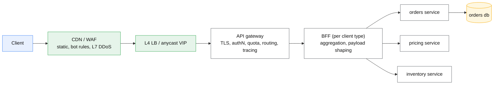
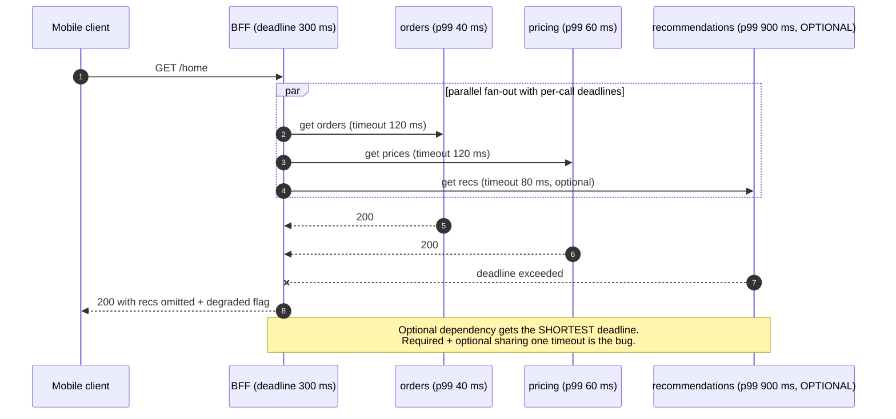

# API gateway and BFF

## Core concept

A gateway exists to hold the work that **every** service would otherwise implement separately and
inconsistently: TLS termination, authentication, quota, routing, request logging, trace
propagation. The test for whether something belongs there is not "is it cross-cutting?" but
**"would 40 teams implement this identically?"** Token signature validation, yes. Whether user 12
may read order 88, never — that answer lives in the service that owns orders.

A **BFF** is the opposite move. Instead of one gateway serving every client with a
lowest-common-denominator API, each client type (web, iOS, Android, partner) gets its own thin
aggregation layer, **owned by the team that owns that client**. The insight that makes it more than
duplication: the mismatch a BFF resolves is organisational as much as technical — a shared general
API means every client change becomes a negotiation with a central team, and the queue at that team
is the real latency.

## Mechanics & internals

### The request path, and what each hop is allowed to do

| Concern | Gateway | BFF | Service |
|---|---|---|---|
| TLS termination | ✅ | | |
| AuthN — validate token signature, expiry, audience | ✅ | | |
| Coarse authZ — scope/claim present | ✅ | | |
| **Fine authZ — does this user own this row** | ❌ | ❌ | ✅ always |
| Rate limit / quota per key | ✅ | | |
| Routing, versioning, canary split | ✅ | | |
| Request/response logging, trace-id injection | ✅ | | |
| Payload size limits, schema validation | ✅ | | |
| Response aggregation across services | | ✅ | |
| Client-specific payload shaping, field pruning | | ✅ | |
| **Business rules** | ❌ | ❌ | ✅ |

The bottom row is the one that decides whether this design survives three years. **A gateway
holding business logic is an ESB**: a single deploy unit every team must coordinate through, owned
by a team that understands none of the domains inside it, and too frightening to change by the
time anyone notices.

### Token validation: local vs introspection

| | Local JWT validation | Introspection (call the auth server) |
|---|---|---|
| Latency | Signature check, ~10–100 µs | 1 RTT per request, or per cache TTL |
| Revocation | **Not until expiry** | Immediate |
| Failure mode | None — offline verification | Auth server is now in every request path |
| Typical answer | Short-lived access tokens (5–15 min) + refresh | Long-lived tokens, or high-value operations |

The staff-level statement: **revocation latency is a design parameter equal to the access token
TTL**, and if someone requires instant revocation, they are asking for introspection with all of
its availability coupling, or for a revocation list checked at the gateway — which is introspection
with extra steps and a cache.

### Aggregation, and the tail-latency arithmetic it creates

A BFF that fans out to `n` services in parallel has a response time equal to the **slowest** of
them. If each has an independent p99 of 50 ms, the chance all `n` are under their p99 is `0.99ⁿ`,
so the aggregate p99 degrades fast:

| Fan-out `n` | P(all under p99) | Aggregate behaviour |
|---|---|---|
| 1 | 99% | p99 = 50 ms |
| 5 | 95.1% | ~1 in 20 requests hits a slow dependency |
| 10 | 90.4% | p90 of the *aggregate* is now the p99 of a *dependency* |
| 50 | 60.5% | Almost every request contains a tail event |

This is the same amplification as any fan-out path, and it is why a BFF needs per-dependency
timeouts shorter than its own deadline, partial-response semantics ("render the page without the
recommendations carousel"), and a hedging or caching strategy for the dependencies that are
optional. **A BFF without partial-response handling converts every dependency's tail into the
user's tail.**

### Versioning at the gateway

Three mechanisms, and the choice is mostly about who pays for the change:

| Mechanism | Example | Cost |
|---|---|---|
| **URI path** | `/v2/orders` | Visible, cacheable, but forks every route and client |
| **Header / media type** | `Accept: application/vnd.api+json;version=2` | Clean URLs; harder to debug, and caches must vary on it |
| **No versioning — additive only** | Expand/contract on the schema | Cheapest by far, and requires discipline forever |

The one to argue for is the third: additive-only change with expand–contract migrations, and
explicit versions reserved for breaks that genuinely cannot be additive. Every version you publish
is a support obligation with no expiry date unless you set one at launch.

### Where the gateway must not be

Two placements cause recurring incidents:

- **Gateway in the internal service-to-service path.** East–west traffic through a central L7 hop
  adds latency to every internal call and makes the gateway a fleet-wide SPOF. That is the mesh's
  job (sidecar, no extra network hop beyond localhost).
- **Gateway as the only auth.** If a service is reachable inside the network without a token, the
  gateway is a suggestion. Services validate tokens themselves; the gateway's value is doing it
  first and cheaply, not exclusively.

## Numbers that matter

| Quantity | Value | Confidence |
|---|---|---|
| L7 gateway hop overhead | ~0.3–1 ms p50; more with TLS termination and body buffering | Order of magnitude — measure |
| JWT signature verification (RS256) | ~50–200 µs per request | Order of magnitude; EdDSA is faster, RSA-4096 much slower |
| Introspection call | 1 RTT + auth server load per request, unless cached | Structural |
| Aggregate p99 with 10 parallel dependencies | ~1 − 0.99¹⁰ = **9.6%** of requests hit some dependency's p99 | Derived |
| AWS API Gateway integration timeout | **29 s** maximum for REST/HTTP APIs by default | [AWS docs](https://docs.aws.amazon.com/apigateway/latest/developerguide/limits.html) |
| AWS API Gateway payload limit | **10 MB** request payload (REST) | AWS quotas |
| Azure API Management `forward-request` default timeout | **300 s** | Azure docs — verify per SKU |
| Azure Application Gateway backend request timeout | **20 s** default in HTTP settings | Azure docs — verify; commonly the cause of 502s on slow backends |
| Typical access token TTL | 5–15 min, with a refresh token | Convention; equals your revocation latency |
| BFFs per platform | One per client type — typically 3–5 | Above ~6, the duplication cost exceeds the autonomy benefit |

**Worked example — deadline budgeting.** Client SLO is 300 ms p99 for `/home`. The gateway takes
~2 ms, the BFF ~5 ms of its own work, leaving ~290 ms. With three required dependencies in
parallel, each gets a 120 ms timeout (not 290: leave room for one retry of the fastest, and for the
response serialisation), and the optional one gets 80 ms. Budget **downwards from the SLO**; a
system where each hop picks its own timeout has a total deadline nobody chose.

## Failure modes

| Failure | Symptom | Mitigation |
|---|---|---|
| **Business logic accrues in the gateway** | Central deploy bottleneck; every release coordinated | Hard rule in review: no domain knowledge past routing and auth |
| **Gateway as SPOF** | Total outage from one config push | Multiple instances across zones, staged config rollout, config validation in CI |
| **Bad config deploy** | Global 5xx or, worse, global auth bypass | Treat gateway config as code with canary and instant rollback |
| **Shared timeout for required and optional calls** | One optional dependency sets the page's latency | Per-dependency deadlines; optional gets the shortest |
| **No partial responses** | Any dependency's outage is a full-page outage | Degrade with a flag; cache last-known-good |
| **Fan-out amplification** | One user request becomes 40 internal requests | Batch, cache, and measure amplification per endpoint |
| **Body buffering at the gateway** | Streaming and large uploads break or blow memory | Streaming-capable proxy; direct-to-object-storage uploads with presigned URLs |
| **Auth only at the edge** | Any internal foothold bypasses every check | Services validate tokens independently |
| **Version sprawl** | Five live API versions, none retirable | Additive change by default; published sunset dates |
| **Gateway timeout < backend work** | 504s the backend never sees as failures | Align timeouts end to end; check the platform's hard ceiling first |

**Documented pattern.** The BFF pattern's published origin (SoundCloud, then Netflix's API
re-platforming) describes the same arc twice: a single general-purpose API accumulates
client-specific special cases until change requires the central team, so ownership is pushed to the
client teams as per-client edge services. Netflix's later move to a federated graph is the
correction to the *next* problem — dozens of BFFs re-implementing the same aggregation — which is
worth knowing as the natural endpoint of this design rather than as a competing one.

## Trade-offs vs alternatives

| Approach | Buys | Costs | Choose when |
|---|---|---|---|
| **Single API gateway** | One place for cross-cutting policy | Lowest-common-denominator payloads; central team | Few client types; uniform needs |
| **BFF per client** | Client teams ship independently; payloads fit the device | Duplication across BFFs; more services to run | 3+ meaningfully different clients |
| **GraphQL / federated graph** | Client picks fields; one schema; no per-client layer | Query cost control, caching and auth are all harder | Many clients and a large, well-modelled domain |
| **Direct to services** | Fewest hops, lowest latency | Every client implements auth, retries, aggregation | Internal, trusted, small |
| **Service mesh ingress** | One data plane for north–south and east–west | Mesh operational cost | You already run a mesh |

### Where staff engineers get this wrong

1. **Letting the gateway grow features.** Every "just this one rule" is how the ESB happened last
   time. The rule must be structural, not cultural.
2. **Fine-grained authorization at the edge.** The gateway does not know your data model; the
   service does. Coarse at the edge, fine in the service.
3. **BFF per *team* instead of per *client type*.** Two BFFs for the same client is duplication with
   no autonomy gain.
4. **One timeout for all dependencies.** Required and optional calls need different deadlines, and
   optional should be able to fail invisibly.
5. **Assuming GraphQL removes the problem.** It moves it: query cost, depth limiting, persisted
   queries and per-field authorization are now yours.
6. **Ignoring the platform ceiling.** A managed gateway with a hard 29 s integration timeout makes
   some designs impossible; discover it during design, not during the long-report feature.

## Real-world examples

- **Netflix** — per-device server-side adapters, then a federated GraphQL layer; the clearest
  public record of both the BFF rationale and its scaling limit.
- **SoundCloud** — the BFF pattern's original public write-up, framed as moving ownership to client
  teams rather than as a technical optimisation.
- **Envoy / Kong / NGINX** — gateway data planes where routing, authN filters, rate limiting and
  observability are composable filters rather than application code.
- **AWS API Gateway + Lambda authorizer** — the managed version of "validate once at the edge,
  cache the decision", with an explicit authorizer result TTL.
- **Apollo Federation** — the federated-graph answer to many BFFs re-implementing the same joins.

## On AWS and Azure

| | AWS | Azure |
|---|---|---|
| **The service that IS this** | **API Gateway** (REST, HTTP and WebSocket API types) with usage plans, authorizers, stages, canary deployments | **API Management** (APIM) with products, policies, revisions and versions; **Application Gateway** for L7 routing + WAF without the API-management layer |
| **AuthN hook** | Lambda authorizer (custom) or JWT authorizer (HTTP APIs); authorizer results cached by TTL | `validate-jwt` policy inline, plus named values for keys; Managed Identity for backend auth |
| **Aggregation** | Not native — you write a BFF Lambda or service | Native-ish: `send-request` in policy can call several backends, which is tempting and is exactly the "logic in the gateway" trap |
| **The knob that matters** | **Integration timeout, max 29 s.** Also 10 MB payload limit, and REST APIs do not stream responses | **`forward-request` timeout** (default 300 s) and Application Gateway's HTTP-setting request timeout (default ~20 s) — two different layers with different defaults, frequently both in the path |
| **The default that bites** | The 29 s ceiling: any synchronous operation longer than that must become asynchronous (202 + polling, or a job with a status endpoint). Teams discover it when the export feature ships. Also — throttling is **account-wide per region** (10 000 rps), so a staging API's load test can throttle production | APIM policy expressions are real C#, so aggregation, transformation and conditionals in XML policy are easy to write and impossible to test like code. The gateway accumulates untested business logic *faster* on Azure than on AWS, precisely because the platform makes it convenient |

## In an LLM deployment

The gateway's classic assumptions break in two places, both about **time**.

First, generations run for tens of seconds to minutes, which exceeds hard platform ceilings —
AWS API Gateway's 29 s integration timeout makes a synchronous completion endpoint structurally
impossible for long outputs. The two working shapes are streaming (SSE over a proxy that does not
buffer, e.g. an ALB or Lambda Function URL with response streaming, not a buffering REST gateway)
or asynchronous job submission with a status endpoint. Choosing between them is an architecture
decision forced by a timeout value, which is an unusually honest example of platform limits driving
design.

Second, **buffering proxies silently destroy streaming**. A gateway configured to buffer responses
for inspection or compression will hold every token until the generation ends, turning a 200 ms
time-to-first-token into a 30 s wait with identical total latency — the user-visible metric
collapses while every dashboard stays green.

What the AI gateway layer adds beyond the classic list: provider key management and rotation,
routing by model and cost, token counting for quota (TPM, not RPM — see
[rate-limiting-algorithms.md](./rate-limiting-algorithms.md)), semantic or prefix caching, prompt
and response logging for evaluation, and PII redaction before the request leaves your boundary.
The last one is genuinely cross-cutting and is a rare case where a policy hop *earns* its place in
the request path.

## Staff-level follow-ups

1. Your gateway team is asked to add "if the user is in the EU, strip field X" to the gateway.
   Argue both sides, then decide, and say what rule you write down so the next request is decided
   the same way.
2. A `/home` endpoint fans out to 12 services. Give a deadline budget from a 400 ms p99 SLO,
   including which dependencies are optional and what the client renders when each fails.
3. Compare local JWT validation against introspection for an app that must revoke a compromised
   session within 30 seconds. Give a third option and its cost.
4. You have four BFFs re-implementing the same three joins. Make the case for a federated graph and
   state what gets harder the day you adopt it.
5. The platform's hard timeout is 29 s and product wants a synchronous "generate report" call that
   takes up to 4 minutes. Design the alternative, including the client-side experience and the
   failure semantics.

## See also

- [load-balancing-algorithms.md](./load-balancing-algorithms.md) — the layer beneath the gateway
- [rate-limiting-algorithms.md](./rate-limiting-algorithms.md) — the gateway's most valuable single feature
- [authn-and-authz.md](./authn-and-authz.md) — token validation, scopes, and why fine-grained checks stay in the service
- [service-mesh.md](./service-mesh.md) — the same features for east–west traffic
- [tail-latency.md](./tail-latency.md) — fan-out amplification arithmetic
- [../patterns/graceful-degradation.md](../patterns/graceful-degradation.md) — partial responses done deliberately
- [../patterns/api-versioning.md](../patterns/api-versioning.md) — expand–contract instead of `/v3`

## Sources

- [Sam Newman — Backends For Frontends](https://samnewman.io/patterns/architectural/bff/) — the pattern statement and its ownership argument
- [Netflix technology blog — embracing the differences: inside the Netflix API redesign](https://netflixtechblog.com/embracing-the-differences-inside-the-netflix-api-redesign-15fd8b3dc49d) — per-device adapters
- [Netflix technology blog — how Netflix scales its API with GraphQL Federation](https://netflixtechblog.com/how-netflix-scales-its-api-with-graphql-federation-part-1-ae3557c187e2) — the limit of many BFFs
- [AWS — API Gateway quotas and important notes](https://docs.aws.amazon.com/apigateway/latest/developerguide/limits.html) — 29 s integration timeout, 10 MB payload, account-level throttle
- [AWS — Lambda authorizers](https://docs.aws.amazon.com/apigateway/latest/developerguide/apigateway-use-lambda-authorizer.html) — cached authorizer results
- [Azure — API Management policies reference](https://learn.microsoft.com/en-us/azure/api-management/api-management-policies) — `validate-jwt`, `send-request`, `forward-request`
- [Azure — Application Gateway HTTP settings](https://learn.microsoft.com/en-us/azure/application-gateway/configuration-http-settings) — backend request timeout default
- [Envoy — HTTP filters](https://www.envoyproxy.io/docs/envoy/latest/configuration/http/http_filters/http_filters) — gateway concerns as composable filters
