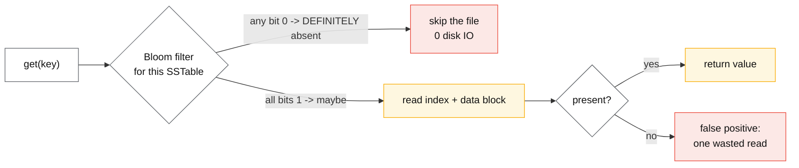

# Bloom filters and sketches

## Core concept

A sketch trades **an exactly-bounded error for an unbounded reduction in space**. The useful framing
is not "approximate answers" — it is that these structures turn a memory requirement proportional
to `n` into one proportional to `log n` or to a constant you choose, while keeping the error
*provable* rather than hopeful.

The property that makes them safe to deploy is **one-sided error**. A Bloom filter never returns a
false negative; a count-min sketch never *under*-counts; HyperLogLog's error is symmetric but
bounded by a standard error you pick when you size it. Every sound design using a sketch puts the
harmless direction on the hot path and the expensive direction behind a verification step: the
filter says "definitely not here" (skip the disk read) or "maybe here" (do the read and find out).

## Mechanics & internals

### Bloom filter

`m` bits, `k` hash functions. Insert: set `k` bits. Query: if any of the `k` bits is 0, the element
is **definitely absent**; if all are 1, it is *probably* present.

```
False positive rate:   p ≈ (1 − e^(−kn/m))^k
Optimal hash count:    k = (m/n) · ln 2
Bits per element:      m/n = −ln(p) / (ln 2)²  ≈ −1.44 · log₂(p)
```

| Target FPR | Bits/element | Optimal k | 1 M elements |
|---|---|---|---|
| 10% | 4.8 | 3 | 0.6 MB |
| **1%** | **9.6** | **7** | **1.2 MB** |
| 0.1% | 14.4 | 10 | 1.8 MB |
| 0.01% | 19.2 | 13 | 2.4 MB |

The shape of that table is the thing to remember: **each additional order of magnitude of accuracy
costs a constant ~4.8 bits per element**, not a multiple. Going from 1% to 0.01% doubles memory and
divides errors by 100.

Two hard limits: **you cannot delete** (clearing bits would create false negatives — counting Bloom
filters or cuckoo filters exist for this), and **`n` is fixed at sizing time**. Insert 4× more
elements than planned and the FPR does not degrade gracefully, it collapses — a filter sized for 1%
at 1 M elements is at roughly 40–50% FPR at 4 M, i.e. useless while still consuming memory and CPU.



### The variants, and when each earns its place

| Structure | Adds | Costs | Use when |
|---|---|---|---|
| **Counting Bloom** | Deletion | 4× memory (4-bit counters) | Membership set with churn |
| **Cuckoo filter** | Deletion, better cache locality, often smaller below ~3% FPR | Insert can fail when near-full | Deletes needed and memory matters |
| **Quotient filter** | Mergeable, resizable, sequential access | More complex | Large on-disk filters |
| **Ribbon filter** (RocksDB) | ~30% less space at the same FPR | More CPU to build and query | Space-constrained LSM levels |
| **Blocked Bloom** | One cache line per query | Slightly worse FPR | High query rate |

### HyperLogLog — counting distinct things in constant space

Hash each element, use the first `p` bits to pick one of `m = 2^p` registers, and store in that
register the maximum number of leading zeros seen in the rest of the hash. Long runs of leading
zeros are rare, so the maximum observed is an estimator of cardinality; averaging across `m`
registers (harmonically, with bias correction) tightens it.

```
Standard error ≈ 1.04 / √m
p = 14  →  m = 16 384 registers × 6 bits ≈ 12 KB  →  ~0.81% error
```

**12 KB to count distinct users in a set of any size, to within ~1%.** That is the number to quote.
Properties that matter in a design: sketches are **mergeable** (register-wise max), so per-shard
sketches combine into a global count without re-scanning — which is what makes distinct counts
work over a distributed dataset at all. Exact distinct count requires shuffling every value.

The known weakness is small cardinality: raw HLL is biased when the count is far below `m`, so
implementations switch to linear counting or sparse representations below a threshold. Redis's
implementation uses a sparse encoding for small sets and converts to dense at a configurable byte
limit — which is why a small HLL can be a few hundred bytes rather than 12 KB.

### Count-min sketch — frequencies, never underestimated

A `d × w` matrix of counters with `d` independent hash functions. Increment: add 1 at
`(i, h_i(x))` for each row. Query: take the **minimum** across rows. Collisions can only add, so
the estimate is an over-estimate bounded by `ε·N` with probability `1 − δ`:

```
w = ⌈e / ε⌉     d = ⌈ln(1 / δ)⌉
ε = 0.001, δ = 0.001  →  w ≈ 2 719, d ≈ 7  →  ~19 000 counters (~76 KB at 4 bytes)
```

This is the structure behind hot-key detection, per-key rate limiting at the edge, heavy-hitter
dashboards and cache admission policies (TinyLFU keeps a CM sketch of recent frequency and only
admits a new item if its estimated frequency exceeds the victim's). The failure mode to name: with
a heavily skewed key distribution and a too-narrow `w`, **rare keys colliding with a whale inherit
its count**, so the tail of the estimate is wrong in the direction that triggers alarms.

### Quantile and similarity sketches

| Sketch | Answers | Property to know |
|---|---|---|
| **t-digest** | p50/p99/p999 | Accurate at the *tails* by design, where naive histograms are worst |
| **DDSketch** | Quantiles with **relative** error guarantee | Mergeable, error bound holds across the range |
| **MinHash (+ LSH)** | Jaccard similarity of sets | Near-duplicate detection at corpus scale |
| **SimHash** | Cosine-ish similarity of documents | One 64-bit fingerprint per document |
| **Space-Saving / Top-K** | The heaviest hitters and their counts | Bounded memory, guarantees on the top-k set |

**Averaging percentiles is the mistake these fix.** You cannot average p99s across hosts and get a
fleet p99; you *can* merge t-digests or DDSketches and read a correct quantile off the merged
structure. Any metrics pipeline that aggregates pre-computed percentiles is reporting a number with
no defined meaning, and saying so is a reliable staff-level signal.

## Numbers that matter

| Quantity | Value | Confidence |
|---|---|---|
| Bloom bits/element at 1% FPR | **9.6** (k = 7) | Derived from the formula |
| Marginal cost per 10× accuracy | ~**4.8 bits/element** | Derived |
| RocksDB default Bloom | **10 bits/key** ≈ 1% FPR, per SSTable | RocksDB docs |
| Ribbon filter saving | ~30% space at equal FPR, more CPU | RocksDB docs |
| HLL at p = 14 | 12 KB, **0.81%** standard error | Flajolet et al.; Redis implementation |
| Redis HLL sparse→dense switch | Configurable (`hll-sparse-max-bytes`, default 3 000) | Redis docs |
| Count-min at ε = 0.1%, δ = 0.1% | ~2 719 × 7 counters ≈ 76 KB | Derived |
| Exact distinct of 1 B 16-byte ids | ~16 GB + hash-set overhead ≈ 30–50 GB | Derived — the reason HLL exists |
| Bloom filter CPU per query | `k` hashes (often 2 hashes combined), ~50–200 ns | Order of magnitude |
| FPR of a 1%-sized filter at 4× overfill | ~40–50% | Derived from the formula |

**Worked example — what the LSM filter actually saves.** An LSM tree with 8 levels, a point lookup
that misses. Without filters, up to 8 SSTable reads, each possibly hitting disk: at ~100 µs per NVMe
read that is ~800 µs. With 1% filters, expected wasted reads ≈ 0.08, so ~8 µs of expected IO plus a
few hundred nanoseconds of hashing. **A ~100× reduction in read amplification for miss-heavy
workloads, at 1.2 MB of RAM per million keys** — which is why every LSM engine ships them on by
default and why turning them off "to save memory" is nearly always a mistake.

**Worked example — sizing a dedup filter.** Deduplicating 500 M message ids over a 24 h window at
0.1% FPR: `500e6 × 14.4 bits ≈ 900 MB`. Feasible in RAM, and the 0.1% of false positives means
0.1% of *new* messages are wrongly considered duplicates and dropped. If dropping a real message is
unacceptable — and for payments it is — the filter must be a **pre-filter** in front of an exact
check, not the decision itself. This is the single most important design rule on the page.

## Failure modes

| Failure | Symptom | Mitigation |
|---|---|---|
| **Filter treated as authoritative** | Real items silently dropped as "duplicates" | One-sided error only: "maybe" must trigger an exact check |
| **Cardinality outgrows the filter** | FPR quietly degrades to uselessness | Size for peak `n`; monitor fill ratio; rotate/rebuild filters |
| **Deleting from a plain Bloom** | False negatives — the one error it promised not to make | Counting Bloom, cuckoo filter, or rebuild |
| **CM sketch too narrow under skew** | Rare keys inherit a whale's count; bogus heavy hitters | Size `w` from the skew, not from the mean |
| **Merging incompatible sketches** | Wrong answers with no error | Same algorithm, parameters and hash seeds across producers; version the sketch |
| **HLL for small sets** | Noticeable bias without sparse/linear-counting fallback | Use an implementation that switches; or exact for small `n` |
| **Averaging percentiles** | p99 that is not any percentile of anything | Merge quantile sketches, never average quantiles |
| **Hash quality** | Correlated hashes destroy the independence the bounds assume | Use a good hash (xxHash, Murmur3); derive k hashes by the Kirsch–Mitzenmacher trick, not by seeding a weak hash |
| **Time-unbounded filters** | A "24 h dedup" filter that never forgets and fills up | Rotating/segmented filters with explicit windows |
| **Reporting an approximate number as exact** | A finance or compliance report built on HLL | Exact paths for anything auditable; label approximations in the schema |

**Documented pattern.** Cache admission is the elegant case worth citing: TinyLFU keeps a
count-min sketch of recent access frequency and, on a miss, admits the new item **only if its
estimated frequency exceeds that of the item it would evict**. This fixes the classic LRU
pathology where a large scan of cold keys evicts the working set, and it does so in kilobytes of
sketch rather than by tracking full histories. Caffeine (Java) made this the default and published
hit-rate comparisons showing it beating LRU across standard traces.

## Trade-offs vs alternatives

| Need | Sketch | Exact alternative | When exact wins |
|---|---|---|---|
| Membership | Bloom / cuckoo | Hash set, database index | Small `n`, or false positives unacceptable and no verification step |
| Distinct count | HyperLogLog | `COUNT(DISTINCT)` with a shuffle | Small cardinality, or the number is audited |
| Frequency / heavy hitters | Count-min, Space-Saving | Full counter map | Key space small enough to count exactly |
| Quantiles | t-digest, DDSketch | Sorted array of all samples | Small samples; or exact medians required |
| Similarity | MinHash + LSH | All-pairs comparison | Small corpora — all-pairs is O(n²) |

### Where staff engineers get this wrong

1. **Using the sketch as the answer instead of as a filter.** The design is "cheap maybe, expensive
   confirm", and skipping the confirm converts a probabilistic structure into a correctness bug.
2. **Sizing for today's `n`.** These structures degrade badly, not gracefully, past their design
   point, and nothing alerts you.
3. **Assuming you can delete from a Bloom filter.** Clearing bits introduces false *negatives* —
   the error class the structure exists to exclude.
4. **Merging sketches built with different parameters.** Silent wrong answers; there is no error
   signal.
5. **Averaging percentiles across shards or time buckets.** Extremely common in metrics pipelines,
   and mathematically meaningless.
6. **Reaching for a sketch when the exact answer is affordable.** 10 M distinct ids fit in memory;
   the complexity is not worth it below the crossover.

## Real-world examples

- **RocksDB / Cassandra / Bigtable / HBase** — per-SSTable Bloom filters to avoid disk reads on
  misses; the highest-volume use of the structure in existence.
- **Redis** — `PFADD`/`PFCOUNT` (HyperLogLog, ~12 KB), plus Bloom/cuckoo/t-digest/CMS/top-k in the
  probabilistic module.
- **Caffeine / TinyLFU** — count-min sketch as the cache admission policy.
- **Apache DataSketches (originally Yahoo)** — a production library of mergeable sketches
  (Theta, HLL, quantiles, frequent items) adopted into Druid and Presto/Trino.
- **Chrome's Safe Browsing** — a local filter for "definitely not malicious" so only maybes require
  a network check: the canonical privacy-and-latency use of one-sided error.
- **Google BigQuery / Trino / Spark** — `APPROX_COUNT_DISTINCT` and `approx_percentile` as the
  default for dashboard-scale analytics.

## On AWS and Azure

| | AWS | Azure |
|---|---|---|
| **Cardinality in SQL** | Athena/Trino `approx_distinct()` (HLL); Redshift `APPROXIMATE COUNT(DISTINCT)` (HLL, documented error around a few percent) | Synapse/SQL `APPROX_COUNT_DISTINCT` — documented as **2% error at 97% probability**, HLL-based |
| **Sketch storage** | ElastiCache/MemoryDB (Redis `PF*`); DynamoDB has no native sketch — you store a serialized one in an item | Azure Cache for Redis (`PF*`); Synapse aggregates in-engine |
| **Streaming** | Kinesis Data Analytics / Managed Flink with DataSketches for approximate aggregates | Stream Analytics has approximate functions; Event Hubs Capture + Synapse for the batch half |
| **Where it shows up implicitly** | DynamoDB and S3 metadata layers, and any LSM-backed managed store, use filters internally — you see the effect as read-amplification behaviour you cannot tune | Cosmos DB's internal indexes similarly; the knob you get is indexing policy, not filters |
| **The default that bites** | `APPROXIMATE COUNT(DISTINCT)` is materially faster and gets used in **billing and reporting queries** where the error is not acceptable — the function name is optional in some dialects' migration paths, so an exact query silently becomes approximate when ported | Synapse's 2% error is a *documented* bound but is quoted at 97% probability, i.e. ~3% of queries fall outside it. A dashboard refreshing hourly will show numbers that move without the data moving, and someone will file a data-quality bug against the pipeline |

## In an LLM deployment

**Training-corpus deduplication is MinHash + LSH at petabyte scale**, and it is one of the few
places a sketch is the whole system rather than an optimisation. Exact near-duplicate detection
across 10 B documents is an all-pairs problem; MinHash signatures plus banded LSH reduce it to
hashing each document once and comparing only bucket collisions. Published corpus pipelines
(C4-style cleaning, RefinedWeb and successors) report that near-deduplication materially improves
downstream model quality, so this is a quality intervention, not a storage saving.

**Contamination checks** use the same shape in the other direction: a Bloom filter of benchmark
n-grams lets you test "does this training document contain eval data?" in constant time per document
with a one-sided error that is safe here — a false positive drops a document you did not need, a
false negative is impossible.

**Semantic cache prefiltering** is the serving-side use: before doing an ANN query, a cheap sketch
or fingerprint can reject prompts that cannot match anything, and MinHash/SimHash over normalised
prompts catches near-identical requests that differ only in whitespace or a name.

One caution specific to this domain: sketch-based dedup at the *request* level is the exact case
where a false positive is harmful — returning a cached answer for a "duplicate" that was actually a
different question. Keep the sketch as a prefilter and confirm with an embedding distance check
plus an exact-text comparison before serving a cached completion.

## Staff-level follow-ups

1. Design deduplication for 2 B events/day with a 48 h window and a hard requirement that no real
   event is dropped. Give the memory arithmetic and say exactly where the exact check lives.
2. Your Bloom filter was sized for 50 M keys and the workload grew to 300 M. Describe what users
   see, what your metrics show, and the migration to a correctly sized filter with no downtime.
3. Explain why merging t-digests is valid and averaging p99s is not, then describe what your metrics
   pipeline must store per host to report a correct fleet-wide p99.
4. A count-min sketch is reporting heavy hitters that the exact logs do not confirm. Derive the
   likely cause from the sketch's parameters and the key distribution.
5. When is HyperLogLog the *wrong* answer for a distinct count? Give two concrete cases and what you
   would use instead.

## See also

- [storage-engines.md](./storage-engines.md) — where Bloom filters do their highest-volume work
- [hot-shard-mitigation.md](./hot-shard-mitigation.md) — count-min sketch as the hot-key detector
- [caching-strategies.md](./caching-strategies.md) — admission policies and what they fix in LRU
- [rate-limiting-algorithms.md](./rate-limiting-algorithms.md) — approximate counters at the edge
- [metrics-logs-traces.md](./metrics-logs-traces.md) — quantile sketches versus pre-aggregated percentiles
- [vector-search-and-ann.md](./vector-search-and-ann.md) — the other "approximate answer, bounded error" structure

## Sources

- B. H. Bloom, *Space/time trade-offs in hash coding with allowable errors*, CACM 1970
- P. Flajolet, É. Fusy, O. Gandouet, F. Meunier, *HyperLogLog: the analysis of a near-optimal cardinality estimation algorithm*, AOFA 2007
- G. Cormode, S. Muthukrishnan, *An improved data stream summary: the count-min sketch and its applications*, 2005
- [RocksDB — Bloom filters and Ribbon filters](https://github.com/facebook/rocksdb/wiki/RocksDB-Bloom-Filter) — 10 bits/key default, ribbon space saving
- [Redis — HyperLogLog](https://redis.io/docs/latest/develop/data-types/probabilistic/hyperloglogs/) and [probabilistic data structures](https://redis.io/docs/latest/develop/data-types/probabilistic/) — 12 KB, sparse/dense encodings
- [Apache DataSketches](https://datasketches.apache.org/) — mergeable sketch library and accuracy documentation
- [Caffeine — efficiency and TinyLFU admission](https://github.com/ben-manes/caffeine/wiki/Efficiency) — CM sketch as cache admission
- [Azure — APPROX_COUNT_DISTINCT](https://learn.microsoft.com/en-us/sql/t-sql/functions/approx-count-distinct-transact-sql) — 2% error at 97% probability
- [AWS — Redshift approximate count distinct](https://docs.aws.amazon.com/redshift/latest/dg/r_COUNT.html) and [Athena/Trino approx_distinct](https://trino.io/docs/current/functions/aggregate.html)
