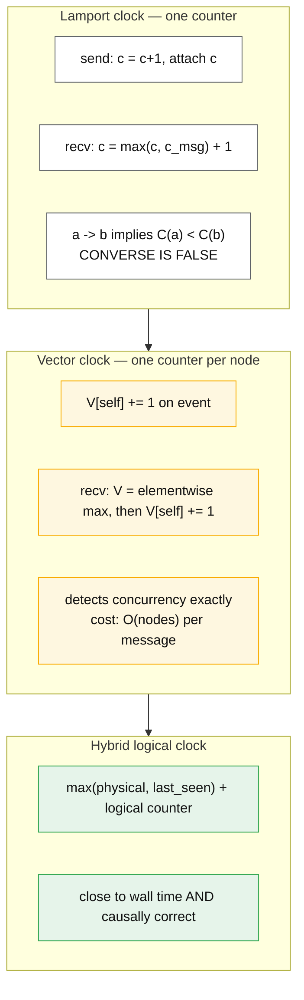

# Clocks and ordering

## Core concept

There are two kinds of time in a distributed system and conflating them causes data loss.
**Physical time** answers "when did this happen?" and is a measurement with an error bar.
**Logical time** answers "did A happen before B?" and is exact but says nothing about wall-clock
duration. Almost every clock-related bug is a system using a physical timestamp to answer a logical
question — last-write-wins conflict resolution being the canonical case.

The framing that makes this tractable: **a timestamp without an error bound is a lie you cannot
detect.** Spanner's contribution was not accurate clocks; it was exposing the *uncertainty* as a
first-class value (`TT.now()` returns an interval, not a point) and then waiting out that
uncertainty before committing. AWS now exposes the same primitive — ClockBound gives you
`(earliest, latest)` — so the technique is available outside Google, and a design that needs
ordering across nodes should say which of the three approaches it uses: wait out the error bar,
use logical clocks, or route the decision through a single sequencer.

## Mechanics & internals

### What the clock actually is

| Clock | Property | Use it for |
|---|---|---|
| `CLOCK_REALTIME` (wall clock) | Can jump backwards (NTP step, admin, VM migration) | Timestamps for humans, TTLs coarse enough not to care |
| `CLOCK_MONOTONIC` | Never goes backwards; **not** comparable across machines; may pause across suspend | **Measuring elapsed time**, timeouts, latency |
| `CLOCK_BOOTTIME` | Monotonic including suspend | Long-lived timers on laptops/VMs |
| Logical/Lamport | Counter, no wall relation | Causality within one system |

**Measuring a duration with the wall clock is a bug**, not a style preference: an NTP step during
the measurement produces a negative or wildly inflated interval, which shows up as impossible
latency values in dashboards and as negative TTLs in caches. Every latency measurement uses
`CLOCK_MONOTONIC`.

### How accurate is the clock, really

| Sync method | Typical accuracy | Notes |
|---|---|---|
| Public NTP over the internet | 1–100 ms | Path asymmetry dominates the error |
| **Amazon Time Sync, link-local NTP** | **~±100 µs** (chrony reports `+/- 115us` in AWS's own documented sample) | No VPC configuration needed; `169.254.169.123` |
| **Enhanced (precision time placement group)** | Stratum 1 source, `+/- 91us` in AWS's sample | Gen7+ instance families, no extra charge |
| **PTP hardware clock (PHC) on Nitro** | **Microseconds** — AWS's sample shows `+/- 5032ns` (~5 µs) | Linux only; ENA driver ≥ 2.10.0 |
| Google TrueTime | Uncertainty exposed as an interval; commit-wait bounded by it | Spanner's ordering guarantee is built on the *bound*, not the accuracy |

Two operational details from AWS's own documentation that are exactly the kind of thing that bites:

- **The PTP hardware clock reports an error bound of zero to chrony.** AWS states that with a
  direct PHC connection "your time daemon… will underestimate the clock error bound… your clock
  synchronization daemon assumes the clock is accurate to UTC and thus has an error bound of `0`."
  The real bound is exposed separately via `sysfs` (`phc_error_bound`, in nanoseconds) and must be
  *added* to what chrony reports. A system that trusts the daemon's bound while using PHC has an
  uncertainty interval that is confidently wrong.
- **The link-local NTP endpoint shares a 1 024 packets-per-second budget** with the Instance
  Metadata Service, Route 53 Resolver DNS queries and (on Windows) licensing. A metadata-heavy or
  DNS-heavy workload can starve time sync on the same instance — a clock problem whose root cause is
  in a completely different subsystem.

### Ordering without trusting clocks



**Lamport clocks** give you a total order consistent with causality, but `C(a) < C(b)` does *not*
imply `a` happened before `b` — the converse fails, so a Lamport timestamp cannot tell you that two
writes conflicted. That is precisely what you need for conflict resolution, and precisely what a
vector clock provides: comparing two vectors yields "before", "after", or **"concurrent"** — and
concurrent is the answer that tells you a human or a merge function must decide.

The cost is size: a vector clock carries one entry per writer, so a system with 5 000 clients
carries 5 000 entries per value. The usual mitigations — version vectors per *replica* rather than
per client, dotted version vectors, pruning old entries — are all about bounding that.

**Hybrid logical clocks (HLC)** are the practical compromise most modern databases use: a
timestamp that tracks physical time closely (so it is human-meaningful and works with TTLs and
range scans) while preserving causality by bumping a logical counter when physical time has not
advanced. CockroachDB, YugabyteDB and MongoDB all use HLC-shaped timestamps.

### Commit-wait and the uncertainty interval

```mermaid
sequenceDiagram
    autonumber
    participant T1 as Txn 1 (node A)
    participant TT as Clock with error bound ±ε
    participant T2 as Txn 2 (node B, causally after)

    T1->>TT: now() -> [earliest, latest], ε
    T1->>T1: choose commit ts = latest
    Note over T1,TT: COMMIT-WAIT: hold the commit until now.earliest > ts<br/>duration ~ 2ε
    T1-->>T2: release locks; client observes commit
    T2->>TT: now() -> guaranteed > ts
    Note over T1,T2: External consistency: any transaction that STARTS after<br/>T1 is observed to commit gets a larger timestamp.
```

Commit-wait is the honest tax: **you pay the clock's uncertainty as latency on every write**. With
a 7 ms bound that is ~7 ms added to commit; with microsecond-accurate hardware clocks it is
negligible — which is the real reason precision time infrastructure matters commercially, not
because anyone needs a better `date`.

CockroachDB takes the alternative route: rather than waiting, it carries an **uncertainty interval**
on reads. A read that encounters a value whose timestamp falls inside its uncertainty window cannot
tell whether that write is in its past or future, so the transaction's timestamp is pushed forward
and the read may be restarted. That converts clock error into **retries** instead of latency — and
the guardrail is brutal by design: a node "crashes immediately" when it "detects that its clock is
out of sync with at least half of the other nodes in the cluster by 80% of the maximum offset
allowed", because the documented alternative is that "skew outside the configured clock offset
bounds can result in violations of single-key linearizability between causally dependent
transactions." **The database would rather die than silently violate its guarantee**, and that
trade is worth quoting in an interview.

### Leap seconds and smearing

A leap second repeats or skips a second of UTC, which breaks any code assuming monotonic wall time.
The industry answer is **smearing** — spreading the extra second over hours so no clock steps. Note
the inconsistency AWS itself documents: "The NTP time source offers a leap smearing view of the UTC
timescale, while the PHC does not smear time." **Two time sources on the same instance can disagree
about what time it is** during a leap event, so a system mixing NTP-synced and PHC-synced hosts has
a correctness question exactly when it is least expected.

## Numbers that matter

| Quantity | Value | Confidence |
|---|---|---|
| Public NTP accuracy | 1–100 ms | Order of magnitude |
| AWS link-local NTP, documented sample | `+/- 115 µs` (chrony `sources` output) | [AWS docs](https://docs.aws.amazon.com/AWSEC2/latest/UserGuide/configure-ec2-ntp.html), fetched 2026-09-25 |
| AWS enhanced NTP (precision time placement group) | Stratum 1, `+/- 91 µs` in AWS's sample | Same source |
| AWS PHC sample | `+/- 5032 ns` (~5 µs), Stratum 0 | Same source |
| PTP under typical conditions | "typically under 40 microseconds"; NTP with PHC "typically under 100 microseconds" | AWS public statements |
| Link-local packet budget | **1 024 PPS**, shared across NTP + IMDS + Route 53 Resolver | AWS docs |
| Spanner TrueTime ε (published, 2012) | Single-digit to low tens of ms; commit-wait ≈ 2ε | Spanner OSDI 2012 — verify current values before quoting |
| CockroachDB self-termination | Clock off by **80% of max offset** vs half the cluster → immediate crash | [CockroachDB docs](https://docs.cockroachlabs.com/docs/stable/architecture/transaction-layer), fetched 2026-09-25 |
| Vector clock size | One entry per writer — O(writers) bytes per value | Structural |
| Typical VM clock drift, unsynced | Tens of ppm — seconds per day | Order of magnitude |
| Cost of commit-wait | ≈ 2ε per write transaction | Derived |

**Worked example — what clock skew costs last-write-wins.** Two clients write the same key through
two replicas whose clocks differ by 250 ms. Client A writes at true time T, Client B writes at
T + 100 ms. If A's replica's clock runs 250 ms fast, A's timestamp is larger, so **the earlier
write wins and the later one is silently discarded** — no error, no conflict, no log line. This is
the whole argument against LWW on user data, and the reason Cassandra-style stores document it as a
data-loss mode rather than a merge policy.

**Worked example — commit-wait budget.** At ε = 5 ms, commit-wait is ~10 ms per write transaction:
at 2 000 writes/s that is 20 seconds of aggregate waiting per second across the fleet, i.e. you
need ~20 concurrent transaction slots doing nothing but waiting. With microsecond clocks
(ε ≈ 50 µs), the same fleet waits ~0.1 ms per commit — **a 100× reduction in a latency component
nobody can optimise in code.** That is what precision time infrastructure buys.

## Failure modes

| Failure | Symptom | Mitigation |
|---|---|---|
| **Wall clock used for durations** | Negative or absurd latencies; expired-in-the-past TTLs | `CLOCK_MONOTONIC` for every measurement |
| **LWW with skewed clocks** | Silent, unlogged data loss on concurrent writes | Version vectors, CRDTs, or a single sequencer per key |
| **Trusting a timestamp without a bound** | Ordering decisions made on noise | ClockBound-style intervals; explicit ε in the protocol |
| **PHC error bound read as zero** | Uncertainty interval confidently too small | Add `phc_error_bound` from sysfs to the daemon's bound |
| **NTP starved by the PPS budget** | Clock drifts on a busy instance for no visible reason | Cap IMDS/DNS query rates; monitor chrony tracking |
| **Leap second / smearing mismatch** | Two hosts disagree by up to a second for hours | One smearing policy fleet-wide; know that PHC does not smear |
| **VM migration / suspend** | Clock jumps forward; timers fire late or all at once | Monotonic timers; re-check invariants after a jump |
| **Clock-based token expiry** | Tokens rejected as expired or accepted after expiry | Allow explicit skew tolerance; keep TTLs ≫ skew |
| **Vector clocks unbounded** | Metadata grows larger than the values | Per-replica version vectors; pruning |
| **Retry storms from uncertainty restarts** | Throughput collapse under clock drift | Alert on clock offset *before* it affects transactions |

**Documented behaviour to cite.** CockroachDB's decision to crash a node whose clock is out of sync
is the clearest statement in production software that **correctness depends on a clock assumption
being enforced, not assumed**. Most systems make the same assumption and enforce nothing; the
difference is that one of them tells you.

## Trade-offs vs alternatives

| Approach | Gives | Costs | Use when |
|---|---|---|---|
| **Physical timestamps + LWW** | Trivial, no coordination | Silent data loss under skew | Metrics, caches, truly idempotent overwrites |
| **Lamport clocks** | Total order consistent with causality | Cannot detect concurrency | Single-system event ordering |
| **Vector clocks** | Exact concurrency detection | O(writers) metadata | Multi-writer replication with merges |
| **HLC** | Causality + near-wall-clock values | Still needs bounded skew | Distributed databases (the modern default) |
| **TrueTime / commit-wait** | External consistency | Latency = 2ε per write; needs the clock infrastructure | Global databases with strict ordering |
| **Uncertainty interval + restarts** | No commit-wait | Retries under skew; crash on drift | CockroachDB-style deployments |
| **Single sequencer / log** | Perfect order, no clocks | Throughput ceiling, single failure domain | Ledgers, per-entity ordering |
| **CRDTs** | Merge without ordering | Restricted data types | Collaborative editing, counters, sets |

### Where staff engineers get this wrong

1. **Using timestamps to resolve write conflicts.** It works in testing, where the clocks agree.
2. **Quoting clock accuracy without an error bound.** "We use NTP, we're within a few ms" is an
   assumption; ClockBound is a measurement.
3. **Assuming monotonic means comparable.** `CLOCK_MONOTONIC` is per-machine; comparing two hosts'
   monotonic readings is meaningless.
4. **Forgetting that "now" moves backwards.** NTP steps, VM migrations and admin changes all do it.
5. **Vector clocks per client.** Metadata explosion; use per-replica version vectors.
6. **Ignoring the leap-second policy.** Especially when mixing time sources with different smearing
   behaviour on the same fleet.
7. **Not alerting on clock offset.** It is a cheap metric that predicts a class of incidents nothing
   else predicts.

## Real-world examples

- **Google Spanner** — TrueTime as an interval plus commit-wait; external consistency at the cost of
  a latency tax proportional to clock uncertainty.
- **CockroachDB** — HLC, uncertainty-interval restarts, and self-termination on drift past 80% of
  max offset.
- **Cassandra / DynamoDB-style LWW** — the documented data-loss mode when clocks disagree; why
  Riak's dotted version vectors existed as an alternative.
- **AWS ClockBound + Nitro PHC** — the commodity version of TrueTime: microsecond accuracy plus an
  explicit error bound your code can read.
- **Kafka** — per-partition offsets as logical ordering; message *timestamps* deliberately do not
  determine order, which is why event-time processing needs watermarks.

## On AWS and Azure

| | AWS | Azure |
|---|---|---|
| **Time source** | Amazon Time Sync Service over link-local `169.254.169.123` (IPv6 `fd00:ec2::123` on Nitro); enhanced source via a **precision-time placement group**; PHC device on Linux with ENA ≥ 2.10.0 | Azure hosts sync guest VMs via the host (VMICTimeSync/Hyper-V integration) with `time.windows.com`/`ntp.ubuntu.com` as defaults; precision time is documented for supported VM series |
| **Error bound API** | **ClockBound** daemon — returns `(earliest, latest)`; the primitive TrueTime made famous | No first-party equivalent daemon; you derive bounds from `chronyc tracking` / `w32tm` |
| **Accuracy** | Documented samples: NTP `+/- 115 µs`, enhanced `+/- 91 µs`, PHC `+/- ~5 µs` | Azure documents accuracy improvements per VM generation; verify for your series rather than assuming |
| **Leap seconds** | NTP source **smears**; **PHC does not** | Windows/Azure smearing behaviour differs by OS version — check before mixing |
| **The default that bites** | The link-local endpoint shares a **1 024 PPS** budget with IMDS and Route 53 Resolver, so a chatty metadata/DNS workload silently degrades clock sync; and with PHC the daemon's reported error bound is **0**, which means a naive ClockBound-style interval is too narrow exactly where you thought you had the best clock | The guest clock is influenced by the **host**, so VM pause/migrate events step the guest clock. Code measuring durations with the wall clock breaks on maintenance events rather than on anything in your application — and the event appears in the platform's logs, not yours |

## In an LLM deployment

Clock questions arrive here in an unglamorous form: **ordering the messages in a conversation**.
A chat UI that timestamps messages client-side will order a user turn after the assistant reply it
prompted whenever the client's clock is behind — the conversation is then replayed to the model in
the wrong order, and the model's confusion is blamed on the model. Assign sequence numbers
server-side (a logical clock per conversation), and keep client timestamps as display metadata only.

The same rule governs **streaming chunk ordering** (rely on the transport's sequence, not on
arrival timestamps) and **distributed request tracing across a GPU fleet**, where per-host clock
skew of even a few milliseconds makes a trace's spans appear to start before their parents — a
common and confusing artefact when profiling prefill/decode latency across nodes. Trace analysis
that must compare cross-host timings needs the error bound stated, or the conclusions are noise.

One genuinely useful application: **cache TTL semantics for prompt caches.** Provider prompt caches
expire on a TTL measured server-side, so a client reasoning about "is my prefix still cached?" is
doing arithmetic across two clocks. Treat a cache hit as an observation reported by the provider
(the usage fields in the response), never as something your own clock can predict.

## Staff-level follow-ups

1. A key's value reverts to an older version once a week. Walk from that symptom to clock skew, and
   give the fix at the data-model level rather than at the clock level.
2. Your service needs to prove that event A was recorded before event B across three regions.
   Give three designs — one using time, one using logical clocks, one using a sequencer — with
   their latency and failure characteristics.
3. Derive the write-latency cost of commit-wait at ε = 5 ms and at ε = 50 µs for a 5 000 writes/s
   workload, and say what infrastructure change moves you between them.
4. Explain why a monotonic clock does not solve cross-host ordering, and what the minimum
   additional mechanism is.
5. You are told "our clocks are synced by NTP so skew is under 10 ms". What measurement would you
   ask for, and what would make you distrust the answer?

## See also

- [consistency-models.md](./consistency-models.md) — what external consistency means and costs
- [consensus-raft-paxos.md](./consensus-raft-paxos.md) — ordering by agreement rather than by clock
- [leases-locks-and-fencing.md](./leases-locks-and-fencing.md) — why a lease needs a fencing token, not a clock
- [crdts-and-conflict-resolution.md](./crdts-and-conflict-resolution.md) — merging without ordering
- [replication-topologies.md](./replication-topologies.md) — where LWW gets used and what it loses
- [stream-processing-semantics.md](./stream-processing-semantics.md) — event time, watermarks, late data

## Sources

- [AWS — Set the time reference on your EC2 instance](https://docs.aws.amazon.com/AWSEC2/latest/UserGuide/configure-ec2-ntp.html) — link-local endpoints, precision-time placement groups, chrony samples (`+/- 115us`, `+/- 91us`, `+/- 5032ns`), leap smearing on NTP but not PHC, 1024 PPS link-local limit. Fetched 2026-09-25
- [AWS — Compare timestamps for your Linux instances (ClockBound)](https://docs.aws.amazon.com/AWSEC2/latest/UserGuide/compare-timestamps-with-clockbound.html) — clock error bound, PHC reporting an error bound of 0, `phc_error_bound` in sysfs. Fetched 2026-09-25
- [aws/clock-bound](https://github.com/aws/clock-bound) — the daemon and library
- [CockroachDB — transaction layer](https://docs.cockroachlabs.com/docs/stable/architecture/transaction-layer) — uncertainty intervals, read refresh, crash at 80% of max offset, linearizability violation warning. Fetched 2026-09-25
- J. Corbett et al., *Spanner: Google's globally-distributed database*, OSDI 2012 — TrueTime, commit-wait
- L. Lamport, *Time, clocks, and the ordering of events in a distributed system*, CACM 1978
- S. Kulkarni et al., *Logical physical clocks and consistent snapshots in globally distributed databases* (HLC), 2014
- [Yugabyte — achieving precise clock synchronization on AWS](https://www.yugabyte.com/blog/aws-clock-synchronization/) — practical measurements of AWS time sync accuracy
