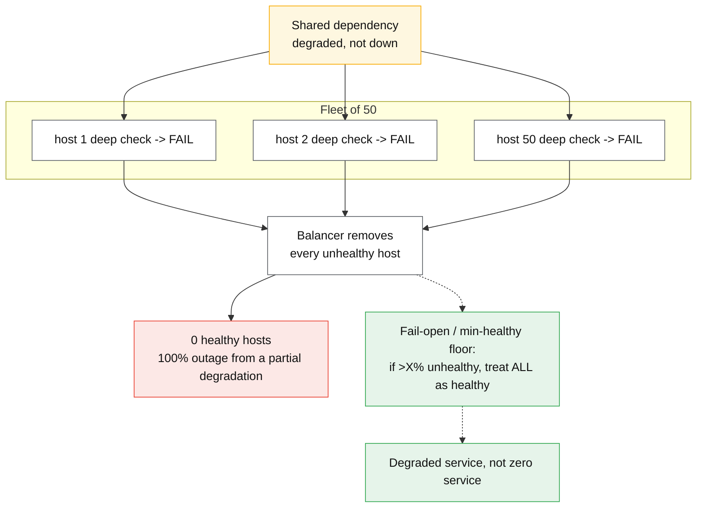
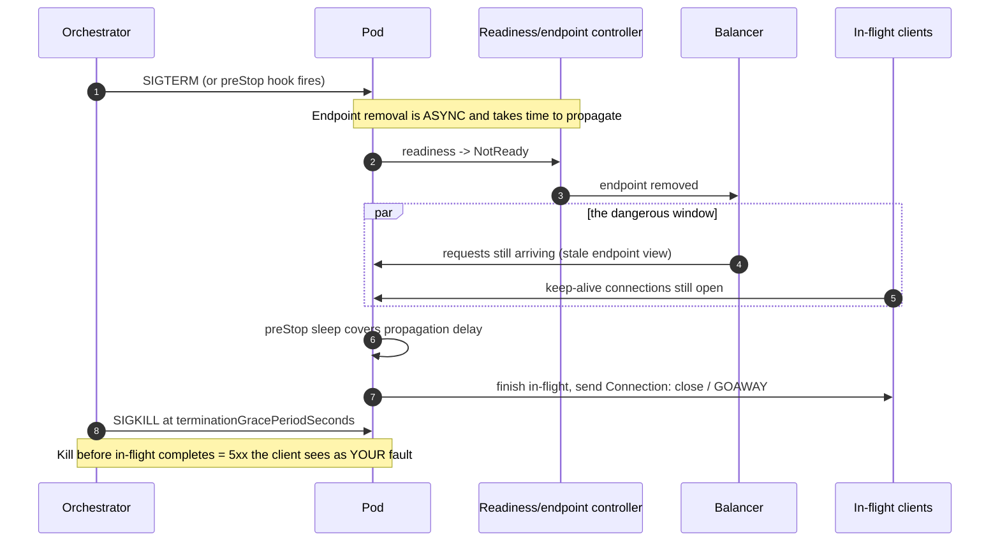

# Health checking and draining

## Core concept

A health check is a **control loop with authority to remove capacity**, and that is the whole
danger: the same mechanism that routes around one sick host will route around the entire fleet if
the thing that is sick is shared. Deep checks make this certain — every host queries the same
database, the database blips, every host reports unhealthy, and the balancer dutifully removes
100% of capacity in response to a dependency that was degraded, not dead.

The second half of the topic is the opposite motion. Removing a host from rotation is not the same
as it being safe to kill: in-flight requests, open connections, and every client and balancer that
has not yet noticed the removal are all still sending work. **Draining is the interval between
"stop sending" and "safe to stop serving"**, and a deploy that skips it is a small outage repeated
once per host.

## Mechanics & internals

### Three different questions, three different checks

| Check | Question | Failure action | Who must never conflate it |
|---|---|---|---|
| **Liveness** | Is the process wedged beyond recovery? | **Restart** the process | Anyone who points it at a dependency |
| **Readiness** | Should this instance receive traffic *right now*? | Remove from rotation, keep running | Anyone who restarts on it |
| **Startup** | Has slow initialisation finished? | Suppress the other two until it passes | Anyone with a slow JVM/model load |

The classic outage is a **liveness probe with a dependency in it**. The database gets slow,
liveness times out, Kubernetes restarts every pod, the restarts hammer the database's connection
establishment path, and a recoverable slowdown becomes a crash loop. Kubernetes' own documentation
states the rule plainly: liveness probes should not check dependencies, and a readiness probe is
the correct place for "I cannot serve right now".

### Fail-open is the property that saves you

Envoy calls it **panic mode**: if the share of healthy hosts in a cluster falls below a threshold
(default **50%**), Envoy ignores health status entirely and load balances across *all* hosts. The
reasoning is that a fleet reporting 80% unhealthy is far more likely to be a broken check than 80%
broken hosts, and sending traffic to possibly-sick hosts beats sending it nowhere.

AWS target groups express the same idea differently and it is worth knowing verbatim: if **all**
targets in a target group are unhealthy, the load balancer routes requests to all targets
regardless — "fail open" rather than return 503 to everyone.

Build this into any custom check you write. A health system without a floor has an amplification
factor of `fleet size`.

### Shallow for routing, deep for alerting

| | Shallow | Deep |
|---|---|---|
| Checks | Process alive, event loop responsive, `/healthz` returns 200 | DB reachable, cache reachable, downstream reachable |
| Suitable for | **Routing decisions** | **Alerts and dashboards** |
| Blast radius if wrong | One host | The fleet |
| Cost | Microseconds | A query per check per host per interval |

The cost line is not a footnote: 200 hosts checked every 5 s with a deep check that runs one query
is 40 queries/s of pure health traffic against the database, before any user request — and it is
the query that arrives hardest exactly when the database is already struggling.

### Outlier detection: passive health, and why it is different

Active checks ask; **passive (outlier) detection observes real traffic**. Envoy ejects a host after
`consecutive_5xx` (default 5) or when its success rate falls below the fleet mean by a configured
number of standard deviations, for a `base_ejection_time` (default 30 s) that grows with each
ejection, and it will never eject more than `max_ejection_percent` (default **10%**) of hosts.

Passive detection catches what active checks structurally cannot: a host that answers `/healthz`
correctly while failing every real request — a poisoned cache entry, a bad feature flag, a corrupt
model artefact, a certificate it cannot validate for one downstream.

### The drain sequence, in the order the failures happen

Four distinct things must all be handled, and skipping any one produces errors on every deploy:

1. **Propagation delay.** Endpoint removal is eventually consistent — the orchestrator, the
   balancer's control plane, and every client's cached endpoint list update independently. The
   standard fix is a `preStop` sleep (commonly 5–15 s) so the pod keeps serving while the removal
   propagates. Terminating instantly on SIGTERM is the single most common cause of deploy 5xx.
2. **In-flight completion.** Stop accepting new work, finish what is running, then exit. The grace
   period must exceed your p99.9 request duration, not your p50 — Kubernetes' default
   `terminationGracePeriodSeconds` is **30 s**, which is too short for a service with 60 s jobs and
   far too long as a deploy-speed default for a service with 50 ms requests.
3. **Keep-alive connections.** An HTTP/1.1 keep-alive or HTTP/2 connection outlives the endpoint
   removal. HTTP/2 needs a **GOAWAY** so the client stops multiplexing new streams onto it; HTTP/1.1
   needs `Connection: close`. Without it the client keeps using a socket to a process that is about
   to exit.
4. **Long-lived streams.** WebSockets and gRPC streams do not end on their own. Draining means
   actively closing them with a reason the client understands, staggered so reconnects do not
   arrive as one thundering herd.

### Check parameters, and the arithmetic that sets them

Detection time is `interval × unhealthy_threshold + timeout`, and every part of that has a cost in
the other direction — flapping. With AWS ALB defaults (30 s interval, 5 s timeout, 2 consecutive
failures for unhealthy) a dead target keeps receiving traffic for up to **~65 s**. Tightening the
interval to 10 s and threshold to 2 gives ~25 s and triples the check traffic.

The threshold asymmetry is deliberate and worth stating in an interview: **fail fast, recover
slow.** Two failures to eject, five successes to re-admit — because a host that just failed is
more likely to fail again, and re-admitting it early produces the flap that makes the fleet's
capacity oscillate.

## Numbers that matter

| Quantity | Value | Confidence |
|---|---|---|
| Envoy panic threshold | **50%** healthy; below it, ignore health entirely | [Envoy docs](https://www.envoyproxy.io/docs/envoy/latest/intro/arch_overview/upstream/load_balancing/panic_threshold) |
| Envoy `max_ejection_percent` | **10%** default | Envoy outlier detection defaults |
| Envoy `consecutive_5xx` / base ejection | 5 / **30 s**, growing per ejection | Envoy defaults |
| ALB health check defaults | 30 s interval, 5 s timeout, 2 unhealthy / 5 healthy | [AWS docs](https://docs.aws.amazon.com/elasticloadbalancing/latest/application/target-group-health-checks.html) |
| Worst-case ALB detection time at defaults | ~65 s of traffic to a dead target | Derived: `30 × 2 + 5` |
| Kubernetes `terminationGracePeriodSeconds` | **30 s** default | Kubernetes docs |
| Typical `preStop` sleep for endpoint propagation | 5–15 s | Convention; measure your own propagation |
| AWS target deregistration delay (drain) | **300 s** default | AWS docs — often far longer than needed, slowing deploys |
| Deep-check query load | `hosts / interval` queries/s | 200 hosts / 5 s = 40 qps of pure health traffic |
| Health traffic as a share of a small service's load | Can exceed 100% of user traffic at low volume | Common in staging and low-traffic tiers |

**Worked example — the fleet-removal bound.** 50 hosts, deep readiness check on a database with a
2 s timeout, threshold 2, interval 5 s. The database enters a 20 s latency spike. Every host fails
two consecutive checks within ~10 s, so within one interval of each other **all 50** are removed,
and the balancer without a panic threshold now has zero healthy destinations. The blast radius of
that spike went from "some slow requests" to "total outage" purely through the health system. With
Envoy's 50% panic threshold, traffic keeps flowing to all hosts and users see the original
degradation and nothing worse.

**Worked example — grace period.** Requests have p50 40 ms, p99.9 8 s (a report endpoint). A 30 s
grace period is fine; a 5 s one kills 0.1% of requests on every host of every deploy. At 20 deploys
a week and 40 hosts that is 800 host terminations a week, each cutting off the tail of the
distribution — invisible in aggregate, and precisely the errors your most patient users see.

## Failure modes

| Failure | Symptom | Mitigation |
|---|---|---|
| **Liveness probe checks a dependency** | Fleet-wide crash loop during a dependency blip | Liveness = process-local only, always |
| **Deep readiness check, no floor** | 100% capacity removed by a partial degradation | Shallow for routing; panic/fail-open threshold |
| **No `preStop` delay** | 5xx on every deploy, proportional to fleet size | Sleep ≥ endpoint propagation time before exiting |
| **Grace period < p99.9 latency** | A slice of long requests killed per rollout | Derive from the tail, not the median |
| **HTTP/2 without GOAWAY** | Clients keep streaming to a terminating process | Send GOAWAY, then drain streams |
| **Startup slower than liveness threshold** | Pods killed while loading; never reach ready | Startup probe, or `initialDelaySeconds` past worst-case load |
| **Flapping thresholds** | Capacity oscillates; cache hit rate collapses with it | Fail fast, recover slow; hysteresis |
| **Healthy check, sick service** | `/healthz` 200 while every real request 500s | Passive outlier detection on real traffic |
| **Health checks bypass the code path users hit** | Synthetic success, real failure | Check a route that touches the real serving stack |
| **Deregistration delay too long** | Deploys take hours; rollback is slow when it matters | Set drain to p99.9 request time, not the 300 s default |

**Documented pattern.** Google's SRE material and Kubernetes' own probe documentation converge on
the same warning from opposite directions: the SRE guidance is that a health-checking system must
degrade toward *serving* rather than toward *removing*, and the Kubernetes guidance is the
narrower rule that liveness must not depend on anything outside the container. Both exist because
the failure they prevent is not "a bad host stays in rotation" — it is "a good fleet is deleted by
its own supervisor".

## Trade-offs vs alternatives

| Approach | Buys | Costs |
|---|---|---|
| **Active shallow checks** | Fast, safe, cheap | Misses a host that lies |
| **Active deep checks** | Catches real dependency loss | Correlated failure across the fleet; query load |
| **Passive outlier detection** | Catches liars; zero synthetic traffic | Needs volume; reacts only after real users fail |
| **Both (recommended)** | Coverage and safety | Two systems to tune; ejection interacts with balancing policy |
| **Fail-open floor** | Bounds blast radius to "degraded" | Sends traffic to genuinely sick hosts for a while |
| **Long drain** | Zero deploy errors | Slow deploys and slow rollbacks — a real incident cost |

### Where staff engineers get this wrong

1. **Treating liveness and readiness as synonyms.** They have opposite failure actions; swapping
   them turns a routing decision into a restart storm.
2. **Adding dependencies to a check "for accuracy".** Accuracy in a health check is not the goal —
   *bounded blast radius* is.
3. **No fail-open floor.** Without one, the health system's worst case is a full outage triggered
   by a partial degradation.
4. **Grace period copied from the default.** It has to come from your own tail latency; 30 s is a
   number Kubernetes chose, not a statement about your service.
5. **Forgetting long-lived connections.** WebSocket and gRPC streams ignore readiness entirely, so
   draining them is separate work with its own reconnect-storm risk.
6. **Never testing the check.** The check that has never failed in staging is the one with a typo
   in the failure path. Fault-inject it.

## Real-world examples

- **Kubernetes** — startup / liveness / readiness as three separate probes with distinct actions,
  `terminationGracePeriodSeconds`, `preStop` hooks, and asynchronous endpoint propagation that
  makes the preStop sleep necessary rather than optional.
- **Envoy** — active health checking, passive outlier detection, and a panic threshold, three
  mechanisms that exist because no single one is safe alone.
- **AWS ELB** — configurable interval/timeout/thresholds, a documented fail-open when all targets
  are unhealthy, and a 300 s default deregistration delay.
- **HAProxy / NGINX Plus** — `agent-check` and slow-start on re-admission, so a recovered backend
  ramps instead of taking its full share cold.

## On AWS and Azure

| | AWS | Azure |
|---|---|---|
| **Where checks are configured** | On the **target group**, not the load balancer — protocol, path, interval, timeout, healthy/unhealthy thresholds, matcher codes | On the **health probe** resource, referenced by a load-balancing rule; Application Gateway has its own probe with host/path/match |
| **Defaults** | 30 s interval, 5 s timeout, 2 unhealthy, 5 healthy, matcher `200` | Load Balancer probe: 5 s interval; Application Gateway: 30 s interval, 30 s timeout, 3 unhealthy threshold |
| **Fail-open behaviour** | If **all** targets are unhealthy, the LB routes to all of them anyway rather than 503 | Standard Load Balancer: if **all** instances probe down, traffic is *not* forwarded — connections fail. This is the opposite default and the reason a probe misconfiguration on Azure is an outage rather than a degradation |
| **Draining** | `deregistration_delay.timeout_seconds`, **default 300 s**, during which existing connections complete | Load Balancer `enableTcpReset` plus connection draining on the backend pool; AKS uses the same Kubernetes preStop/grace mechanics |
| **The default that bites** | The 300 s drain applied to a 50 ms service makes every rolling deploy and every rollback five minutes slower per batch — teams discover it during an incident, when rollback speed is the only thing that matters | Standard Load Balancer's **HTTPS probes have no support for self-signed or private-CA certificates in some configurations, and a probe failure removes the instance entirely** — combined with no fail-open, a certificate rotation on the probe endpoint can take the whole backend pool out at once |

The asymmetry across the two clouds is the interview-worthy point: **AWS fails open when everything
is unhealthy and Azure Standard Load Balancer does not.** A design ported between them inherits
opposite worst cases from the same probe configuration, so "the health check is the same" is not a
statement about behaviour.

## In an LLM deployment

Readiness for a model server is not a socket check — it is **weights resident and the first
forward pass done**. A 70 B model in fp16 is ~140 GB of weights to page from object storage onto
GPU, which commonly takes minutes, so the startup probe's threshold is the difference between a
working rollout and an infinite crash loop. Set the startup probe to cover worst-case cold load
from cold storage, not warm load from a local cache.

Draining inverts, too. A replica serving streaming completions cannot finish "in flight" work in
milliseconds: a long generation can run for minutes, so the grace period is a function of
`max_tokens × time-per-token`, and a grace period shorter than that truncates a user's answer
mid-sentence — an error the client sees as corruption rather than as a retryable failure. Either
size the grace period to the longest permitted generation, or implement request-level draining
that refuses new prompts while letting running streams complete.

The health signal itself also changes: queue depth and KV-cache occupancy predict imminent
failure long before the process is unhealthy, and a readiness probe that flips on
`kv_cache_utilisation > 0.95` sheds load correctly, where a liveness probe on the same signal would
restart a busy replica and hand its traffic to its neighbours — the classic metastable cascade,
with a 3-minute weight load in the recovery path.

## Staff-level follow-ups

1. Your readiness check queries the primary database. Describe the exact sequence from a 15 s
   database latency spike to a full outage, then give three independent changes that each break the
   chain.
2. Deploys produce a burst of 502s proportional to fleet size. Walk from symptom to root cause, and
   say which of `preStop`, grace period, GOAWAY and deregistration delay you would change first and
   why.
3. Design health checking for a service holding 500 k WebSocket connections. What does "drain" mean
   here, and how do you avoid a reconnect storm?
4. Choose interval, timeout and thresholds for a service with a 99.9% SLO and a 40 ms p99. Show the
   detection-time arithmetic and the flapping risk at your numbers.
5. Same design deployed to AWS and to Azure Standard Load Balancer, identical probe config. Where
   do the worst cases differ, and what do you add on Azure to recover the AWS behaviour?

## See also

- [load-balancing-algorithms.md](./load-balancing-algorithms.md) — what happens to the hosts that stay in the pool
- [cascading-and-metastable-failures.md](./cascading-and-metastable-failures.md) — the fleet-removal loop as a metastable failure
- [load-shedding-and-admission-control.md](./load-shedding-and-admission-control.md) — shedding as the alternative to removal
- [../patterns/graceful-degradation.md](../patterns/graceful-degradation.md) — serving less rather than serving nothing
- [deployment-strategies.md](./deployment-strategies.md) — the rollout that draining makes safe
- [long-lived-connections.md](./long-lived-connections.md) — draining connections that never end on their own

## Sources

- [Kubernetes — configure liveness, readiness and startup probes](https://kubernetes.io/docs/tasks/configure-pod-container/configure-liveness-readiness-startup-probes/) — probe semantics, dependency warning
- [Kubernetes — pod termination lifecycle](https://kubernetes.io/docs/concepts/workloads/pods/pod-lifecycle/#pod-termination) — SIGTERM, grace period, async endpoint removal
- [Envoy — panic threshold](https://www.envoyproxy.io/docs/envoy/latest/intro/arch_overview/upstream/load_balancing/panic_threshold) — 50% default, ignore-health behaviour
- [Envoy — outlier detection](https://www.envoyproxy.io/docs/envoy/latest/intro/arch_overview/upstream/outlier) — consecutive 5xx, ejection time, max ejection percent
- [AWS — target group health checks](https://docs.aws.amazon.com/elasticloadbalancing/latest/application/target-group-health-checks.html) — defaults, fail-open when all targets unhealthy
- [AWS — deregistration delay](https://docs.aws.amazon.com/elasticloadbalancing/latest/application/load-balancer-target-groups.html#deregistration-delay) — 300 s default
- [Azure — Load Balancer health probes](https://learn.microsoft.com/en-us/azure/load-balancer/load-balancer-custom-probe-overview) — probe behaviour when all instances are down
- [Azure — Application Gateway health probes](https://learn.microsoft.com/en-us/azure/application-gateway/application-gateway-probe-overview) — defaults and match conditions
- [Google SRE workbook — canarying and rollouts](https://sre.google/workbook/canarying-releases/) — degrade toward serving
