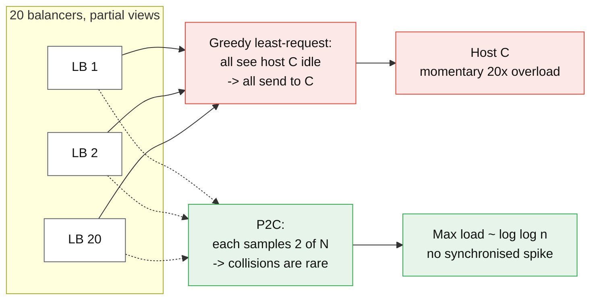

# Load balancing algorithms

## Core concept

Every load balancing algorithm is a bet about **information you do not have**: the cost of the
request you are about to route, and the current queue depth of a backend you last heard from
milliseconds ago. Round robin bets that all requests cost the same. Least-request bets your
in-flight count is accurate. Latency-based bets that the fastest responder is the healthiest —
which is false precisely when a node is failing fast.

The second property that decides real behaviour is **how many balancers are making the decision
independently**. One balancer with perfect state can play greedy optimally. Twenty balancers each
with a partial view and a greedy rule will converge on the same "best" backend simultaneously and
herd it into overload — the failure that makes textbook least-connections worse than random at
scale, and the reason power-of-two-choices exists.

## Mechanics & internals

### The algorithms, by what they actually compute

| Algorithm | Decision rule | Coordination needed | Breaks on |
|---|---|---|---|
| **Round robin** | Next in list | None | Request cost variance; unequal instance sizes |
| **Weighted round robin** | Next in list, weights as repeats/credits | Weight distribution | Stale weights after autoscaling |
| **Random** | Uniform pick | None | Nothing in particular — it is the honest baseline |
| **Least request (least outstanding)** | Fewest in-flight to *this* balancer | Per-balancer state only | Herding when many balancers act greedily on partial views |
| **Power of two choices (P2C)** | Sample 2 at random, take the lesser in-flight | None | Extremely skewed backend capacity |
| **Peak-EWMA / least-time** | Latency EWMA × in-flight | Per-balancer state | Fast failures look fast — error funnelling |
| **Ring hash** | `hash(key)` → point on ring | Consistent view of membership | Key skew; ~`1/N` remap per membership change |
| **Maglev** | `hash(key)` → lookup table slot | Table build across balancers | Table size caps backend count |

Envoy's default for `LEAST_REQUEST` **is** P2C — it samples `choice_count` (default 2) hosts and
picks the one with fewest active requests, rather than scanning all hosts. That default is the
practical statement of the herding problem: the maintainers chose an approximation over the exact
answer because the exact answer behaves worse in a fleet.

### Why two random choices beats the greedy rule

With `n` balls into `n` bins chosen uniformly at random, the fullest bin holds
Θ(log n / log log n) balls. Sampling **two** bins and taking the lesser drops that to
Θ(log log n) — an exponential improvement, and sampling `d > 2` only improves the constant.
That is Mitzenmacher's result, and it is the whole argument: **the second sample buys almost all
of the benefit of global knowledge at none of its coordination cost, and unlike global knowledge
it cannot herd**, because two independent balancers rarely draw the same pair.



### Subsetting — the constraint nobody states

A balancer that knows every backend holds a connection to every backend. At 10 000 clients and
10 000 backends that is 10⁸ connections, which no fleet survives. **Deterministic subsetting**
(Google SRE book, ch. 20) assigns each client a pseudo-random but stable subset of size `k`, so
connections are `clients × k` instead of `clients × backends`, and a client's subset only shifts
when membership changes.

The cost is load-balancing quality: with `k = 20`, a client's view of the fleet is 20 hosts, so
per-client skew rises, and a backend's total load is the sum of however many subsets happened to
include it. Choose `k` from *both* constraints — connection budget and the tolerable imbalance —
and re-derive it when the fleet doubles. A subset size chosen at 200 backends is usually wrong at
2 000.

### Slow start, and why a fresh node is a latency spike

A just-started backend has a cold JIT, cold connection pools, an empty local cache and an unwarmed
page cache. Give it an equal share immediately and it serves its first few hundred requests at
several times the fleet's p99 — and under least-request it will look *idle*, so a greedy balancer
sends it **more**. Envoy's `slow_start_window` ramps a host's weight from a configured minimum over
a window; NGINX Plus and HAProxy have the same knob. Rolling deploys without it produce the
characteristic sawtooth p99 that everyone blames on the application.

### Hashing: ring vs Maglev vs rendezvous

Use a hash-based policy only when you need **affinity** — cache warmth, session locality,
per-shard routing. Then the axis that matters is disruption on membership change:

| | Ring hash (Ketama) | Maglev | Rendezvous (HRW) |
|---|---|---|---|
| Lookup | O(log N) binary search on ring | O(1) table lookup | O(N) hash per backend |
| Disruption on one host leaving | ~`1/N` of keys | ~`1/N`, with a small table-size-bounded excess | Exactly `1/N` |
| Memory | `N × vnodes` ring entries | Fixed table (65 537 default in Envoy) | None |
| Balance quality | Depends on vnode count (100–1000 typical) | Very even by construction | Even |

Maglev's contribution is picking a **fixed-size lookup table** built by a deterministic permutation
so every balancer independently derives the *same* table — which matters when the balancers are a
stateless ECMP-sprayed fleet and a packet for an existing connection may arrive at any of them.

```mermaid
sequenceDiagram
    autonumber
    participant C as Client
    participant L as Balancer (P2C + outlier detection)
    participant A as Host A — p99 40 ms
    participant B as Host B — failing fast, 3 ms 500s

    C->>L: request
    L->>L: sample {A, B}; B has fewer in-flight (it finishes instantly)
    L->>B: forward
    B-->>L: 500 in 3 ms
    Note over L,B: Under peak-EWMA, B now looks like the FASTEST host.<br/>Error funnelling: the broken node attracts traffic.
    L->>L: outlier detection: 5 consecutive 5xx -> eject B for base_ejection_time
    L->>A: forward
    A-->>C: 200 in 40 ms
```

**Error funnelling is the single most important interaction on this page**: any latency-aware
policy must be paired with outlier detection (consecutive-5xx or success-rate ejection), or the
worst host in the fleet becomes the most attractive one. Envoy ships both because neither is safe
alone.

## Numbers that matter

| Quantity | Value | Confidence |
|---|---|---|
| Max bin load, `n` balls / `n` bins, random | Θ(log n / log log n) | Proven |
| Max bin load with two choices | Θ(log log n) | Mitzenmacher 2001 — exponential improvement |
| Envoy `LEAST_REQUEST` sample size | `choice_count` = **2** by default | [Envoy docs](https://www.envoyproxy.io/docs/envoy/latest/intro/arch_overview/upstream/load_balancing/load_balancers) |
| Envoy Maglev table size | **65 537** entries (prime) | Envoy docs; caps practical backend count |
| Ring hash vnodes for acceptable balance | 100–1 000 per host | Convention; below ~100 the skew is visible |
| Connections without subsetting | `clients × backends` | 10 k × 10 k = 10⁸ — the reason subsetting exists |
| Typical subset size `k` | 20–100 | Google SRE book; re-derive per fleet size |
| Extra hop cost of an L7 proxy | ~0.3–1 ms p50 within a zone | Order of magnitude — measure yours |
| Cross-AZ hop added by zone-unaware routing | ~0.5–2 ms RTT + inter-AZ data charge | Order of magnitude |
| Outlier ejection defaults (Envoy) | 5 consecutive 5xx, 30 s base ejection, ≤10% of hosts ejected | Envoy defaults |

**Worked example — cost variance defeats round robin.** Requests are 95% cache hits at 2 ms and
5% cold renders at 400 ms. Mean cost is `0.95×2 + 0.05×400 = 21.9 ms`. Round robin hands each
host the same *count*, so a host that draws three cold renders in a row is at ~1.2 s of queued
work while a peer is idle — the p99 is set by draw luck, not by capacity. Least-request routes on
outstanding *work in progress* and removes that variance without any cost estimate, which is why
it is the default recommendation for mixed workloads.

**Worked example — subset sizing.** 3 000 clients, 800 backends, target ≤ 200 inbound connections
per backend. `k = 200 × 800 / 3000 ≈ 53`. Take `k = 50`, and note it must be re-derived if the
client fleet grows: at 6 000 clients the same `k` doubles inbound connections to 375 per backend.

## Failure modes

| Failure | Symptom | Mitigation |
|---|---|---|
| **Greedy least-request herding** | Synchronised spikes on whichever host just freed capacity | P2C instead of full-scan least-request |
| **Error funnelling** | Traffic migrates *toward* the failing host; error rate climbs superlinearly | Pair latency/least-request with outlier detection and ejection |
| **No slow start** | p99 sawtooth on every deploy, blamed on the app | Weight ramp over 30–60 s; readiness gate before weighting |
| **Stale weights after autoscale** | New capacity idle; old hosts saturated | Weights derived from live endpoint data (EDS/ORCA), not config |
| **Hash policy on a skewed key** | One backend at 100%, hashing "working as designed" | Bounded-load variants, or do not hash on a key with a whale |
| **Membership flap → mass remap** | Cache hit rate collapses fleet-wide after a rolling restart | Ring/Maglev over modulo; drain rather than kill; stagger restarts |
| **Zone-unaware routing** | Latency and inter-AZ bill both rise quietly | Zone-aware routing with a failover floor |
| **Retry amplification through the balancer** | 3× backend load exactly when the backend is failing | Retry budget as a percentage of traffic, not per-request counts |
| **Subset too small after fleet growth** | Load imbalance rises with no config change | Recompute `k` on fleet-size change |

**Documented pattern.** Google's own account of datacenter load balancing (SRE book ch. 20)
describes the sequence most fleets repeat: simple round robin produces a *2×* spread between the
busiest and least busy task because request costs are not uniform, least-loaded-round-robin
improves it but degrades when a task is *broken* (it drains its queue instantly and therefore looks
least loaded), and the working answer is a combination — bounded in-flight limits, subsetting, and
treating "fast" as suspicious without a success-rate check.

## Trade-offs vs alternatives

| Policy | Choose when | Give up |
|---|---|---|
| **Round robin** | Uniform request cost; you want zero surprises | Any adaptation to cost or health |
| **P2C least-request** | Default for mixed HTTP/gRPC workloads | Exact optimality (which you cannot have anyway) |
| **Peak-EWMA** | Heterogeneous hardware or noisy neighbours | Safety without outlier detection |
| **Ring hash / Maglev** | Cache affinity or per-key ownership | Load balance quality; you now own skew |
| **Random** | Enormous fleets, cheap requests, no state | A few percent of tail |
| **Client-side (mesh/library)** | You want per-request decisions without an extra hop | Uniform policy across languages; the LB hop that also shields you |

### Where staff engineers get this wrong

1. **Calling least-connections "the safe default" at fleet scale.** Exact greedy behaves worse
   than P2C with many independent balancers. Say *which* variant you mean.
2. **Deploying latency-based routing without ejection.** It is not a tuning issue; it is a
   directional bug that sends more traffic to the most broken host.
3. **Hash-based affinity as a cache strategy.** It converts a cache-miss problem into a hot-shard
   problem, which is strictly harder to fix later.
4. **Ignoring cold start.** A rolling deploy with no slow-start window is a self-inflicted latency
   incident every release.
5. **Treating the balancer as stateless and therefore free.** Its health-check policy, ejection
   thresholds and retry budget are the highest-blast-radius config in the request path.
6. **Not asking how many balancers there are.** Every property on this page changes between one
   balancer and fifty.

## Real-world examples

- **Envoy** — `LEAST_REQUEST` implemented as P2C, Maglev and ring hash as separate policies,
  `slow_start_window`, and outlier detection as a first-class subsystem.
- **Google Maglev** — a software network balancer whose consistent-hash table is built identically
  on every node, so ECMP may deliver any packet to any balancer and the connection still lands on
  the same backend.
- **Twitter Finagle** — P2C with peak-EWMA as the documented client-side default, precisely because
  clients are many and independent.
- **AWS ALB** — round robin per target group by default, with "least outstanding requests" as an
  opt-in algorithm; NLB hashes a flow 5-tuple so a TCP connection is pinned.
- **Kubernetes `kube-proxy`** — iptables mode picks a backend at *random* per connection; it is the
  clearest production example of random being good enough when requests are cheap and numerous.

## On AWS and Azure

| | AWS | Azure |
|---|---|---|
| **L7 default algorithm** | ALB: **round robin** per target group; least-outstanding-requests is opt-in per target group | Application Gateway: **round robin**, with cookie-based affinity as the opt-in |
| **L4 behaviour** | NLB: flow hash on the 5-tuple (protocol, src IP/port, dst IP/port) plus TCP sequence number — a connection is pinned for its life | Azure Load Balancer: 5-tuple hash by default, configurable to 2- or 3-tuple for source-IP affinity |
| **Global / latency routing** | Global Accelerator (anycast, static IPs) or Route 53 latency records | Front Door: `Latency` routing with a **sensitivity window** — backends within the window are treated as equal and load balanced between |
| **Cross-zone** | **ALB: always on and free. NLB: off by default**, and enabling it bills inter-AZ data | Standard Load Balancer is regional; zone behaviour follows the frontend IP's zonality (zonal vs zone-redundant) |
| **The default that bites** | NLB cross-zone **disabled by default**: if one AZ holds 2 targets and another holds 20, each AZ still receives ~50% of traffic, so the small AZ is 10× overloaded while the dashboard shows the target group healthy | Front Door's latency sensitivity (default 50 ms) is wide enough that a backend 45 ms slower is still considered "equal" and receives full traffic — latency routing that is, by design, not choosing the fastest |

The AWS row is the one to remember in an interview: NLB's per-AZ distribution is a property of DNS
and ECMP, not of the target group, so **unequal target counts per AZ are an outage waiting for a
deploy**. Either keep target counts balanced across zones or turn cross-zone on and pay for the
inter-AZ traffic — there is no third option.

## In an LLM deployment

In-flight request count stops being a proxy for load the moment requests are token streams. Two
requests on one replica can differ by 100× in work — a 200-token completion against a 32 k-token
prompt with a 4 k-token answer — so **least-request routes by the wrong unit** and a "balanced"
fleet by connection count can have one replica at 95% KV-cache occupancy and another at 10%.

Two things replace it. First, route on the queue's *work*: vLLM-style schedulers expose pending
tokens, running sequences and KV-cache utilisation, and a router that balances on KV-cache
occupancy is balancing the actual bottleneck — GPU memory, not CPU. Second, **prefix affinity
inverts the usual advice on hashing**: routing a conversation back to the replica already holding
its prefix in the KV cache turns a full prefill into a cache hit, and prefill is the expensive
half. Here the hash-affinity policy this page warns about is the correct default, and the hot-shard
risk is real but cheaper than re-prefilling — a long shared system prompt is exactly the "whale
key" that also gives the largest saving when it stays put.

The number that makes the argument: prefill cost scales with prompt length while decode cost scales
with output length, so a router that ignores prompt size can hand one replica several seconds of
prefill while its peer idles — and no connection-count metric will show it.

## Staff-level follow-ups

1. You have 40 balancer instances and 600 backends. Argue for or against exact least-connections,
   then state what you would measure in the first hour after switching.
2. Latency-based routing has been enabled and error rate went *up*. Explain the mechanism, and
   give the two configuration changes that fix it without reverting.
3. Derive a subset size for 5 000 clients and 1 200 backends under a 150-connection-per-backend
   budget, and say what breaks when the client fleet triples.
4. Your cache hit rate collapses from 94% to 60% after every rolling restart. Trace the cause
   through the balancing policy and propose two fixes with different costs.
5. One AZ holds 3 targets, another holds 30, behind an NLB with default settings. Predict the
   per-target load, then give the two ways out and their bills.

## See also

- [health-checking-and-draining.md](./health-checking-and-draining.md) — the policy that decides which hosts are even in the pool
- [consistent-hashing.md](./consistent-hashing.md) — ring construction, virtual nodes, bounded loads
- [tail-latency.md](./tail-latency.md) — why the slowest backend sets your p99, and hedging
- [hot-shard-mitigation.md](./hot-shard-mitigation.md) — what hash-based affinity turns into
- [timeouts-retries-backoff.md](./timeouts-retries-backoff.md) — retry budgets at the balancer
- [api-gateway-and-bff.md](./api-gateway-and-bff.md) — the layer above, and what belongs in it

## Sources

- [Envoy — supported load balancers](https://www.envoyproxy.io/docs/envoy/latest/intro/arch_overview/upstream/load_balancing/load_balancers) — LEAST_REQUEST as P2C, ring hash, Maglev, slow start
- [Envoy — outlier detection](https://www.envoyproxy.io/docs/envoy/latest/intro/arch_overview/upstream/outlier) — consecutive-5xx and success-rate ejection defaults
- [Google SRE book, ch. 20 — Load balancing in the datacenter](https://sre.google/sre-book/load-balancing-datacenter/) — subsetting, why least-loaded misroutes to broken tasks
- [Maglev: A Fast and Reliable Software Network Load Balancer (NSDI 2016)](https://research.google/pubs/pub44824/) — consistent-hash table construction
- M. Mitzenmacher, *The Power of Two Choices in Randomized Load Balancing*, IEEE TPDS 2001 — Θ(log log n) bound
- [AWS — Application Load Balancer routing algorithms](https://docs.aws.amazon.com/elasticloadbalancing/latest/application/load-balancer-target-groups.html) — round robin default, least outstanding requests
- [AWS — Network Load Balancer](https://docs.aws.amazon.com/elasticloadbalancing/latest/network/network-load-balancers.html) — flow hash, cross-zone off by default
- [Azure — Front Door routing methods](https://learn.microsoft.com/en-us/azure/frontdoor/routing-methods) — latency sensitivity window
- [Azure — Load Balancer distribution modes](https://learn.microsoft.com/en-us/azure/load-balancer/distribution-mode-concepts) — 5-tuple, 2- and 3-tuple affinity
- [vLLM — scheduling and KV cache](https://docs.vllm.ai/) — continuous batching, KV-cache occupancy as the real capacity metric
