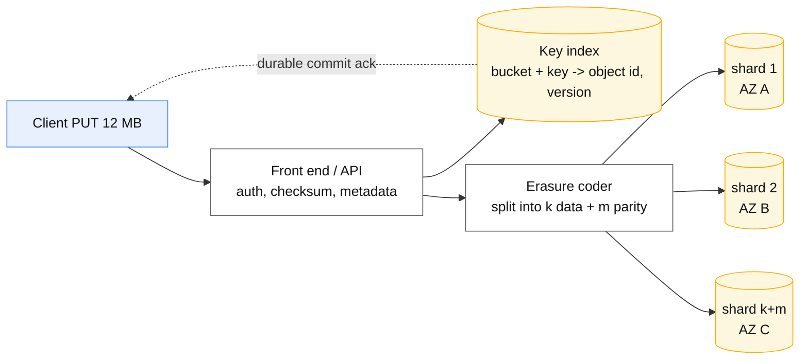
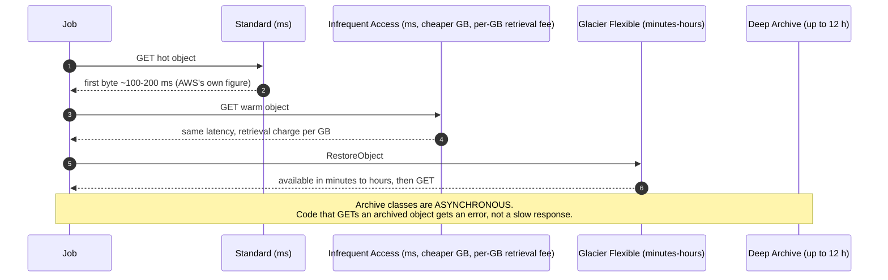

# Object storage internals

## Core concept

Object storage is a **flat key → blob map with HTTP semantics**, and almost every mistake made with
it comes from treating it as a filesystem. There are no directories — `a/b/c.parquet` is a key
containing slashes, and the console's folder view is a rendering of key prefixes. There is no
atomic rename; a "rename" is a server-side **copy plus delete**, which is O(size) and non-atomic.
There is no in-place update; writing one byte rewrites the object.

What you get in exchange is the best durability and cost curve available anywhere — eleven nines of
designed durability, near-zero marginal cost per stored byte, effectively unlimited capacity, and a
request-rate ceiling per prefix rather than per volume. The design work is fitting your access
pattern to **per-request cost and per-request latency**, because object storage charges and behaves
per *operation*, not per byte moved.

## Mechanics & internals

### What happens on a PUT



Three subsystems, and knowing they are separate explains most behaviour:

1. **A metadata/index service** mapping `bucket + key (+ version)` to the object's placement. This
   is the component that makes `LIST` expensive and prefix throughput a thing.
2. **An erasure-coded data plane.** Objects are split into `k` data shards plus `m` parity shards
   spread across failure domains; any `k` reconstruct the object. Storage overhead is `(k+m)/k` —
   typically ~1.3–1.5× — against 3× for triple replication, which is the whole economic story of
   the last decade of storage.
3. **A background repair/verification loop** continuously re-reading shards, comparing checksums
   and rebuilding what has decayed. Durability comes from this loop, not from the initial write.

### Prefixes, and the throughput limit that surprises people

S3 scales request rate **per prefix**: at least **3 500 PUT/COPY/POST/DELETE** and **5 500 GET/HEAD
per second per partitioned prefix**, with no limit on prefix count. The index partitions by key
range, so keys that share a leading string share a partition.

This is why the classic advice — and the historical anti-pattern — is about key *design*:

```
s3://bucket/2026-09-25/00001.json      <- date prefix: one day = one hot partition
s3://bucket/a3f/2026-09-25/00001.json  <- hash prefix: spread across partitions
```

Modern S3 auto-partitions hot prefixes over time, but the adaptation takes **minutes to hours**, so
a workload that goes from zero to 50 000 GET/s against one prefix gets `503 SlowDown` for the first
part of the run — exactly the shape of a batch job or a model-training epoch. Design the key layout;
do not rely on adaptation.

### Multipart upload — and why it is not optional

| Constraint | Value |
|---|---|
| Max single PUT | 5 GB |
| Max object size | **5 TB** |
| Parts per upload | **10 000** |
| Min part size | 5 MB (except the last) |
| Implied part size for a 5 TB object | ≥ 500 MB |

Multipart buys parallelism (upload parts concurrently, saturate the link), resumability (retry one
failed part, not 200 GB), and it is the only way past 5 GB. Its failure mode is financial:
**incomplete multipart uploads keep their parts and you are billed for them, invisibly** — they do
not appear in a normal `LIST`. Every bucket should have a lifecycle rule aborting incomplete
uploads after 7 days; the absence of that rule is one of the most common silent-cost findings in a
storage audit.

### Consistency, and what it still does not give you

S3 has provided **strong read-after-write consistency for PUTs, DELETEs and LISTs since December
2020** — a new object is immediately visible, an overwrite returns the new bytes, and listings
reflect the change. That removed a whole class of pipeline bugs and, importantly, removed the need
for the old "consistent listing" sidecar databases.

What it did **not** give you:

- **No atomic multi-object operation.** Writing 40 files that must appear together is still your
  problem — which is precisely why table formats (Iceberg, Delta) exist: they make a single atomic
  pointer swap the commit, and the data files merely accumulate.
- **No atomic rename.** Copy + delete. A job that "renames" a 2 TB directory is copying 2 TB.
- **No compare-and-swap on the object** in the classic API (conditional writes have since been
  added on some platforms — check before designing a lock on it, and never build a distributed lock
  on object storage without one).

### Listing is the expensive operation

`LIST` returns up to **1 000 keys per request** and is paginated. A prefix with 10 million objects
costs 10 000 requests and minutes of wall clock just to enumerate — before reading a byte. This is
the root of the **small-file problem**:

| | 1 M files × 1 MB | 1 000 files × 1 GB |
|---|---|---|
| Storage cost | Same | Same |
| `LIST` requests to enumerate | 1 000 | 1 |
| `GET` requests to read all | 1 000 000 | 1 000 |
| Request cost at $0.0004/1 000 GETs | ~$0.40 per full scan | ~$0.0004 |
| Time at ~100 ms first-byte latency, 100-way parallel | ~17 minutes of pure latency | negligible |

The bytes are identical and the job is 100× slower and 1 000× more expensive in requests. Compaction
into larger objects is not tidiness; it is the main performance lever object storage offers.

### Storage classes as a cost/latency dial



The trap is not the latency, it is the **minimum duration and retrieval charges**: infrequent-access
classes bill a minimum storage duration (30 days) and per-GB retrieval, so lifecycle-ing objects
that are still read weekly *increases* the bill. Move data by measured access age, not by a guess.

## Numbers that matter

| Quantity | Value | Confidence |
|---|---|---|
| Designed durability (S3 Standard) | **99.999999999%** (11 nines) | AWS docs |
| Availability SLA | 99.9% (Standard); lower for One Zone classes | AWS SLA |
| Request rate per prefix | **3 500** PUT/COPY/POST/DELETE and **5 500** GET/HEAD per second per *partitioned* prefix, unlimited prefixes | [AWS docs](https://docs.aws.amazon.com/AmazonS3/latest/userguide/optimizing-performance.html), verified verbatim 2026-09-25 |
| Max object size / parts | **5 TB** / 10 000 parts / 5 MB min part | AWS docs |
| Single PUT max | 5 GB | AWS docs |
| `LIST` page size | **1 000 keys** | AWS docs |
| First-byte latency, Standard | AWS documents **~100–200 ms** for small objects and first-byte-out on larger ones (S3 Express One Zone: single-digit ms) | [AWS docs](https://docs.aws.amazon.com/AmazonS3/latest/userguide/optimizing-performance.html), fetched 2026-09-25 |
| Throughput per connection | ~50–100 MB/s; AWS documents single-instance aggregate up to **100 Gb/s** with enough parallelism | Same source |
| Erasure-coding overhead | ~1.3–1.5× vs 3× replication | Structural |
| Azure block blob max | **~190.7 TiB** (50 000 blocks × 4 000 MiB) | Azure docs |
| Azure storage account request ceiling | **20 000 requests/s** per account (default) | Azure docs |
| Cross-region/internet egress | The dominant cost in most designs | Check current pricing — it moves |

**Worked example — request cost dominates.** A training job reads 40 M small objects per epoch,
10 epochs: `400 M GETs × $0.0004/1 000 = $160` in *requests alone*, plus the wall-clock cost of 400 M
round trips. Repack into 40 k shards of ~1 GB (WebDataset-style tar shards, or Parquet row groups)
and the same bytes cost `400 k GETs ≈ $0.16` and stream sequentially. **A 1 000× request reduction
with no change to the data.**

**Worked example — the invisible multipart bill.** A pipeline uploads 500 GB/day in 100 MB parts and
fails 2% of the time, leaving partial uploads. Without an abort-incomplete lifecycle rule that is
~10 GB/day accumulating forever — 3.6 TB after a year, billed at full Standard rates, and invisible
to every `LIST`-based audit.

## Failure modes

| Failure | Symptom | Mitigation |
|---|---|---|
| **Hot prefix** | `503 SlowDown` under a burst on one date/id prefix | Hash or reverse the leading component; pre-warm is not a thing you can request reliably |
| **Small-file explosion** | Jobs slow, request bill large, `LIST` takes minutes | Compact to 128 MB–1 GB objects; table formats manage this for you |
| **Incomplete multipart uploads** | Storage cost grows with no visible objects | Lifecycle rule: abort after 7 days |
| **Treating it as a filesystem** | "Rename" copies terabytes; partial states visible to readers | Atomic pointer swap (manifest/table format) instead |
| **Archive class accessed synchronously** | `InvalidObjectState` errors in production code | Restore workflow, or don't archive what is still read |
| **Lifecycle policy too aggressive** | Retrieval charges exceed the storage saving | Drive transitions from measured access age |
| **Deletes with versioning on** | Storage keeps growing; delete markers accumulate | Lifecycle for noncurrent versions; expire delete markers |
| **Public bucket / broad policy** | Data exposure — the canonical cloud breach | Block Public Access at the account level; presigned URLs for sharing |
| **Cross-region reads in the hot path** | Latency and egress cost per request | Replicate, or move compute to the data |
| **Eventual consistency assumptions in old code** | Sleeps and retries that are now pure latency | Strong consistency since 2020 — delete the workarounds |
| **No checksum verification end to end** | Silent corruption in transit blamed on storage | Send and verify checksums; the service supports it |

**Documented pattern.** The reason Iceberg, Delta Lake and Hudi all exist is a single object-storage
property: **there is no atomic multi-file commit and no atomic rename**. Hive-style tables relied on
directory renames to publish a partition, which on object storage is a slow, non-atomic copy — so
readers saw half-published partitions. All three formats replace it with one atomic pointer update
to a new manifest. Being able to state that causal chain — storage semantics → table format — is a
strong signal in a data-platform interview.

## Trade-offs vs alternatives

| Option | Choose when | Give up |
|---|---|---|
| **Object storage** | Large immutable blobs, analytics, backups, media, model artefacts | Low latency, in-place mutation, POSIX semantics |
| **Block storage (EBS/managed disks)** | Databases, low-latency random IO | Sharing across instances; cost per GB |
| **Network filesystem (EFS/Azure Files)** | POSIX apps, shared mutable state | Cost per GB and per IO; throughput scaling rules |
| **Low-latency object tier (S3 Express One Zone)** | Many small reads where ms matter | One AZ (availability), higher per-GB price |
| **HDFS** | Existing Hadoop estate, data locality | Operating it, and it lost the cost argument |
| **Database BLOBs** | Small blobs needing transactional consistency with rows | Cost, backup size, and database cache pollution |

### Where staff engineers get this wrong

1. **Designing keys after launch.** The prefix layout *is* the throughput design and is painful to
   change once petabytes are written.
2. **Ignoring request-count economics.** Cost models built on GB-months miss the bill that actually
   arrives on a small-file workload.
3. **Assuming rename is cheap.** It is a full copy, and it is not atomic.
4. **Using object storage for coordination.** Locks, queues and counters on object storage are
   fragile; use a service built for it.
5. **Lifecycle policies by intuition.** Retrieval fees and minimum durations can invert the saving.
6. **Forgetting versioning's cost.** Noncurrent versions are real storage with no visible object.
7. **Still coding for eventual consistency.** The sleeps and retry loops are now cargo cult.

## Real-world examples

- **Netflix / Iceberg** — object storage as the only storage layer, with a table format supplying
  the atomicity S3 does not.
- **WebDataset / tar shards for ML** — the canonical answer to the small-file problem: pack millions
  of samples into sequentially-streamed shards.
- **Data lakes generally** — the separation of compute and storage is only economical because
  erasure-coded object storage is ~1.3× overhead rather than 3×.
- **Static site hosting + CDN** — object storage as origin, CDN as the request-rate and latency
  layer, which is also how you sidestep per-prefix limits for public content.
- **Backup/WORM compliance** — object lock and immutability policies as the regulated-retention
  mechanism.

## On AWS and Azure

| | AWS | Azure |
|---|---|---|
| **The service** | **S3** — buckets, flat keyspace, 11-nines durability design | **Blob Storage** — storage account → container → blob; block/append/page blob types |
| **Scale unit** | Per-**prefix** request rate (3 500 write/s, 5 500 read/s), unlimited prefixes, no account-wide ceiling to speak of | Per-**storage account**: 20 000 requests/s and a bandwidth ceiling by region. The account, not the container, is the limit |
| **Tiers** | Standard, Intelligent-Tiering, Standard-IA, One Zone-IA, Glacier Instant/Flexible, Deep Archive | Hot, Cool, Cold, Archive — with rehydration required from Archive |
| **Filesystem semantics** | None; rename = copy + delete | **ADLS Gen2 (hierarchical namespace)** adds real directories and **atomic rename** — a genuine semantic difference, not a rebrand |
| **Large objects** | 5 TB max, 10 000 parts | Block blob ~190.7 TiB (50 000 blocks × 4 000 MiB) |
| **The default that bites** | Incomplete multipart uploads billed silently until a lifecycle rule aborts them; and the "one prefix" key design that hits `503 SlowDown` during the first big batch run | **The 20 000 req/s account ceiling is shared by every container and every workload in that account.** Teams scale out containers expecting linear headroom and hit throttling that has nothing to do with the data they are reading — the fix is to spread across *accounts*, which is an architecture change, not a config one |

The Azure row is worth internalising because it inverts the AWS mental model: on S3 you shard your
**keys**; on Azure Blob you shard your **accounts**. A design ported between them without changing
that assumption meets a throttle that its dashboards do not explain.

## In an LLM deployment

Object storage is where the weights live, and three numbers decide your cold-start behaviour.

A 70 B model at fp16 is ~140 GB. Pulling it at ~100 MB/s per connection takes ~23 minutes; with 16
parallel ranged GETs at ~1.5 GB/s aggregate it is ~90 seconds. **Cold-start time for a model replica
is a parallelism decision about object reads**, and it is the reason serving platforms pre-warm
nodes, cache weights on local NVMe, or keep a hot standby — a scale-out event that takes 20 minutes
is not autoscaling, it is a capacity plan.

Training data hits the small-file problem head-on: millions of individual images or documents as
separate objects means millions of GETs per epoch, with latency, request cost and prefix throttling
all against you. The standard fix is sharding into large sequentially-read archives
(WebDataset tar shards, Parquet, TFRecord) of roughly 100 MB–1 GB, read with prefetch and shuffled
*within* a shard buffer rather than across individual files.

Checkpoints are the write-side mirror: a 70 B model's optimiser state can be several hundred GB per
checkpoint, written every N steps. Multipart upload with parallel parts is mandatory, lifecycle
rules matter (keeping every checkpoint of a long run is a large, quiet bill), and the abort-incomplete
rule matters more than usual because a crashed training job leaves exactly the partial uploads this
page warns about.

## Staff-level follow-ups

1. A nightly job writes 20 M small files under a single date prefix and the next morning's read job
   gets `503 SlowDown`. Give the key redesign, the migration for existing data, and what you measure
   to confirm the fix.
2. Storage cost is flat but the bill is rising. List the four places the cost could be hiding and
   the command or report that finds each.
3. Explain why Hive-style partition publishing is unsafe on object storage and how Iceberg's commit
   protocol fixes it. What does that protocol require from the storage layer?
4. Design the read path for a training job over 200 TB of images so it saturates 8 GPUs, including
   object layout, request concurrency and where you would expect to be throttled.
5. Same data, same access pattern, on Azure Blob instead of S3. What changes in your design, and
   what would you have to discover the hard way if you ported the AWS design unchanged?

## See also

- [storage-engines.md](./storage-engines.md) — the B-tree/LSM layer that object storage is *not*
- [../comparisons/lakehouse-table-formats.md](../comparisons/lakehouse-table-formats.md) — Iceberg/Delta/Hudi, and the atomicity they add
- [../comparisons/erasure-coding-vs-replication.md](../comparisons/erasure-coding-vs-replication.md) — the durability/cost arithmetic in full
- [../comparisons/row-vs-columnar.md](../comparisons/row-vs-columnar.md) — what to write into these objects
- [cdn-and-edge-caching.md](./cdn-and-edge-caching.md) — the request-rate and latency layer in front
- [cost-modelling.md](./cost-modelling.md) — request-count economics as a first-class input

## Sources

- [AWS — best practices design patterns: optimizing S3 performance](https://docs.aws.amazon.com/AmazonS3/latest/userguide/optimizing-performance.html) — per-prefix request rates, parallelisation
- [AWS — S3 strong consistency announcement](https://aws.amazon.com/s3/consistency/) — read-after-write and list consistency, December 2020
- [AWS — multipart upload limits](https://docs.aws.amazon.com/AmazonS3/latest/userguide/qfacts.html) — 5 TB objects, 10 000 parts, 5 MB minimum
- [AWS — lifecycle configuration: abort incomplete multipart uploads](https://docs.aws.amazon.com/AmazonS3/latest/userguide/lifecycle-configuration-examples.html)
- [AWS — S3 storage classes](https://aws.amazon.com/s3/storage-classes/) — retrieval behaviour and minimum durations
- [Azure — scalability and performance targets for Blob storage](https://learn.microsoft.com/en-us/azure/storage/blobs/scalability-targets) — 20 000 req/s per account, blob size limits
- [Azure — Data Lake Storage hierarchical namespace](https://learn.microsoft.com/en-us/azure/storage/blobs/data-lake-storage-namespace) — atomic directory operations
- [Apache Iceberg — table spec and commit protocol](https://iceberg.apache.org/spec/) — atomic pointer swap over object storage
- [WebDataset](https://github.com/webdataset/webdataset) — sharded sequential reads for ML training
