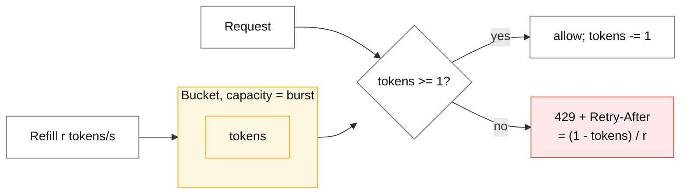
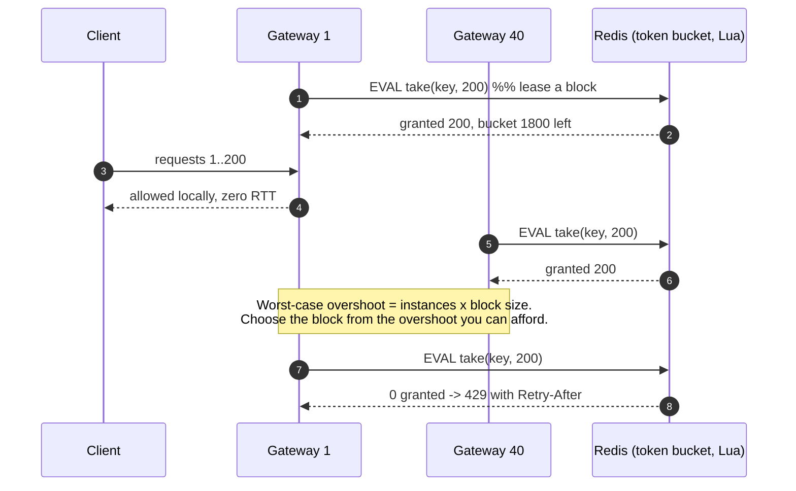

# Rate limiting algorithms

## Core concept

A rate limiter answers two questions that are usually conflated: **"has this caller used more than
their share?"** (fairness, billing, abuse) and **"is the system about to fall over?"** (protection).
The first is a policy question with a contractual answer; the second is a capacity question whose
correct answer changes minute to minute. An algorithm chosen for one is usually wrong for the
other — a fixed per-key quota protects nothing when 10 000 keys each stay just under it, and an
adaptive concurrency limiter makes a terrible billing meter.

The design difficulty is almost never the algorithm. It is that the limiter must be **fast,
distributed, and exact**, and you can have two. Every production design picks which property to
give up, and the interesting part of the answer is which one and why.

## Mechanics & internals

### The five algorithms and what each actually stores

| Algorithm | State per key | Burst behaviour | Precision | Cost |
|---|---|---|---|---|
| **Fixed window** | 1 counter + window id | **2× the limit** at a window boundary | Poor | Cheapest |
| **Sliding window log** | Timestamp per request | Exact | Exact | O(n) memory per key |
| **Sliding window counter** | 2 counters | Smoothed, approximate | ~0.003% error at scale | Cheap |
| **Token bucket** | Tokens + last-refill timestamp | Burst up to bucket size, then steady rate | Exact for the model | Cheap |
| **Leaky bucket (GCRA)** | One timestamp (TAT) | Perfectly smooth output | Exact | Cheapest exact option |

**Fixed window's boundary flaw is the one to be able to draw.** Limit 100/minute: a caller sends
100 requests at 11:00:59 and 100 more at 11:01:00. Both windows are within limit; the server saw
200 requests in one second. Any system that relies on a fixed window for protection has a
documented 2× headroom requirement it probably has not budgeted.

**Sliding window counter** is the fix that survives production. Weight the previous window by how
much of it remains in view:

```
rate = prev_window_count × (1 − elapsed_fraction) + current_window_count
```

At 30 s into the current minute with 80 in the previous window and 45 so far:
`80 × 0.5 + 45 = 85`. Under a 100/min limit, the request is allowed. This is Cloudflare's
production approach, and their measurement over ~400 million requests found **0.003%** of requests
wrongly allowed or rate limited — two counters per key against a timestamp list, for an error rate
three orders of magnitude below anything a caller notices.

**Token bucket** is the model almost every cloud provider actually implements: tokens refill at
`r` per second up to a capacity `b`; a request takes one token or is rejected. `b` is the
*permitted burst* and `r` the sustained rate, and separating them is the whole point — APIs want to
allow a short burst while capping the average.

**GCRA (leaky bucket as a meter)** stores a single value — the theoretical arrival time — and
compares it to now. One number per key, exact, no list, no windows. It is the highest
sophistication-per-byte option on this page and is what Redis's `redis-cell` module implements.



### Distributed enforcement — where the real design lives

One process with one counter is trivial. The question is what happens with 40 gateway instances.

| Strategy | Accuracy | Latency added | Failure behaviour |
|---|---|---|---|
| **Local only** (limit ÷ N per instance) | Wrong whenever traffic is unbalanced | 0 | Perfect — nothing to fail |
| **Central store** (Redis + Lua/`INCR`) | Exact | 1 RTT, ~0.2–1 ms in-zone | Redis down = fail-open or fail-closed decision |
| **Local with async reconciliation** | Approximate, converges | 0 on the hot path | Degrades to local limits |
| **Central with local pre-allocation (leases)** | Approximate, bounded | Amortised: 1 RTT per batch | Bounded overshoot equal to outstanding leases |

**Lease/batch allocation is the pattern worth naming.** Each instance asks the central store for a
block of N tokens and spends them locally, refilling when the block runs low. Central round trips
drop by a factor of N, the worst-case overshoot is `instances × N`, and both numbers are yours to
choose. Stripe's published rate-limiter design and most large API platforms land here rather than
on per-request Redis calls.

The **atomicity requirement** is absolute: read-then-write across a network is a race, so the
check-and-decrement must be one Lua script or one atomic command. A limiter implemented as `GET`
then `SET` will over-admit under exactly the concurrency it exists to control.



### What to limit on, and why the key is harder than the algorithm

| Key | Catches | Fails on |
|---|---|---|
| API key / account | Contractual quota, billing | Nothing — but says nothing about abuse per user |
| User ID | Per-user fairness | Unauthenticated endpoints (login, signup) |
| IP | Unauthenticated abuse | CGNAT and corporate egress (thousands of users per IP); trivially rotated by attackers |
| IP + endpoint | Credential stuffing on `/login` | Distributed attacks |
| Tenant + endpoint class | Multi-tenant fairness | Needs endpoint cost classification |
| Cost units, not requests | Expensive-query abuse | Requires a cost model |

**Limiting by request count treats a 2 ms cache hit and a 4 s report as equal.** Any API with
variable cost per call eventually moves to *cost units* — the caller is charged a weight per
endpoint, the bucket holds units, and the limit finally correlates with the resource being
protected. Say this before an interviewer asks about the expensive endpoint.

### Telling the caller the truth

A 429 without information is an invitation to retry immediately and turn a rate limit into a
retry storm. The contract is:

- **`429 Too Many Requests`** with **`Retry-After`** (seconds or HTTP-date).
- `RateLimit-Limit` / `RateLimit-Remaining` / `RateLimit-Reset` (IETF `RateLimit` header fields
  draft), so a well-behaved client throttles *before* being rejected.
- **`503` + `Retry-After` for capacity shedding**, distinct from 429 for quota. Different cause,
  different client response, and mixing them means a client cannot tell "you are over your plan"
  from "come back later".

## Numbers that matter

| Quantity | Value | Confidence |
|---|---|---|
| Fixed-window boundary overshoot | Up to **2×** the limit in one instant | Structural |
| Cloudflare sliding-window-counter error | **0.003%** of requests wrongly allowed/limited over ~400 M requests | [Cloudflare blog](https://blog.cloudflare.com/counting-things-a-lot-of-different-things/) |
| Sliding window log memory | ~8–16 bytes × requests in window, per key | 1 M keys × 100 req/window ≈ 1–1.6 GB |
| Sliding window counter memory | 2 counters per key, ~100 bytes with Redis overhead | 1 M keys ≈ 100 MB |
| GCRA state | **One timestamp** per key | Smallest exact option |
| Central Redis check cost | ~0.2–1 ms in-zone RTT, per request | Order of magnitude — measure yours |
| Lease overshoot bound | `instances × block size` | Exactly chosen, not discovered |
| AWS API Gateway account-level default | **10 000 rps steady, 5 000 burst** per region | AWS service quotas |
| Azure API Management `rate-limit-by-key` scope | Per **gateway instance**, not global, on multi-unit deployments | Azure docs |
| Typical login-endpoint limit | 5–10 attempts / 15 min per account, plus IP limits | Convention (OWASP guidance) |

**Worked example — choosing burst.** A partner integration syncs nightly: 50 000 records in one
push, then nothing for 24 h. A flat 100 rps limit makes the sync take 500 s and look like an
attack. Token bucket with `r = 100/s`, `b = 5 000` lets the first 5 000 records land immediately
and the remainder drain at the sustained rate — the same average, a far better experience, and the
protection property is unchanged because `b` is chosen from what the backend can absorb in a burst
(here: 5 000 records × 2 ms ≈ 10 s of work, well inside any queue).

**Worked example — the fleet division trap.** Limit 1 000 rps across 40 gateways, enforced locally
as 25 rps each. A single client with keep-alive connections lands on 4 gateways and is limited at
100 rps — a tenth of its contractual rate, while the system is at 10% utilisation. Local division
is correct only when key-to-instance distribution is uniform, which sticky connections and
consistent hashing both guarantee it is not.

## Failure modes

| Failure | Symptom | Mitigation |
|---|---|---|
| **Read-then-write race** | Over-admission exactly under load | One atomic operation (Lua/`INCRBY` with TTL) |
| **Limiter store outage** | Every request fails (closed) or no limit at all (open) | Decide per endpoint: fail-open for reads, fail-closed for spend/auth |
| **Retry storms from 429s** | The limit increases total load | `Retry-After`, jittered backoff, retry budgets client-side |
| **Fixed-window boundary spike** | 2× traffic at :00 every minute | Sliding window counter or token bucket |
| **Local division with skewed keys** | Legitimate clients limited at a fraction of their quota | Central or lease-based enforcement |
| **IP limiting behind CGNAT** | Whole office blocked by one bad actor | Layer identity keys; never IP alone for authenticated paths |
| **Rate limiter becomes the bottleneck** | Added latency on 100% of requests, and an SPOF | Leases, local caching, co-located store |
| **Synchronised clients** | Every client retries at the reset boundary | Jitter the reset, or return per-client `Retry-After` values |
| **Counting requests, not cost** | One caller monopolises capacity while under limit | Cost units weighted per endpoint |
| **Unbounded key cardinality** | Memory blowout from per-IP keys during an attack | TTLs on every key; cap distinct keys; sketch for detection |

**Documented pattern.** Cloudflare's published rate-limiting work is the clearest statement of the
accuracy/cost trade: they rejected the sliding-window log on memory grounds, adopted the two-counter
approximation, then *measured* the error on production traffic rather than asserting it was small.
That is the move to copy — an approximate limiter with a measured error bound is a strictly
better engineering artefact than an exact one you cannot afford to run.

## Trade-offs vs alternatives

| Mechanism | Protects against | Wrong tool for |
|---|---|---|
| **Rate limiting** (req/s per key) | Abuse, quota enforcement, fairness | Overload — 10 000 compliant keys still saturate you |
| **Concurrency limiting** (in-flight per key) | Slow expensive requests hogging capacity | Fairness over time |
| **Load shedding / admission control** | Actual overload, adaptively | Billing, contracts |
| **Queueing** | Burst absorption | Sustained overload — the queue just adds latency |
| **Backpressure** | Producer/consumer mismatch | Untrusted third-party callers |
| **Quotas (per day/month)** | Cost control, plan enforcement | Per-second protection |

The staff-level framing: **rate limits are a contract, load shedding is a reflex.** You need both,
they live at different layers, and neither substitutes for the other. A system with only rate
limits falls over when everyone is compliant at once; a system with only shedding cannot tell a
paying customer what their plan entitles them to.

### Where staff engineers get this wrong

1. **Choosing the algorithm first.** The key, the distribution strategy and the failure mode matter
   more than token bucket vs GCRA.
2. **Dividing the limit by instance count.** Correct only under uniform key distribution, which
   sticky connections break by construction.
3. **Non-atomic check-and-decrement.** It fails under precisely the concurrency it was built for.
4. **429 with no `Retry-After`.** The limiter then *causes* the retry storm it was meant to damp.
5. **Rate limiting as overload protection.** It is a per-key contract; overload is an aggregate
   property. Add adaptive shedding.
6. **Ignoring the limiter's own failure mode.** "What happens when Redis is unavailable?" must have
   a per-endpoint answer written down before launch.
7. **Counting requests for variable-cost APIs.** The expensive endpoint is where the abuse goes.

## Real-world examples

- **Cloudflare** — sliding window counter at edge scale, with a published production error
  measurement.
- **Stripe** — documented multiple limiter types in front of the API (request-rate limiters and
  concurrency limiters), because they catch different failures.
- **Envoy** — a *local* rate limit filter (per-instance token bucket, no network) and a *global*
  rate limit service (gRPC to a shared limiter); the split exists because the local one is free and
  the global one is exact.
- **GitHub API** — per-token hourly quota with `X-RateLimit-*` headers and secondary abuse limits,
  a clear example of quota-vs-protection as separate systems.
- **Redis `redis-cell`** — GCRA in a module, one value per key.

## On AWS and Azure

| | AWS | Azure |
|---|---|---|
| **Managed API limiter** | API Gateway **usage plans** — per-API-key rate (`rps`) and burst, plus quota (per day/week/month). Token bucket semantics throughout | API Management policies: `rate-limit` / `rate-limit-by-key` (short-term, token-bucket-like) and `quota` / `quota-by-key` (long-term volume) |
| **Account-level ceiling** | Regional account limit — **10 000 rps steady, 5 000 burst**, shared across every API in the account, raisable via quota increase | Per-SKU throughput; Consumption tier has its own hard concurrency limits |
| **Granularity trap** | Usage-plan throttling applies **per API key**; the account-level limit is shared, so one noisy API in the account can throttle an unrelated one | **`rate-limit-by-key` counts per gateway *instance*, not globally.** Scale APIM to 4 units and the effective limit is ~4× what the policy says |
| **Response** | `429 Too Many Requests` with `x-amzn-ErrorType: ThrottlingException`; the SDKs retry with backoff automatically | `429` with `Retry-After`; the `rate-limit` policy emits it by default |
| **The default that bites** | The account-wide 10 000 rps is easy to forget because it is invisible per API. A load test on a staging API in the same account and region throttles production | The per-instance counting: a limit tested on 1 unit silently becomes 3× looser when autoscale adds units at peak — the exact moment the limit mattered |

Both defaults fail in the same direction and it is the direction worth remembering: **the enforced
limit differs from the configured limit by a factor equal to the deployment topology**, and nobody
notices until the topology changes.

## In an LLM deployment

Requests are the wrong unit here by an order of magnitude more than usual: a 100-token prompt and a
100 000-token prompt are both "one request" and differ in cost by ~1000×. Every serious LLM
platform therefore limits on **tokens per minute (TPM) alongside requests per minute (RPM)**, and
Azure OpenAI's deployment quota is defined primarily in TPM with RPM derived from it.

The mechanism has a wrinkle absent from ordinary APIs: **the cost is not known when the admission
decision is made.** Output length is unknown until generation finishes, so limiters debit an
*estimate* — typically `prompt_tokens + max_tokens` — and reconcile after the response. Consequences
to state explicitly:

- A client that always sends `max_tokens: 4096` and generates 50 tokens is charged 4 096 against the
  limit and is throttled at ~1% of its real usage. Telling customers to set `max_tokens` honestly
  is a *rate-limit* optimisation, not a cost one.
- Streaming responses hold a slot for the whole generation, so **concurrency limiting matters more
  than request-rate limiting** — the binding resource is KV-cache memory occupied for seconds, not
  requests arriving per second.
- Retry-after values must account for a queue drain measured in seconds, not milliseconds; naive
  immediate retries against a saturated GPU fleet are far more damaging than against a stateless
  web tier, because each retry re-runs prefill.

## Staff-level follow-ups

1. Design the limiter for an API with 40 gateway instances, a 10 000 rps global limit, and a
   requirement that a single customer never exceeds 500 rps. State the overshoot you accept and
   where it comes from.
2. Redis (your limiter store) is unavailable. Give the fail-open/fail-closed decision per endpoint
   class for a payments API, and justify each.
3. Your API has endpoints ranging from 2 ms to 8 s. Design a cost-unit scheme, including how you
   assign weights and what you do when a weight turns out to be wrong in production.
4. `/login` is being credential-stuffed from 30 000 residential IPs. Rate limiting by IP is useless
   here — what do you limit on, and what does the attacker do next?
5. Compare token bucket and GCRA for a limiter holding 50 M keys. Include memory, exactness, and
   what each does when the clock jumps.

## See also

- [load-shedding-and-admission-control.md](./load-shedding-and-admission-control.md) — the reflex that rate limits cannot replace
- [abuse-and-ddos.md](./abuse-and-ddos.md) — when the limiter is the defence and when it is a bystander
- [api-gateway-and-bff.md](./api-gateway-and-bff.md) — why the limiter lives at the gateway
- [timeouts-retries-backoff.md](./timeouts-retries-backoff.md) — the client-side half of the 429 contract
- [queueing-theory-basics.md](./queueing-theory-basics.md) — why a queue does not fix sustained overload
- [multi-tenancy-isolation.md](./multi-tenancy-isolation.md) — per-tenant fairness and the noisy neighbour

## Sources

- [Cloudflare — How we built rate limiting capable of scaling to millions of domains](https://blog.cloudflare.com/counting-things-a-lot-of-different-things/) — sliding window counter, 0.003% measured error
- [Stripe — Scaling your API with rate limiters](https://stripe.com/blog/rate-limiters) — request-rate and concurrency limiters as separate tools
- [Envoy — global rate limiting](https://www.envoyproxy.io/docs/envoy/latest/intro/arch_overview/other_features/global_rate_limiting) and [local rate limiting](https://www.envoyproxy.io/docs/envoy/latest/configuration/http/http_filters/local_rate_limit_filter)
- [AWS — API Gateway throttling and usage plans](https://docs.aws.amazon.com/apigateway/latest/developerguide/api-gateway-request-throttling.html) — token bucket, account-level 10 000 rps / 5 000 burst
- [Azure — API Management rate-limit-by-key policy](https://learn.microsoft.com/en-us/azure/api-management/rate-limit-by-key-policy) — per-gateway-instance counting
- [Azure OpenAI — quotas and limits](https://learn.microsoft.com/en-us/azure/ai-services/openai/quotas-limits) — TPM/RPM relationship, estimated-token admission
- [IETF — RateLimit header fields for HTTP](https://datatracker.ietf.org/doc/draft-ietf-httpapi-ratelimit-headers/) — `RateLimit-Limit`/`Remaining`/`Reset`
- [RFC 6585 §4 — 429 Too Many Requests](https://datatracker.ietf.org/doc/html/rfc6585#section-4)
- [redis-cell — GCRA rate limiting in Redis](https://github.com/brandur/redis-cell) — single-value exact limiter
