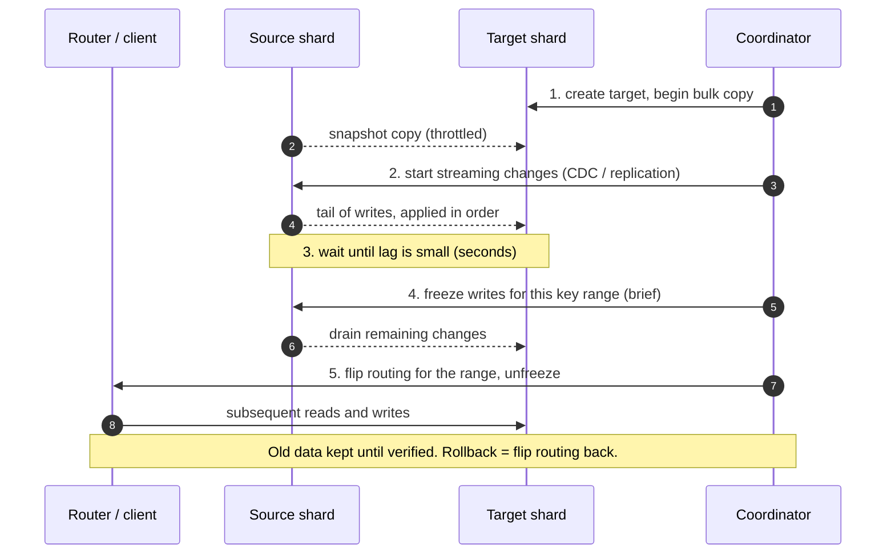

# Rebalancing and resharding

## Core concept

Rebalancing is a **data migration performed while the system is serving traffic**, and every hard
part comes from that overlap: reads must land wherever the data currently is, writes must not be
lost or applied twice, and the copy itself competes for the same disks and network as production
work. The algorithm for choosing *where* data should go is the easy half; the protocol for moving
it without a correctness gap is the half that takes a quarter.

The single decision that determines whether this is routine or terrifying is made long before the
migration: **how many partitions exist, and whether that number can change.** A system with a fixed
large partition count (Kafka's partitions, Cassandra's vnodes, Vitess's shards) rebalances by
*moving* partitions, which is a bookkeeping change. A system that hashes `key mod N` over N nodes
must *rehash almost everything* when N changes — and that is why nobody does it twice.

## Mechanics & internals

### Four strategies, and what each costs when the cluster grows

| Strategy | Keys moved adding 1 node to N | Notes |
|---|---|---|
| **`hash(key) mod N`** | ~**all of them** | Never use it for a growable cluster |
| **Fixed partition count** (e.g. 1 024 partitions on 10 nodes) | `1/(N+1)` of partitions, moved whole | Simplest correct answer; partition count is the ceiling |
| **Consistent hashing / vnodes** | ~`1/(N+1)` of keys | Ring maths; vnodes even out the spread |
| **Dynamic splitting** (range-partitioned) | Only the split partition | Auto-scales with data; hot *ranges* split, hot *keys* do not |

**Fixed partition count is the design most large systems land on**, and the number is chosen once:
too few and you cannot spread across future nodes; too many and per-partition overhead (memory,
open files, metadata, per-partition request costs) dominates. The rule of thumb is to pick a
partition count you can live with at 10× your current node count — for Kafka, that also sets the
maximum consumer parallelism for the topic's whole life.

### The safe migration protocol

Any correct resharding follows the same five steps, whatever the system:

The properties that make it safe, each of which is a common omission:

- **The cutover window is bounded by lag, not by data size.** Copy 2 TB in the background; freeze
  for the sub-second it takes to drain the final changes. A design that freezes for the whole copy
  is not a migration plan, it is an outage plan.
- **Routing is a lookup, not a formula.** A directory/metadata service that maps range → shard can
  be updated atomically; an algorithm compiled into every client cannot.
- **Verification before deletion.** Row counts, checksums per range, and a shadow-read period where
  both shards are read and compared. Deleting the source before this is how a migration becomes
  data loss.
- **Throttled copy.** The migration must lose to production traffic. Unthrottled backfill saturating
  disk or network is the most common self-inflicted incident during resharding.

### Kafka's consumer rebalance — the other meaning of the word

Consumer-group rebalancing assigns partitions to consumers, and the protocol matters operationally:

| Protocol | Behaviour | Cost |
|---|---|---|
| **Eager** (original) | Every consumer stops, all partitions revoked, reassigned | A full **stop-the-world** on every membership change |
| **Cooperative / incremental** | Only the partitions that must move are revoked | Much shorter pauses; two rebalance rounds |
| **Static membership** (`group.instance.id`) | A restarting consumer keeps its partitions if it returns within the session timeout | Removes rebalances from rolling restarts entirely |

**A rolling restart of 30 consumers under eager rebalancing triggers 30 stop-the-world rebalances**,
each pausing the whole group. Static membership plus cooperative assignment turns that into nearly
nothing, and is the single highest-value Kafka consumer configuration change most teams have not
made.

### Where rebalancing goes wrong: the connection between splitting and heat

A range split helps a **hot partition** and does nothing for a **hot key** — a single partition-key
value cannot be divided, no matter how the ranges move. Managed stores split automatically for
heat, but the reaction time is minutes, so a flash crowd is over before the split lands.

Equally, splitting on *size* and splitting on *load* are different policies, and most systems only
do the first. A 2 GB partition serving 80% of reads is perfectly balanced by a size-based rule and
is the cause of your incident.

### Choosing what "balanced" means

| Metric | Balanced by it means | Missed |
|---|---|---|
| **Data size** | Even storage | Load skew |
| **Request rate** | Even CPU/IO | Storage skew; one node fills up |
| **Working set / cache footprint** | Even memory pressure | Hard to measure |
| **Tenant boundaries** | Isolation, easy eviction of a whale | Fragmentation, stranded capacity |

Multi-tenant systems generally end up balancing on a **weighted composite** and accepting that no
single metric is right. Say which metric you are balancing on: an interviewer who asks "rebalance
by what?" is testing exactly this.

## Numbers that matter

| Quantity | Value | Confidence |
|---|---|---|
| Keys moved, `mod N` → `mod N+1` | ~`N/(N+1)` — effectively everything | Derived |
| Keys moved, consistent hashing | ~`1/(N+1)` | Derived |
| Partition count rule of thumb | Support **10×** current nodes; Kafka partitions also cap consumer parallelism | Convention |
| Kafka partition overhead | Memory, file handles and replication traffic per partition; thousands per broker is the practical region | Order of magnitude — check broker guidance |
| Copy time for 2 TB at 200 MB/s throttled | ~**3 hours** per shard, before verification | Derived |
| Acceptable cutover freeze | **< 1 s** for online systems; anything longer is user-visible | Convention |
| DynamoDB split-for-heat reaction | **Minutes**, and blocked entirely by a local secondary index | AWS docs |
| Elasticsearch shard size guidance | ~10–50 GB per shard; shard count fixed at index creation | Elastic guidance |
| Rebalance pause, eager protocol | Seconds to tens of seconds per event, group-wide | Order of magnitude |
| Backfill throttle target | Migration ≤ ~20–30% of the cluster's spare IO | Convention; measure the knee |

**Worked example — the partition count you cannot change.** A Kafka topic created with 12
partitions eventually needs 40 consumers for throughput. **The consumer parallelism is capped at
12**; 28 consumers sit idle. Adding partitions is possible but breaks key-to-partition affinity
for existing keys (ordering per key is lost across the change) and does not redistribute existing
data. The fix is a new topic and a migration — hours of work created by one number chosen in five
seconds at creation time.

**Worked example — the cutover budget.** 6 shards → 12, each holding 2 TB. Sequential copy at a
throttled 200 MB/s is ~3 h per shard, ~18 h total if serialised, plus verification. Parallelising
across 3 at a time gives ~6 h but triples the IO stolen from production. The decision is not
technical preference — it is how much latency regression you will accept for how long, and it
should be written down before starting.

## Failure modes

| Failure | Symptom | Mitigation |
|---|---|---|
| **Unthrottled backfill** | Production p99 doubles during migration | Rate-limit the copy; abort criteria tied to production SLO |
| **Long write freeze** | Visible outage at cutover | Copy in background, freeze only to drain the tail |
| **Split-brain writes during cutover** | Writes land on both shards; divergence | Single atomic routing flip; fence the source |
| **Routing formula in clients** | Cannot flip atomically; mixed views for hours | Directory service, versioned routing table |
| **Deleting the source too early** | Unrecoverable if verification was wrong | Keep source read-only for a retention period |
| **Rebalancing on size, hot on load** | Perfectly even shards, one saturated node | Composite metric including request rate |
| **Rebalance storms** | Cluster perpetually moving data, never stable | Hysteresis and cooldowns on the balancer |
| **Kafka eager rebalance on rolling restart** | Group-wide pauses on every pod restart | Static membership + cooperative assignor |
| **Cross-AZ copy cost** | Surprise data-transfer bill | Plan the copy path; prefer same-AZ sources |
| **Ordering lost on repartition** | Per-key ordering guarantees broken after adding partitions | Explicit migration with a key-affinity plan |

**Documented pattern.** Vitess's resharding workflow — bulk copy, then a replication stream, then a
short write freeze and an atomic routing switch, with verification before cleanup — is the
reference implementation of the protocol above, and it exists because YouTube had to reshard MySQL
while serving traffic. Every hand-rolled migration eventually reinvents the same five steps, usually
after discovering the missing one in production.

## Trade-offs vs alternatives

| Approach | Buys | Costs |
|---|---|---|
| **Fixed partitions, move whole partitions** | Simple, predictable, no rehashing | Partition count is a permanent ceiling |
| **Consistent hashing** | Minimal movement, no coordinator | Skew without vnodes; range queries lost |
| **Dynamic splitting** | Grows with data automatically | Split timing is the system's decision, not yours |
| **Vertical scaling instead** | No migration at all | A ceiling, and a single failure domain |
| **A new cluster + dual write** | Clean, testable, reversible | Two clusters' cost; application changes |
| **Tenant-per-shard** | Isolation, easy whale handling | Stranded capacity; many small shards |

### Where staff engineers get this wrong

1. **Choosing the partition count casually.** It is the one number you cannot change cheaply.
2. **Planning the copy and not the cutover.** The cutover is where correctness is won or lost.
3. **Unthrottled migration.** The migration becomes the incident.
4. **Balancing on one metric.** Size-balanced and load-imbalanced is the usual outcome.
5. **No verification step.** "Counts match" is the minimum; checksums per range are the real bar.
6. **Assuming automatic splitting saves you.** It reacts in minutes, and never helps a hot key.
7. **Forgetting consumers.** Repartitioning a topic changes ordering guarantees downstream.

## Real-world examples

- **Vitess** — resharding MySQL under YouTube's load; the canonical published workflow.
- **DynamoDB** — automatic partition splits on size and heat, with documented ceilings and the LSI
  caveat that disables splitting.
- **Cassandra vnodes** — many small token ranges per node so joining a node pulls evenly from all
  peers rather than from its ring neighbours.
- **Kafka cooperative rebalancing + static membership** — the protocol change that removed
  stop-the-world pauses from routine restarts.
- **Elasticsearch** — shard count fixed at index creation, with the split/shrink APIs and rollover
  as the workarounds; the same "number chosen once" lesson.

## On AWS and Azure

| | AWS | Azure |
|---|---|---|
| **Automatic** | DynamoDB splits partitions by size and by heat; Kinesis shards split/merge via API and on-demand mode | Cosmos DB splits physical partitions at 50 GB; throughput divides evenly across partitions |
| **Manual** | Aurora/RDS: resharding is your application's problem (or Aurora Limitless where available); Kinesis `UpdateShardCount` | Cosmos: hierarchical partition keys to subdivide; Event Hubs partition count is fixed per hub |
| **What you cannot change** | **Kinesis stream partitioning semantics and, for provisioned mode, the per-shard limits (1 MB/s in, 2 MB/s out)** | **Event Hubs partition count** — historically immutable for the life of the hub in most tiers; plan it at creation |
| **Observability for skew** | CloudWatch Contributor Insights (DynamoDB), per-shard Kinesis metrics | Normalized RU consumption per `PartitionKeyRangeId` |
| **The default that bites** | Splitting is **size-driven first**: a small, extremely hot partition may never split, and adaptive capacity's minutes-scale reaction is too slow for a flash crowd. Teams read "automatic" as "handled" | Cosmos physical-partition splits are documented as taking **hours** in some cases, and a low-cardinality first-level hierarchical key colocates everything on one partition by design — the feature bought to fix hot partitions creates one |

## In an LLM deployment

Resharding shows up as **re-indexing**, and the economics are different from a database migration:
you are usually not moving bytes, you are recomputing them.

A vector index sharded by document id must be rebuilt when the corpus grows past a node's memory,
and the rebuild is a graph construction over every vector — hours of CPU, not a copy. The cheaper
pattern is the same blue/green shape: build the new sharded index offline, serve from the old one,
verify recall against the same ground-truth query set on both, then flip routing. **Verification
here is a quality measurement, not a checksum** — two indexes over the same data can both be
"correct" and return different results, so the acceptance criterion must be recall parity, not
byte equality.

The other resharding-shaped decision is **replica placement for cache affinity**. Routing
conversations to the replica holding their KV-cache prefix is a partitioning scheme, and adding
replicas to a fleet reshuffles that mapping — with consistent hashing, ~`1/(N+1)` of conversations
lose their cached prefix and pay a full prefill. Scaling a prefix-affinity fleet therefore has a
measurable, transient cost spike that naive autoscaling will trigger repeatedly if it flaps.

## Staff-level follow-ups

1. You must go from 8 to 20 shards on a 30 TB dataset with a 99.9% availability SLO. Give the plan,
   the cutover budget, the verification, and the abort criteria.
2. A topic was created with 6 partitions and needs 5× the consumer throughput. Walk through the
   options and what each breaks.
3. Your shards are perfectly balanced by size and one node is at 95% CPU. Diagnose, then give a
   rebalancing policy that would have prevented it.
4. Describe the exact sequence at cutover that guarantees no write is lost and none is applied
   twice, and name the component that makes it atomic.
5. Migration backfill is causing a 40% p99 regression. What do you change, and what is your rule for
   deciding whether to pause the migration?

## See also

- [partitioning-strategies.md](./partitioning-strategies.md) — choosing the key in the first place
- [consistent-hashing.md](./consistent-hashing.md) — the ring maths behind minimal movement
- [hot-shard-mitigation.md](./hot-shard-mitigation.md) — why splitting does not fix a hot key
- [../patterns/expand-contract-migration.md](../patterns/expand-contract-migration.md) — the same shape for schema
- [../patterns/backfill-and-reprocessing.md](../patterns/backfill-and-reprocessing.md) — throttling and verification for bulk work
- [kafka-internals.md](./kafka-internals.md) — consumer-group rebalance protocols

## Sources

- Martin Kleppmann, *Designing Data-Intensive Applications*, ch. 6 — rebalancing strategies, why `mod N` fails
- [Vitess — resharding workflow](https://vitess.io/docs/user-guides/configuration-advanced/resharding/) — copy, stream, freeze, switch, verify
- [Apache Kafka — incremental cooperative rebalancing](https://kafka.apache.org/documentation/#consumerconfigs_partition.assignment.strategy) and [static membership](https://kafka.apache.org/documentation/#consumerconfigs_group.instance.id)
- [AWS — DynamoDB partitions and adaptive capacity](https://docs.aws.amazon.com/amazondynamodb/latest/developerguide/burst-adaptive-capacity.html) — split for heat and its limits
- [AWS — Kinesis resharding](https://docs.aws.amazon.com/streams/latest/dev/kinesis-using-sdk-java-resharding.html) — shard splits and merges
- [Azure — Cosmos DB partitioning](https://learn.microsoft.com/en-us/azure/cosmos-db/partitioning-overview) — physical partition splits, 50 GB threshold
- [Elastic — size your shards](https://www.elastic.co/guide/en/elasticsearch/reference/current/size-your-shards.html) — shard sizing and the fixed-count consequence
