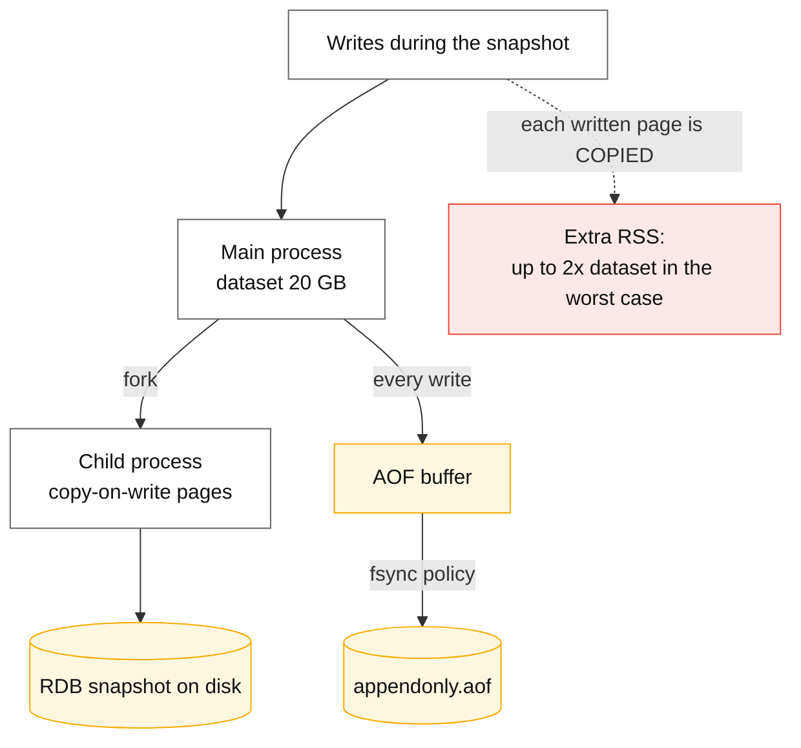

# Redis internals

## Core concept

Redis is fast for one structural reason and dangerous for the same one: **command execution is a
single thread**. There is no lock contention, no coordination, every operation is atomic by
construction — and any one slow command stops the world for every other client. A `KEYS *` on a
10 M-key database is not a slow query; it is a **full-service stall** measured in seconds, and it
will appear in your metrics as a network or application problem because the database's own CPU
graph looks fine.

Everything else follows from that thread. The data structures are chosen so the common operations
are O(1) or O(log n); persistence is pushed to forked child processes so it does not block the
event loop; and the two worst production incidents in Redis's history — the fork memory spike and
synchronous eviction — are both cases where work leaked back onto the main thread.

## Mechanics & internals

### The thread model, precisely

| Work | Thread |
|---|---|
| Command parsing and execution | **Main thread, one** |
| Network I/O read/write (Redis ≥ 6) | Optional **I/O threads** (`io-threads`), parsing and execution still main |
| `BGSAVE` / AOF rewrite | Forked child process |
| Lazy free (`UNLINK`, `lazyfree-*`) | Background thread |
| Cluster bus gossip | Main thread, event loop |

So `io-threads 4` does *not* make Redis multi-core for commands; it parallelises socket reads and
writes only. The command-per-second ceiling on one instance is still one core's worth of
execution — which is why scaling Redis means **more instances**, not bigger instances.

### Data structures, and the encodings that actually run

Redis switches internal encodings by size, and the small-collection encodings are where the
surprising memory wins come from:

| Type | Small encoding | Large encoding | Switch threshold (default) |
|---|---|---|---|
| Hash | `listpack` (flat array) | hashtable | 128 entries / 64-byte values |
| List | `listpack` → `quicklist` | quicklist of listpacks | 128 entries |
| Set | `intset` / `listpack` | hashtable | 512 ints / 128 entries |
| Sorted set | `listpack` | skiplist + hashtable | 128 entries / 64-byte values |

A hash of 100 fields stored as a listpack is a contiguous array with no per-entry pointer overhead;
the same hash at 200 fields becomes a hashtable and its memory use jumps several-fold. This is the
mechanism behind the classic Instagram-style optimisation: **bucket millions of small key–value
pairs into hashes of ~100 fields each and memory drops by 5–10×**, because you stop paying the
~50–90 byte per-key overhead of a top-level key.

Sorted sets are the one to know cold: a skiplist for range queries plus a hashtable for O(1)
member lookup, `ZADD`/`ZSCORE` at O(log n), `ZRANGEBYSCORE` at O(log n + m). That combination is
why leaderboards, rate limiters, delayed queues and priority indexes all land on `ZSET`.

### Persistence: RDB, AOF, and the fork nobody budgets for

| | RDB | AOF |
|---|---|---|
| What it is | Point-in-time binary snapshot | Append-only log of write commands |
| Data loss window | Since last snapshot — minutes | `appendfsync everysec` → **~1 s**; `always` → ~0 with a large throughput cost |
| Restart load time | Fast (compact binary) | Slower (replays commands) |
| Cost during write | One fork + COW memory | fsync latency on the write path; periodic rewrite forks too |

**The fork is the operational hazard.** `fork()` is cheap in page-table terms but every page the
parent writes while the child lives must be copied, so a write-heavy instance can transiently need
close to **2× its dataset in RAM**. On a host sized at 1.5× the dataset this triggers the OOM
killer, and the instance that dies is the one holding your cache. Two mitigations, both standard:
keep `maxmemory` at roughly 50–60% of host RAM if you snapshot, and set
`vm.overcommit_memory = 1` (Redis logs a warning when it is not, precisely because the fork fails
otherwise).

### Eviction and expiry — two mechanisms, commonly confused

**Expiry** is per-key TTL and happens two ways: *lazily* on access, and by a *background sampling*
loop that tests 20 random keys with TTLs, deletes the expired ones, and repeats while more than
25% of the sample was expired. The consequence is that **expired keys still occupy memory until
sampled**, so "my TTLs are set but memory is not dropping" is normal behaviour, not a bug.

**Eviction** is what happens when `maxmemory` is reached, and the policy choice is a real design
decision:

| Policy | Behaviour | Use when |
|---|---|---|
| `noeviction` | Writes fail with an error | Redis is a **database**, not a cache |
| `allkeys-lru` / `allkeys-lfu` | Evict any key by approximate LRU/LFU | Pure cache |
| `volatile-lru` / `volatile-ttl` | Evict only keys with a TTL | Mixed cache + durable data in one instance |
| `allkeys-random` | Evict at random | Uniform access; cheapest |

Redis's LRU is **approximate** — it samples `maxmemory-samples` keys (default 5) and evicts the
best candidate, because true LRU needs a linked list touched on every access. LFU (Redis ≥ 4)
tracks a logarithmic counter with decay and is usually the better cache policy: it does not evict a
popular key just because one scan touched a million cold keys recently.

**The trap worth naming**: `volatile-*` policies with no keys carrying a TTL behave exactly like
`noeviction` — writes start failing at `maxmemory` while the dashboard shows a healthy cache.

### Cluster: 16 384 slots and what it costs you

Redis Cluster hashes each key to one of **16 384 slots** (`CRC16(key) mod 16384`), and slots are
assigned to primaries. The consequences for application design are larger than the operational
ones:

- **Multi-key operations must be in one slot.** `MGET`, transactions and Lua scripts across slots
  fail. Hash tags (`user:{123}:profile`) force colocation by hashing only the braced part.
- **Resharding moves slots**, and clients get `MOVED`/`ASK` redirects; a smart client updates its
  slot map, a naive one pays an extra hop per request indefinitely.
- **Replication is asynchronous**, so failover can lose the writes that had not reached the replica.
  `WAIT numreplicas timeout` gives you an acknowledgement, not a guarantee — Redis Cluster is not
  a consensus system, and saying so plainly is an interview marker.

## Numbers that matter

| Quantity | Value | Confidence |
|---|---|---|
| Throughput, one instance, simple `GET`/`SET` | ~80 k–150 k ops/s per core, pipelining much higher | Order of magnitude; benchmark the payload |
| Pipelining effect | 5–10× throughput by amortising RTT | Structural |
| Per-top-level-key overhead | ~50–90 bytes before the value | Why bucketing into hashes wins |
| Listpack → hashtable threshold | 128 entries / 64-byte values (`hash-max-listpack-*`) | Redis defaults |
| Cluster slots | **16 384** | Fixed |
| Active expiry sampling | 20 keys per cycle, repeat while > 25% expired | Redis docs |
| `maxmemory-samples` default | 5 (approximate LRU/LFU) | Redis defaults |
| AOF `everysec` data loss window | ~1 s | Redis docs |
| Fork COW worst case | Up to **2×** dataset RSS during snapshot | Operational reality; size hosts accordingly |
| `KEYS` on 10 M keys | Blocks the server for **seconds** | O(n) on the main thread |
| Replica failover detection (cluster) | `cluster-node-timeout` default 15 s, then election | Redis defaults |

**Worked example — sizing for snapshots.** A 40 GB dataset with heavy writes, `BGSAVE` enabled, on
a 64 GB host. During the fork, COW can push RSS toward 60–80 GB and the kernel kills Redis. Either
run on a host ≥ 2× the dataset, disable RDB on the primary and snapshot from a **replica**
(the standard answer), or accept AOF-only with periodic rewrites — which forks too, just less often.

**Worked example — the bucketing win.** 100 M small records as top-level keys: `100e6 × (≈90 B
overhead + value)` ≈ 9 GB of pure overhead. Bucketed into 1 M hashes of 100 fields each, encoded as
listpacks: overhead collapses to ~1 M key headers plus compact in-listpack entries — the published
version of this optimisation reported roughly a 5× reduction. The access pattern must tolerate
`HGET bucket field` instead of `GET key`, which is usually trivial.

## Failure modes

| Failure | Symptom | Mitigation |
|---|---|---|
| **O(n) command on the main thread** (`KEYS`, `SMEMBERS` on a huge set, `HGETALL`, big `LRANGE`) | Global latency spike; everything times out at once | `SCAN`/`HSCAN` cursors; `slowlog`; ban `KEYS` in code review |
| **Fork OOM during snapshot** | Redis killed at exactly the moment of a background save | Size RAM ≥ 2× dataset, or snapshot from a replica; `vm.overcommit_memory=1` |
| **Big key deletion** | `DEL` of a 10 M-element set blocks for seconds | `UNLINK` (async free) and `lazyfree-lazy-*` settings |
| **`volatile-*` with no TTLs** | Writes fail at maxmemory as though `noeviction` | Set TTLs, or use `allkeys-*` |
| **Cache stampede after mass expiry** | Thousands of identical misses hit the database together | Jitter TTLs; single-flight; probabilistic early refresh |
| **Async replication data loss on failover** | Acknowledged writes disappear | Do not use Redis as the system of record for anything you cannot replay |
| **Split brain / partition in cluster** | Two primaries for a slot briefly | `cluster-node-timeout`, quorum of primaries; accept the loss window |
| **Hot key** | One shard saturated while the cluster idles | Client-side cache, replicas for reads, key splitting — see hot-shard page |
| **Memory fragmentation** | RSS far above `used_memory`; ratio > 1.5 | `activedefrag`, or restart on a replica and fail over |
| **Swap** | Latency goes from µs to ms with no other signal | Disable swap for the Redis host, full stop |
| **Lua script that loops** | Blocks everything; `SCRIPT KILL` only works before a write | Keep scripts short and deterministic; time-box them |

**Documented pattern.** The recurring public incident shape is *not* Redis failing — it is Redis
doing exactly one expensive thing on the main thread while thousands of clients wait, and the
application team spending hours looking at the network. `slowlog get` and `latency doctor` answer
this in one command, and knowing to run them first is the difference between a 10-minute and a
6-hour incident.

## Trade-offs vs alternatives

| Option | Choose when | Give up |
|---|---|---|
| **Redis (single instance)** | Sub-ms cache, rich structures, atomic ops | Multi-core execution; durability guarantees |
| **Redis Cluster** | Dataset or throughput beyond one core/host | Multi-key ops across slots; operational simplicity |
| **Redis + replicas** | Read scaling, snapshot offload | Replica lag; stale reads |
| **Memcached** | Pure string cache, multi-threaded, simplest possible | Data structures, persistence, replication |
| **Valkey / KeyDB** | Redis semantics with a different licence or multi-threaded execution | Ecosystem assumptions about Redis Inc. features |
| **Embedded cache (Caffeine, etc.)** | Nanosecond access, no network hop | Sharing across instances; invalidation becomes fan-out |
| **DynamoDB/Cosmos with DAX/integrated cache** | You wanted durability and got caching bundled | Redis's data structures |

**The licence footnote that became a design question:** Redis changed to a source-available licence
in 2024, prompting the Linux Foundation's **Valkey** fork, which several cloud providers now offer
as a drop-in. For new systems the wire protocol and data model are effectively a standard with
multiple implementations — evaluate on operations and cost, not on brand.

### Where staff engineers get this wrong

1. **Treating Redis as multi-core.** Adding CPUs to a Redis host does nearly nothing for command
   throughput. The answer is sharding.
2. **Running `KEYS` in production.** Once is an incident. It is in every tutorial and is the single
   most common self-inflicted Redis outage.
3. **Sizing the host to the dataset.** Forks need headroom; the OOM kill arrives during the
   backup, which is also when you least want it.
4. **Assuming durability.** Redis persistence is a recovery convenience, not a transactional
   guarantee; `everysec` loses a second, failover loses more.
5. **Ignoring encoding thresholds.** Memory blowups are usually a collection crossing 128 entries,
   not a leak.
6. **Using `volatile-lru` without TTLs.** Silent write failure at exactly peak load.
7. **Caching with uniform TTLs.** Mass simultaneous expiry is a stampede you scheduled yourself.

## Real-world examples

- **Instagram** — the published memory optimisation of bucketing millions of keys into hashes,
  exploiting the small-hash encoding.
- **Twitter/X timeline caches** — Redis as the materialised-timeline store, with the celebrity hot
  key handled at the application layer, not by Redis.
- **Stack Overflow** — a long-documented two-tier setup: in-process L1 cache plus Redis L2, which
  is the standard answer to Redis's network-hop cost at high hit rates.
- **Rate limiters everywhere** — `INCR` + `EXPIRE` or a Lua GCRA, atomic by virtue of the single
  thread.
- **Sidekiq / Celery-style queues** — `LPUSH`/`BRPOPLPUSH` and sorted sets as delay queues; simple
  and fast, with at-least-once semantics you must design around.

## On AWS and Azure

| | AWS | Azure |
|---|---|---|
| **The managed service** | **ElastiCache** for Redis OSS / Valkey, and **MemoryDB** (Redis-compatible, durable multi-AZ transaction log) | **Azure Cache for Redis** (Basic/Standard/Premium, Enterprise tiers via Redis Inc.) and Azure Managed Redis |
| **Durability option** | ElastiCache = cache semantics; **MemoryDB** is the durable variant — writes acknowledged after a multi-AZ log append, at higher write latency | Premium adds persistence (RDB/AOF to storage) and zone redundancy; Enterprise adds active geo-replication |
| **Scaling model** | Cluster mode enabled (shards) vs disabled (one shard); online resharding supported | Clustering on Premium+; scaling a cache is a longer operation than most teams expect |
| **The knob that matters** | `maxmemory-policy` in a custom parameter group, `reserved-memory-percent` for fork/COW headroom | `maxmemory-reserved` and `maxfragmentationmemory-reserved` — Azure's equivalent headroom settings |
| **The default that bites** | ElastiCache's default `maxmemory-policy` is **`volatile-lru`**: with no TTLs set, the cache stops accepting writes at maxmemory instead of evicting — a "cache" that returns errors under load. Also, failover to a replica loses the asynchronous tail of writes, which MemoryDB exists to fix | Azure documents that **without sufficient `maxmemory-reserved`, non-cache operations (failover, persistence, scaling) contend for the same memory** and cause latency spikes or eviction storms. The default reservation is small, so the first scaling operation on a nearly-full cache is a latency incident |

Both clouds converge on the same lesson: **the managed Redis is still single-threaded Redis**, and
the two things they add — a memory reservation setting and a durable variant — exist to paper over
the fork/COW problem and the asynchronous-replication problem described above. Knowing the
underlying mechanism tells you what the knob is for.

## In an LLM deployment

Redis shows up in three roles, and only one of them is the classic cache.

**Semantic cache.** Store the embedding of each prompt and serve a cached completion when a new
prompt's nearest neighbour is within a distance threshold. Redis's vector index (HNSW or flat,
via the query engine) makes this a single round trip. The trade is uncomfortable and should be
stated: a similarity threshold loose enough to get a useful hit rate will eventually serve an
answer to a *different* question, so it belongs on FAQ-shaped traffic with a conservative threshold
and an easy invalidation path — not on anything where a wrong-but-plausible answer is expensive.

**Conversation and session state.** Chat history per session with a TTL is exactly what Redis is
for; the only wrinkle is size — long conversations with retrieved context are megabyte-scale values,
and a `GET` of a 5 MB value is an O(n) copy on the main thread plus network. Store the history as a
list and fetch a bounded window (`LRANGE key -20 -1`) rather than the whole conversation.

**Queue and rate-limiter for inference.** Token-bucket state and request queues for a GPU fleet;
see [rate-limiting-algorithms.md](./rate-limiting-algorithms.md) for why the unit must be tokens,
not requests.

What it is *not* good for: the KV cache. That lives in GPU memory, and a network round trip to
Redis is orders of magnitude slower than recomputing attention for a short prefix — the only
useful external KV tiering is to local NVMe or RDMA-attached memory, not to a Redis hop.

## Staff-level follow-ups

1. Latency p99 jumps from 0.4 ms to 900 ms once an hour, on a Redis instance at 30% CPU. Give
   three candidate causes and the exact command you run first for each.
2. Your dataset is 40 GB, writes are heavy, and the host has 64 GB. Design the persistence and
   backup strategy, stating what you lose in each failure case.
3. A team wants `MGET` across 50 keys in Redis Cluster. Explain what happens, then give two designs
   that work and their costs.
4. Choose an eviction policy for a cache that also holds session data with no TTL. Show what
   happens under each of `allkeys-lru`, `volatile-lru` and `noeviction` at maxmemory.
5. You need 10× the write throughput of one Redis instance. Compare vertical scaling, cluster
   sharding, and client-side sharding, and say which application changes each forces.

## See also

- [caching-strategies.md](./caching-strategies.md) — where the cache sits and which pattern to use
- [cache-failure-modes.md](./cache-failure-modes.md) — stampede, penetration, cold start
- [cache-invalidation.md](./cache-invalidation.md) — the stale-set race Redis cannot solve for you
- [hot-shard-mitigation.md](./hot-shard-mitigation.md) — the hot key inside a Redis cluster
- [rate-limiting-algorithms.md](./rate-limiting-algorithms.md) — Redis as the limiter's store
- [leases-locks-and-fencing.md](./leases-locks-and-fencing.md) — why Redlock is not mutual exclusion

## Sources

- [Redis — memory optimization](https://redis.io/docs/latest/operate/oss_and_stack/management/optimization/memory-optimization/) — encodings, per-key overhead, bucketing
- [Redis — key eviction](https://redis.io/docs/latest/develop/reference/eviction/) — policies, approximate LRU, LFU counters
- [Redis — expiration](https://redis.io/docs/latest/commands/expire/) — lazy plus sampled active expiry, the 20-key/25% loop
- [Redis — persistence](https://redis.io/docs/latest/operate/oss_and_stack/management/persistence/) — RDB, AOF, fork behaviour, `everysec`
- [Redis — cluster specification](https://redis.io/docs/latest/operate/oss_and_stack/reference/cluster-spec/) — 16 384 slots, MOVED/ASK, failover
- [Redis — latency troubleshooting](https://redis.io/docs/latest/operate/oss_and_stack/management/optimization/latency/) — slowlog, fork latency, swap
- [Instagram engineering — storing hundreds of millions of simple key-value pairs in Redis](https://instagram-engineering.com/storing-hundreds-of-millions-of-simple-key-value-pairs-in-redis-1091ae80f74c)
- [AWS — ElastiCache parameter groups and best practices](https://docs.aws.amazon.com/AmazonElastiCache/latest/red-ug/ParameterGroups.Redis.html) — `maxmemory-policy` default, reserved memory
- [AWS — MemoryDB](https://docs.aws.amazon.com/memorydb/latest/devguide/what-is-memorydb.html) — durable multi-AZ transaction log
- [Azure — Cache for Redis best practices: memory management](https://learn.microsoft.com/en-us/azure/azure-cache-for-redis/cache-best-practices-memory-management) — `maxmemory-reserved` and non-cache operations
- [Valkey project](https://valkey.io/) — the Linux Foundation fork and its compatibility claims
