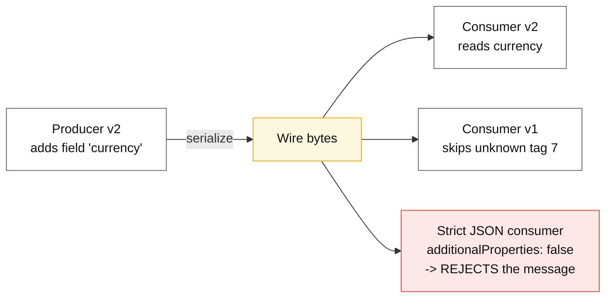
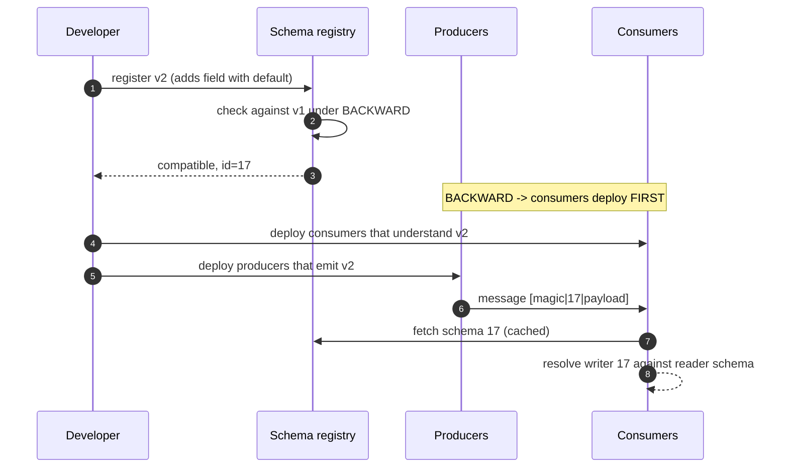

# Serialization and schema evolution

## Core concept

A serialization format is a contract between **code that no longer exists and code that does not
exist yet**. Events sit in a log for weeks; a mobile client from 2023 is still sending requests; a
consumer is mid-rollout so both versions run simultaneously. The question is never "can I encode
this struct?" — it is **"what happens when a field this reader has never heard of arrives, or a
field it requires is missing?"**

Two properties decide everything downstream:

- **Backward compatible** — new code reads old data. Needed to replay history.
- **Forward compatible** — **old** code reads new data. Needed because you cannot deploy
  everything at once, and it is the harder of the two.

Formats differ mainly in how cheaply they give you forward compatibility. Protobuf and Avro give it
by construction; JSON gives it only if every consumer ignores unknown fields, which is a convention
you cannot enforce and will eventually be violated by a strict parser someone added for safety.

## Mechanics & internals

### How the three encodings identify a field

| | JSON | Protobuf | Avro |
|---|---|---|---|
| Field identity | **Name**, in every record | **Tag number**, varint on the wire | **Position**, from the writer's schema |
| Schema needed to decode | No | Helpful, not required | **Required — the writer's schema** |
| Unknown field on read | Present in the map | Skipped (length-delimited or varint), optionally preserved | Impossible — resolution is against the writer schema |
| Field rename | Breaking | **Free** (tag unchanged) | Free with an alias |
| Size of a small record | Largest | Small | Smallest (no field ids at all) |

Avro's design is the one worth understanding, because it is unusual: the encoded data contains
**no field identifiers whatsoever** — just values in the writer's declared order. Decoding
therefore requires the *writer's* schema, which is why Avro is almost always paired with a schema
registry that stores schemas by id and prefixes each message with that id. Confluent's wire format
is a magic byte plus a 4-byte schema id ahead of the payload: **5 bytes to make the whole record
self-describing**, against JSON's cost of repeating every field name in every record.

Protobuf takes the other route: each field is a varint key `(tag << 3) | wire_type`, so a reader
that meets tag 47 and does not know it can still determine its length and skip it. That single
property is what makes forward compatibility automatic.

### The evolution rules, per format

**Protobuf**

| Change | Safe? | Why |
|---|---|---|
| Add a field with a **new** tag | ✅ | Old readers skip it; missing = default |
| Remove a field | ✅ **only if you `reserved` the tag and name** | Otherwise someone reuses the tag later |
| **Reuse a tag number** | ❌ catastrophic | Old data decodes as the new field's type — silent corruption, not an error |
| Rename a field | ✅ | Tags carry identity (breaks JSON mapping, though) |
| Change `int32` → `int64` | ✅ (varint compatible) | Truncation risk on old readers |
| Change `int32` → `string` | ❌ | Wire type differs |
| Add a value to an enum | ⚠️ | Old readers see it as unknown — proto3 preserves it, but branching code needs a default arm |
| `optional` → `repeated` | ❌ in general | Semantics change |

Proto3 removed `required` entirely, and the reason is the most instructive fact in this topic:
**a required field can never be removed**, because any reader compiled with it will reject every
message that omits it — a permanent, unremovable coupling created by a single line in a schema. The
language designers concluded the feature was a net negative and deleted it.

**Avro**

Resolution happens between a **writer's schema** and a **reader's schema**, matched by field name,
with these rules:

- Reader has a field the writer lacks → reader's **default** is used. *No default means the change
  is not compatible.* Defaults are the whole mechanism.
- Writer has a field the reader lacks → skipped.
- Renames need an `alias` on the reader side.
- Type promotions are allowed in one direction only (`int → long → float → double`,
  `string ↔ bytes`).

**JSON Schema / plain JSON**

Compatibility is a matter of consumer discipline: tolerant readers (ignore unknown, treat missing
as default) are compatible; strict validation (`additionalProperties: false`, `required` lists) is
not. The trap is that both are written by reasonable people — the strict one by someone hardening
an API.

### Compatibility modes, as a registry enforces them

| Mode | Registry allows a new schema if… | Deploy order |
|---|---|---|
| `BACKWARD` (common default) | New **readers** can read data written by the previous schema | **Consumers first** |
| `FORWARD` | Old readers can read data written by the new schema | **Producers first** |
| `FULL` | Both | Either |
| `*_TRANSITIVE` | The same, against **all** prior versions, not only the last | Either |
| `NONE` | Anything | Nothing is checked — do not |

The **transitive** distinction is the one that bites. Non-transitive `BACKWARD` checks only against
the immediately previous version, so a sequence of individually-legal changes can produce a schema
that cannot read data from three versions ago — which is exactly what a replay from the start of a
retained topic will hand it. **If you replay history, you need `*_TRANSITIVE`.**

### The rule that survives every format

**Expand, migrate, contract** — the same shape as any online schema change:

1. **Expand** — add the new field as optional, with a default. Write both old and new.
2. **Migrate** — backfill, move readers over, verify by measurement that nothing reads the old one.
3. **Contract** — stop writing the old field; `reserved` its tag; only then delete it from the
   schema.

The gap between steps 2 and 3 is measured in *retention periods*, not sprints: as long as a message
written under the old schema can still be replayed, the reader must still handle it.

## Numbers that matter

| Quantity | Value | Confidence |
|---|---|---|
| Confluent wire-format header | **5 bytes** (1 magic + 4 schema id) | Confluent docs |
| Protobuf vs JSON size, small records | ~**3–10×** smaller | Order of magnitude; depends on field-name length |
| Protobuf vs JSON encode/decode speed | ~**2–10×** faster | Order of magnitude — benchmark your payloads |
| Varint cost | 1 byte for values < 128, 5 bytes for a large `int32`, **10 bytes for a negative `int32`** (use `sint32`/zigzag) | Protobuf spec |
| Tag numbers 1–15 | **1 byte** of key; 16–2047 take 2 | Reserve 1–15 for the hottest fields |
| Max protobuf field number | 536 870 911; **19000–19999 reserved** | Protobuf spec |
| Avro payload overhead | Effectively **zero** per field (no ids, no names) | Structural |
| Schema registry lookup | Once per schema id, then cached in-process | Design assumption: cache or you add an RTT per message |
| Retention-driven contract delay | = topic retention (often **7–30 days**) or forever for compacted/archived data | Operational |

**Worked example — the name tax.** An event with 12 fields, field names averaging 14 characters,
at 200 k events/s. JSON repeats `"customer_identifier":` in every record: `12 × ~16 B ≈ 192 B` of
pure field names per event, `192 × 200 000 ≈ 38 MB/s ≈ 3.3 TB/day` of names. Avro sends the values
and a 5-byte schema id. At cloud storage and inter-AZ transfer rates that difference is a real
monthly line item, and it is the reason high-volume pipelines are not JSON.

**Worked example — a tag reuse.** Field 7 was `int32 user_id`, deleted in v3. In v5 someone adds
`string region = 7`. A replay of v2 data decodes the varint user ID as a length-delimited string:
the parser reads a length from the ID's bytes and either errors or, worse, **succeeds with
garbage**. This is why `reserved 7;` exists, and why the review rule is "tags are allocated once,
forever".

## Failure modes

| Failure | Symptom | Mitigation |
|---|---|---|
| **Reused field tag** | Silent corruption on old data; type errors on replay | `reserved` tags and names at deletion; enforce in review/CI |
| **Missing default in Avro** | Registry rejects, or consumers fail on old records | Always give new fields defaults |
| **Strict JSON validation** | New producer field breaks an old consumer | Tolerant readers; contract tests both directions |
| **Non-transitive compatibility + replay** | Works for a week, fails when reprocessing from the start | `*_TRANSITIVE` modes when history is replayable |
| **Wrong deploy order** | Consumers crash on the new field, or producers emit unreadable data | Derive order from the compatibility mode — BACKWARD = consumers first |
| **New enum value** | Old consumers hit a `default:` branch they never wrote, or throw | `UNKNOWN = 0` convention; explicit default handling |
| **Registry unavailable** | Producers/consumers stall if not cached | Cache schemas aggressively; fail-open on read paths |
| **Schema id drift across environments** | Staging id ≠ prod id for the same schema | Reference schemas by content hash or subject/version, not raw id |
| **Language default mismatch** | Proto3 cannot distinguish "absent" from "zero" (before `optional` presence) | Use `optional`/wrappers where absence is meaningful |
| **Big-bang schema change** | Coordinated deploy of 40 services, rollback impossible | Expand–contract, always |

**Documented pattern.** DDIA's chapter on encoding makes the argument that is easy to skip in
practice: schema evolution is what makes **rolling upgrades** possible, and rolling upgrades are
what make deployment safe. A format without forward compatibility forces lock-step deploys, and
lock-step deploys mean no incremental rollback — so the serialization choice sets the shape of your
release process, years after anyone remembers making it.

## Trade-offs vs alternatives

| Format | Choose when | Give up |
|---|---|---|
| **JSON** | Public APIs, debuggability, no build step | Size, speed, enforced compatibility |
| **Protobuf** | Internal RPC (gRPC), strong typing, polyglot | Human readability; a build/codegen step |
| **Avro** | High-volume event streams with a registry | Standalone decodability — you need the writer schema |
| **Thrift** | Existing Thrift estate | Ecosystem momentum |
| **MessagePack / CBOR** | JSON semantics, smaller bytes, no schema | Compatibility enforcement, typing |
| **FlatBuffers / Cap'n Proto** | Zero-copy reads, mmap, game/edge workloads | Ecosystem size, flexibility |
| **Parquet / columnar** | Analytics at rest, not messages | Row-level operations — different problem, see the comparison page |

### Where staff engineers get this wrong

1. **Treating schema evolution as a serialization detail.** It is a deployment-ordering problem;
   the registry mode dictates which half of the fleet ships first.
2. **Non-transitive compatibility with long retention.** Legal by the registry, broken on replay.
3. **Deleting a field without reserving its tag.** The failure arrives months later as corrupt data,
   not as an error.
4. **Assuming proto3 distinguishes absent from default.** `0`, `""` and "not set" were the same
   value until `optional` presence returned; APIs modelled on that assumption silently misbehave.
5. **Hardening a consumer with strict validation.** Reasonable in isolation; it removes forward
   compatibility for everyone upstream.
6. **Forgetting enums.** Adding a value is not a breaking change to the *encoding* and very often is
   one to the *logic*.
7. **No contract tests.** Compatibility is checkable in CI — old schema against new code, new schema
   against old code — and almost nobody does it.

## Real-world examples

- **Kafka + Confluent Schema Registry** — subject-per-topic schemas, compatibility modes enforced at
  registration, 5-byte schema id on the wire.
- **gRPC / Protobuf across Google's fleet** — tag-based identity precisely so services deploy
  independently over years.
- **Avro in data lakes** — row-oriented landing format with the schema travelling separately;
  converted to Parquet for analytics.
- **Stripe's API versioning** — JSON with per-account pinned versions and server-side
  transformation between them: an alternative strategy where the *server* absorbs the evolution.
- **Protobuf `reserved` in real codebases** — long lists of reserved tags are the visible scar
  tissue of this page's central rule being learned the hard way.

## On AWS and Azure

| | AWS | Azure |
|---|---|---|
| **Registry** | **AWS Glue Schema Registry** (Avro, JSON Schema, Protobuf), integrated with MSK, Kinesis, Flink; **EventBridge Schema Registry** for event discovery and code bindings | **Azure Schema Registry**, hosted *inside an Event Hubs namespace* (Avro and JSON Schema), used by Event Hubs and Kafka-protocol clients |
| **Compatibility modes** | Backward / forward / full, with transitive variants, enforced at registration | Compatibility set per schema **group** (none / backward / forward), applied to all schemas in the group |
| **Wire integration** | SerDe libraries embed a schema **version id (UUID)** and can compress payloads | SerDe embeds the schema id; the registry is addressed by namespace + group + name + version |
| **The knob that matters** | Registry client **cache size and TTL** — an uncached lookup per message adds a call to Glue on the hot path | The Event Hubs namespace hosting the registry is a dependency of producers/consumers; capacity and throttling apply |
| **The default that bites** | Non-transitive modes are the easy default, and MSK topics with long or infinite retention are exactly the case where they are wrong — the compatibility check passes and the replay fails months later | **The registry lives in an Event Hubs namespace**, so deleting or recreating that namespace to "clean up" destroys the schema group every serializer depends on, and clients fail to *decode existing data* rather than merely failing to produce |

## In an LLM deployment

Two places this topic shows up, both underrated.

**Tool/function schemas are wire schemas with the same evolution problem.** The JSON Schema you
send for a tool defines a contract between your service and a model that may be swapped, and
between a conversation started yesterday and code deployed today. Renaming a parameter breaks
replay of stored tool calls; making a parameter required breaks every historical call that omitted
it — the proto2 `required` lesson, rediscovered. Treat tool schemas as versioned artefacts:
additive changes only, defaults for new parameters, and a mapping layer for stored calls.

**Structured output is a schema-compatibility surface with a model on one side.** Constrained
decoding (JSON mode / structured outputs) makes the model's output conform to a schema, so a schema
change silently changes the model's behaviour and your evaluation set's meaning simultaneously.
Version the schema alongside the prompt and the eval set, or a regression in output quality is
indistinguishable from a schema edit.

The size argument also inverts in one specific way worth knowing: **JSON's verbosity costs tokens,
not just bytes.** Field names are re-tokenised in every record you put in a prompt, so passing 200
records with 12 long field names each can cost thousands of tokens of pure key repetition. For
in-prompt data, a compact tabular or CSV-like rendering is materially cheaper, and the "use JSON
because it is self-describing" argument is weaker when the reader is a model that can be told the
column order once.

## Staff-level follow-ups

1. You must delete a field used by three consumers, one of which replays 90 days of history.
   Give the full sequence with the timing of each step and what you check before each.
2. A registry is set to `BACKWARD`. Derive the deploy order, then say what changes if it is set to
   `FORWARD`, and what a team gets wrong when they switch modes without changing their runbook.
3. Design contract tests that would have caught a tag reuse and a strict-validation regression in
   CI, and say where they run.
4. Compare Avro and Protobuf for a 500 k events/s pipeline with 5 years of retained history. Include
   the registry dependency in your availability analysis.
5. Proto3 gives you no way to tell "0" from "unset" for a legacy field. A pricing service depends on
   that distinction. Describe the migration without breaking existing clients.

## See also

- [kafka-internals.md](./kafka-internals.md) — where these schemas ride, and how long the history lives
- [../patterns/expand-contract-migration.md](../patterns/expand-contract-migration.md) — the same three steps for storage
- [../patterns/api-versioning.md](../patterns/api-versioning.md) — the API-surface version of this problem
- [../patterns/change-data-capture.md](../patterns/change-data-capture.md) — where a table's schema becomes an event schema
- [../comparisons/row-vs-columnar.md](../comparisons/row-vs-columnar.md) — the at-rest formats and why they differ
- [stream-processing-semantics.md](./stream-processing-semantics.md) — replay, which is what transitive compatibility protects

## Sources

- [Protocol Buffers — language guide (proto3)](https://protobuf.dev/programming-guides/proto3/) — tags, wire types, `reserved`, enum defaults
- [Protocol Buffers — encoding](https://protobuf.dev/programming-guides/encoding/) — varints, zigzag, field key layout
- [Protocol Buffers — proto best practices](https://protobuf.dev/best-practices/dos-donts/) — never reuse tag numbers
- [Apache Avro — specification, schema resolution](https://avro.apache.org/docs/current/specification/) — writer/reader resolution, defaults, aliases
- [Confluent — schema evolution and compatibility](https://docs.confluent.io/platform/current/schema-registry/fundamentals/schema-evolution.html) — compatibility modes, transitive variants, deploy order
- [Confluent — wire format](https://docs.confluent.io/platform/current/schema-registry/fundamentals/serdes-develop/index.html#wire-format) — magic byte + 4-byte schema id
- Martin Kleppmann, *Designing Data-Intensive Applications*, ch. 4 — encoding, evolution, and rolling upgrades
- [AWS — Glue Schema Registry](https://docs.aws.amazon.com/glue/latest/dg/schema-registry.html) — formats, compatibility modes, SerDe caching
- [Azure — Schema Registry in Event Hubs](https://learn.microsoft.com/en-us/azure/event-hubs/schema-registry-overview) — schema groups, group-level compatibility
