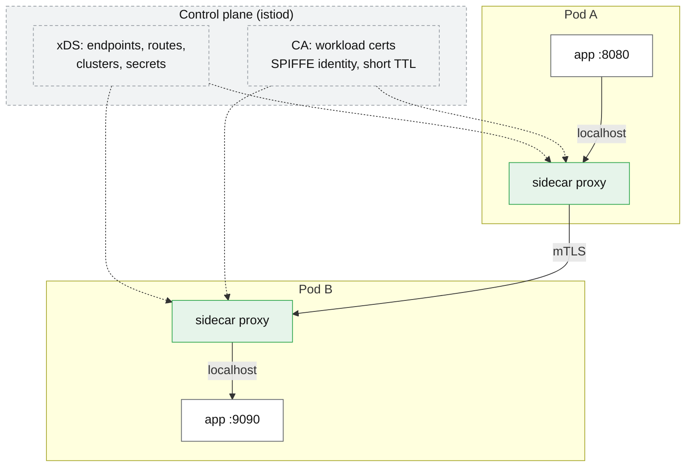
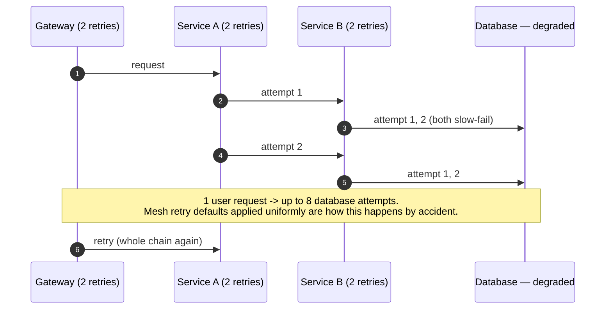

# Service mesh

## Core concept

A mesh moves the *client* half of networking — retries, timeouts, circuit breaking, load balancing,
mTLS, telemetry — out of every application and into a proxy the platform owns. The value is not any
single feature; it is that a polyglot fleet gets **one implementation and one policy surface**
instead of six client libraries drifting apart, and that changing a retry policy stops being a
release of 60 services.

What you pay for it is precise and often understated: an extra process per pod, a hop on every
call, a control plane that is now in your availability path, and a failure surface that is
*invisible to application developers* — which is the actual operational cost, because the person
debugging at 3am does not own the thing that broke.

The honest threshold: below roughly 20–30 services in one or two languages, a shared client library
is cheaper and easier to reason about. Above it, the library drift becomes the bigger problem.

## Mechanics & internals

### Data plane, control plane, and what actually intercepts traffic

Traffic capture is the part that surprises people: the sidecar does not require application
changes because an init container rewrites the pod's **iptables** rules so all inbound and outbound
traffic is redirected to the proxy's ports. Consequences that follow directly from that mechanism:

- Anything that bypasses the socket layer, or protocols the proxy does not parse, ends up in a
  passthrough path with none of the features and sometimes none of the expected behaviour.
- **Startup ordering is a real race.** The application can be running and making calls before the
  proxy has its configuration, and those calls fail in a way that looks like a DNS or connection
  bug. Kubernetes' native sidecar support (init containers with `restartPolicy: Always`, stable
  from 1.29) exists to fix exactly this; before it, teams wrote startup-hold hacks.
- **Shutdown ordering has the same race in reverse**: the proxy exiting before the app finishes
  draining turns a clean termination into connection errors.

### mTLS and identity — the feature that usually justifies the mesh

Each workload gets a short-lived certificate carrying a **SPIFFE identity**
(`spiffe://cluster.local/ns/prod/sa/orders`), issued by the control plane's CA and rotated
automatically (hours, not months). Authorization policy is then expressed against that identity
rather than against an IP address, which is the real advance: **IP-based network policy is
meaningless in a fleet where IPs are recycled every few minutes.**

This is also the strongest argument for a mesh in a compliance context — encryption in transit and
identity-based authorization between every pair of services, with no application changes and no
certificate management code in any service.

### Retries, and the amplification you just built

A mesh makes retries a one-line policy, and that is a hazard. Retries at layer *n* multiply with
retries at layer *n+1*: three hops each retrying twice is up to **8× load** on the deepest service,
arriving precisely when it is already failing.

Two rules keep it safe, and both should be stated whenever a mesh appears in a design:
**retry at exactly one layer** (usually the outermost that can judge idempotency), and use a
**retry budget** — a cap on retries as a percentage of traffic (Envoy supports this) rather than a
per-request count, so retries cannot grow without bound during an incident.

### Sidecar vs ambient vs proxyless

| | Sidecar (classic) | Ambient (ztunnel + waypoint) | Proxyless (gRPC + xDS) | eBPF (Cilium) |
|---|---|---|---|---|
| Where the proxy runs | One per pod | One per node (L4) + optional per-namespace L7 | In the app process, via the gRPC library | Kernel datapath + per-node proxy for L7 |
| Per-pod memory | ~50–100 MB | None for L4 | None | None |
| Upgrade | **Restart every pod** | Restart node agent | Library upgrade = app release | Agent upgrade |
| L7 features | Full | Only where a waypoint is deployed | Full for gRPC only | Partial, plus Envoy for L7 |
| Main drawback | Cost and restart blast radius | Newer; two-tier model to reason about | gRPC only; language support varies | Kernel-version coupling |

The trend is real and worth knowing: the per-pod sidecar tax (memory, CPU, and a fleet-wide restart
for every upgrade) is what ambient and eBPF datapaths exist to remove, at the cost of a less
uniform model where L7 features depend on whether a waypoint proxy is in the path.

## Numbers that matter

| Quantity | Value | Confidence |
|---|---|---|
| Added latency per hop (two proxies, Istio) | ~**0.5–2 ms p90**, depends on telemetry and payload | [Istio performance docs](https://istio.io/latest/docs/ops/deployment/performance-and-scalability/) — order of magnitude; benchmark your own |
| Proxy CPU | ~**0.3–0.5 vCPU per 1 000 rps** per proxy, both sides of the call | Istio benchmarks — verify per version |
| Sidecar memory floor | ~50–100 MB per pod, rising with the number of endpoints it knows | Config scope drives this — see below |
| Fleet cost of the sidecar tax | `pods × (mem + cpu)` — 2 000 pods × 80 MB ≈ **160 GB** of RAM before any application load | Derived |
| Workload certificate TTL | Hours (Istio default 24 h, rotated well before expiry) | Istio defaults |
| Config scope effect | Without a `Sidecar` resource limiting scope, **every proxy gets every endpoint in the mesh** | The single biggest memory/CPU lever |
| Retry amplification, 3 hops × 2 retries | Up to **8×** on the deepest service | Derived |
| Practical adoption threshold | ~20–30 services, multiple languages | Convention, not a law |

**Worked example — is the mesh worth it?** 40 services, 600 pods, 3 languages. Sidecar cost:
600 × 80 MB ≈ 48 GB RAM and, at 20 000 rps aggregate, ~2 × 0.4 × 20 = **16 vCPU** of pure proxy.
Against that: one retry/timeout policy instead of 3 client libraries, mTLS everywhere with zero
application changes, and per-service golden signals without instrumentation work. At this size the
trade is usually favourable; at 8 services in one language it is clearly not, and the honest answer
is a library.

**Worked example — the config-scope trap.** A mesh with 5 000 services pushes every endpoint to
every proxy by default. Each sidecar holds the full endpoint table, memory grows with *fleet* size
rather than with the service's own dependencies, and a deploy anywhere triggers an xDS push
everywhere. Scoping each workload's visibility to its actual dependencies is the difference between
a sidecar at 60 MB and one at 600 MB.

## Failure modes

| Failure | Symptom | Mitigation |
|---|---|---|
| **App starts before sidecar is ready** | Connection refused / 503 for the first seconds of every pod's life | Native sidecar containers (K8s ≥ 1.29) or startup hold |
| **Sidecar exits before app drains** | Errors at the end of every rolling deploy | Ordered shutdown; `preStop` on the proxy |
| **Stacked retries** | One user request becomes 8 backend attempts during an incident | Retry at one layer; retry budgets |
| **Control plane outage** | Existing routing keeps working; **no new config, no new certs** — and cert expiry eventually breaks everything | Treat the control plane as tier-0; alert on cert TTL and push staleness |
| **Unscoped configuration** | Sidecar memory grows with fleet size; xDS pushes storm on every deploy | `Sidecar`/scope resources per namespace |
| **Mesh upgrade** | Every pod in the fleet must restart | Canary the data plane by revision; budget the restart |
| **Protocol misdetection** | Non-HTTP traffic silently loses L7 features or breaks | Explicit port naming/protocol declaration |
| **Debuggability collapse** | "It works from the pod, not from the app" — two proxies and iptables in every path | Access logs on both proxies; `istioctl proxy-config`; train the on-call, not just the platform team |
| **mTLS strict mode flipped too early** | Everything that is not yet in the mesh breaks at once | Permissive → measure → strict, per namespace |

**Documented pattern.** The recurring public complaint about meshes is not latency — it is that
the mesh becomes a **second, invisible source of truth for request behaviour**. An application
timeout of 30 s with a mesh route timeout of 15 s produces failures no application log explains,
and the team that owns the app cannot see the config that caused them. Whatever mesh you adopt,
put the effective route/retry/timeout policy where application developers can read it without
platform-team help.

## Trade-offs vs alternatives

| Option | Buys | Costs | Choose when |
|---|---|---|---|
| **Shared client library** | Zero extra hops, in-process, easy to debug | Per-language duplication; upgrades are releases | Few languages, ≤ ~20 services |
| **Sidecar mesh** | Uniform policy, mTLS, telemetry, no app change | Per-pod cost, fleet restarts, hard debugging | Polyglot, many services, compliance pressure |
| **Ambient / node proxy** | Removes per-pod tax; L4 mTLS cheaply | Newer, two-tier model, L7 needs waypoints | Large fleets where the sidecar tax dominates |
| **Proxyless gRPC (xDS)** | Mesh policy with no proxy | gRPC-only; language support varies | An all-gRPC estate |
| **eBPF datapath** | Kernel-level, minimal overhead | Kernel coupling; L7 still needs a proxy | You already run Cilium |
| **API gateway only** | Simple; covers north–south | No east–west mTLS, policy or telemetry | Small internal estate, external traffic dominates |

### Where staff engineers get this wrong

1. **Adopting a mesh to get retries and timeouts.** Those are the cheapest features to get from a
   library; mTLS, identity-based policy and uniform telemetry are what actually justify the cost.
2. **Turning on retries everywhere.** Uniform retry policy across hops is how you build an
   amplifier with a config file.
3. **Forgetting the control plane is tier-0.** It is not in the data path for existing config, and
   it *is* in the path for certificate rotation — which means an extended outage ends in fleet-wide
   TLS failures.
4. **Not scoping configuration.** The default "everyone knows everything" is the usual cause of
   mesh cost complaints.
5. **Budgeting the latency and not the debugging.** The p50 cost is small; the mean-time-to-diagnose
   cost is the one teams actually feel.
6. **Assuming the managed option is permanent.** Managed mesh offerings have been deprecated
   before; check the lifecycle before building policy on top of one.

## Real-world examples

- **Istio** — the reference implementation: Envoy sidecars, istiod control plane, SPIFFE identities,
  and now an ambient mode designed explicitly to remove the per-pod sidecar tax.
- **Linkerd** — a deliberately smaller Rust micro-proxy, chosen by teams for whom Istio's surface
  area is the problem rather than its features.
- **Cilium** — eBPF datapath with mesh features, avoiding per-pod proxies for L3/L4 work.
- **gRPC xDS ("proxyless")** — the same control-plane API consumed directly by the application's
  gRPC library.
- **Consul Connect** — mesh with service discovery from a non-Kubernetes lineage; relevant when VMs
  are still in the estate.

## On AWS and Azure

| | AWS | Azure |
|---|---|---|
| **The managed option** | **App Mesh** (Envoy-based, control plane managed) — **AWS has announced end of support; new designs should not start here.** ECS **Service Connect** covers service-to-service discovery, retries and telemetry for ECS without a full mesh | **Istio-based service mesh add-on for AKS** — managed istiod, revision-based upgrades, supported revisions tied to the AKS version. Open Service Mesh (OSM) was the earlier add-on and has been retired |
| **Identity** | IAM roles for service accounts (IRSA) / Pod Identity for AWS API calls; mesh mTLS handles service-to-service | Workload identity federation for Azure resources; mesh mTLS for service-to-service |
| **Ingress integration** | ALB/NLB via AWS Load Balancer Controller in front of the mesh ingress | Application Gateway for Containers or the add-on's own ingress gateway |
| **The knob that matters** | Envoy resource requests per sidecar, and whether Service Connect's simpler model is sufficient | Add-on **revision** management: upgrades are canary-by-revision, and supported revisions are pinned to the AKS release train |
| **The default that bites** | Betting on a managed mesh with a published end-of-support date; and on ECS, assuming Service Connect is a mesh — it deliberately is not (no L7 policy surface, no mTLS-by-identity model) | The add-on's supported-revision window is **narrower than most upgrade cadences**: falling behind on AKS versions can strand the mesh revision, and catching up means a data-plane restart of the whole fleet at a time you did not choose |

The transferable lesson across both clouds: **a mesh is a platform dependency with a lifecycle**,
and its upgrade path restarts every pod you run. Evaluate the upgrade story before the feature
list.

## In an LLM deployment

Two of the mesh's default behaviours are actively wrong for model traffic, and both come from the
assumption that requests are short.

**Timeouts.** Default route timeouts (Istio's out-of-the-box HTTP route behaviour is measured in
seconds) will cut off a generation mid-stream. Every route to an inference service needs an
explicit, much longer timeout, and the mesh's idle-timeout settings need checking separately —
a streaming response with slow token emission can look idle to a proxy that measures gaps between
bytes.

**Retries.** Retrying a partially streamed, non-idempotent, GPU-expensive generation is the worst
case on this page: it re-runs prefill on an already-saturated fleet, and the user may receive two
different answers. Disable mesh retries on inference routes explicitly rather than relying on the
route's defaults.

What the mesh does buy here is real: mTLS and identity-based policy between an application and a
model-serving tier handling sensitive prompts, uniform per-route latency telemetry that separates
queueing from generation, and traffic splitting for model canaries — routing 5% of traffic to a new
model revision by header or weight is the same mechanism as any canary, and it is the cleanest way
to run an online evaluation. Note the p50 proxy overhead is negligible against a multi-second
generation, so the usual latency objection to meshes does not apply to this workload.

## Staff-level follow-ups

1. You run 12 services in one language. Make the strongest case *against* adopting a mesh, then
   state the two changes to that estate that would flip your answer.
2. An incident shows 8× load on the deepest service. Trace how the mesh's retry configuration
   produced it and give the fix at each layer.
3. The mesh control plane has been down for 6 hours. Describe what still works, what has already
   broken, and what breaks next — with the time constant for each.
4. Design the upgrade path for a 3 000-pod mesh, including how you canary the data plane and what
   you do when a revision is incompatible with your platform version.
5. You must add a mesh to a fleet where 30% of workloads are outside Kubernetes. What does that do
   to identity, policy and the migration order?

## See also

- [api-gateway-and-bff.md](./api-gateway-and-bff.md) — the same concerns for north–south traffic
- [load-balancing-algorithms.md](./load-balancing-algorithms.md) — client-side balancing is what the sidecar does
- [timeouts-retries-backoff.md](./timeouts-retries-backoff.md) — retry budgets and why one layer retries
- [health-checking-and-draining.md](./health-checking-and-draining.md) — outlier detection, and the sidecar shutdown race
- [../patterns/circuit-breaker.md](../patterns/circuit-breaker.md) — the policy the mesh implements for you
- [metrics-logs-traces.md](./metrics-logs-traces.md) — the telemetry a mesh gives you for free, and what it cannot see

## Sources

- [Istio — performance and scalability](https://istio.io/latest/docs/ops/deployment/performance-and-scalability/) — added latency and CPU per 1 000 rps
- [Istio — ambient mesh](https://istio.io/latest/docs/ambient/overview/) — ztunnel/waypoint split and the sidecar-tax rationale
- [Istio — sidecar resource and traffic capture](https://istio.io/latest/docs/reference/config/networking/sidecar/) — config scoping, iptables interception
- [Kubernetes — sidecar containers](https://kubernetes.io/docs/concepts/workloads/pods/sidecar-containers/) — native sidecars and startup ordering
- [SPIFFE specification](https://spiffe.io/docs/latest/spiffe-about/overview/) — workload identity format
- [Envoy — retry budgets and circuit breaking](https://www.envoyproxy.io/docs/envoy/latest/intro/arch_overview/upstream/circuit_breaking) — bounding retries as a share of traffic
- [Linkerd — architecture](https://linkerd.io/2/reference/architecture/) — micro-proxy design rationale
- [Cilium — service mesh](https://docs.cilium.io/en/stable/network/servicemesh/) — eBPF datapath, sidecar-free L4
- [AWS — App Mesh documentation](https://docs.aws.amazon.com/app-mesh/) and [ECS Service Connect](https://docs.aws.amazon.com/AmazonECS/latest/developerguide/service-connect.html) — managed options and their scope
- [Azure — Istio-based service mesh add-on for AKS](https://learn.microsoft.com/en-us/azure/aks/istio-about) — revision management and supported versions
