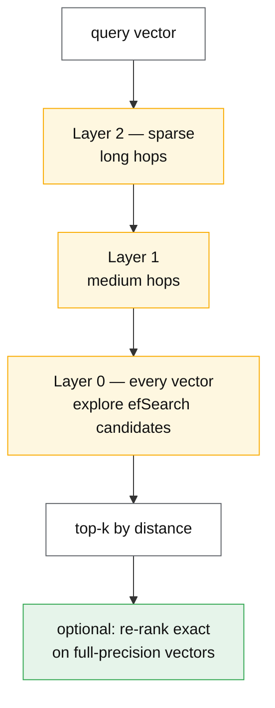
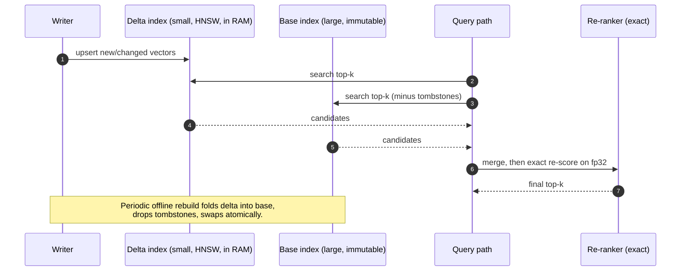

# Vector search and ANN

## Core concept

Exact nearest-neighbour search in high dimensions is a full scan — there is no index that prunes
the way a B-tree prunes a range, because in 100+ dimensions the distance between a query and
almost everything is nearly the same (the concentration of measure that gets called "the curse of
dimensionality"). So every practical vector index is **approximate**, and the design variable is
not correctness but **recall@k**: the fraction of the true top-k that the index actually returns.

That reframes the whole topic. You are not choosing an index, you are choosing a point on a
three-way curve — **recall × latency × memory** — and every parameter in every ANN library moves
you along it. A team that cannot state its target recall has not specified the system, and will
discover the number implicitly when a retrieval-quality complaint arrives.

## Mechanics & internals

### The index families

| Family | Structure | Query cost | Memory | Build | Sweet spot |
|---|---|---|---|---|---|
| **Flat (brute force)** | None — scan all | O(n·d) | `n·d·4 B` | None | ≤ ~100 k vectors; ground truth |
| **IVF** | k-means cells; probe `nprobe` of them | O(nprobe·n/k·d) | Vectors + centroids | Minutes–hours (train) | Large, batch-updated corpora |
| **HNSW** | Multi-layer navigable small-world graph | O(log n) hops × `efSearch` | Vectors + **graph links** | Slow, incremental | Low latency, high recall, in-memory |
| **PQ / OPQ** | Compress vectors into codes | Cheap distance on codes | **~32× smaller** | Train codebooks | Memory-bound at scale |
| **DiskANN / Vamana** | Graph tuned for SSD access | Few SSD reads per query | Small RAM + SSD | Slow build | Billion-scale on one machine |
| **ScaNN** | Anisotropic quantization + partitioning | Very fast | Compressed | Train | High QPS at good recall |

### HNSW, the default, and its three knobs

HNSW builds a layered graph: the top layers are sparse long-range links for fast traversal, the
bottom layer contains every vector. A search greedily descends, then explores the bottom layer with
a priority queue of size `efSearch`.

| Knob | Effect | Typical |
|---|---|---|
| `M` — links per node | Higher = better recall, more memory, slower build | 16–48 |
| `efConstruction` | Build-time candidate list; higher = better graph, slower build | 100–500 |
| `efSearch` | Query-time candidate list; **the runtime recall/latency dial** | 50–400 |

`efSearch` is the only one you can change without rebuilding, which makes it the operational knob:
raise it during an incident about retrieval quality, lower it when p99 matters more. Its cost is
close to linear in latency and strongly sublinear in recall gain — going from `efSearch` 64 to 256
might move recall from 0.92 to 0.98 for 3–4× the query work.

**The memory arithmetic is what surprises people.** Graph links are not free:

```
vectors:  n × d × 4 bytes                (fp32)
HNSW graph: n × M × 2 × 4 bytes ≈ n × 8M bytes (bidirectional links, 32-bit ids)

10 M vectors × 768 dims, M=16:
  vectors: 10e6 × 768 × 4  = 30.7 GB
  graph:   10e6 × 16 × 2 × 4 =  1.3 GB
  total   ≈ 32 GB in RAM, per replica
```



### Quantization: how 30 GB becomes 1 GB

**Product quantization** splits each vector into `m` sub-vectors, runs k-means (256 centroids) on
each sub-space, and stores `m` bytes per vector instead of `d×4`. A 768-dim fp32 vector (3 072 B)
with `m = 96` becomes 96 B — **32× smaller** — and distances are computed by table lookup, which is
also faster.

What it costs is recall, and the standard mitigation is **re-ranking**: retrieve top-100 using
compressed codes, then re-score those 100 with the full-precision vectors (kept on disk or fetched
from a row store) and return the top-10. You pay one small exact computation and recover most of
the lost recall — the same two-stage shape as
[two-stage-retrieval-and-ranking](../patterns/two-stage-retrieval-and-ranking.md).

Scalar quantization (fp32 → int8) is the cheap middle: 4× smaller, typically ~1% recall loss, and
almost always worth enabling before reaching for PQ.

### Filtering is where correctness actually breaks

"Find the 10 nearest documents **belonging to tenant 42**" is the query every real system needs,
and it is genuinely hard:

| Strategy | How | Failure |
|---|---|---|
| **Post-filter** | ANN for top-k, then drop non-matching | Returns **fewer than k**, sometimes zero, when the filter is selective |
| **Pre-filter** | Restrict to matching ids, then search | Breaks graph connectivity — HNSW traversal relies on links you have just removed |
| **Filtered HNSW** | Traverse the graph, evaluate the predicate during search | Correct-ish; slower; can wander when selectivity is extreme |
| **Partitioned indexes** | One index per tenant/partition | Exact and fast; index-count explosion and poor recall for small partitions |

The rule worth stating in an interview: **a highly selective filter (say 0.1% of the corpus) makes
graph ANN behave badly, and a separate index per partition is usually the right answer**. This also
resolves multi-tenancy cleanly — per-tenant indexes give isolation, deletion and residency for free.

### Updates and deletes

Graph indexes do not love mutation. Deletes are usually **tombstones** — the vector stays in the
graph and is filtered from results — so a workload with heavy churn accumulates dead nodes that
still cost traversal time and memory until a rebuild. IVF needs retraining when the data
distribution drifts, or its cells become unbalanced and `nprobe` no longer covers the right region.

Two practical patterns: an **immutable base index plus a small in-memory delta index** searched in
parallel and merged, rebuilt periodically; or **blue/green index builds** where a new index is
built offline and swapped atomically. Both are standard; neither is free, and "how do we handle
updates" is the question that separates a prototype from a system.



### Measuring recall — the step most teams skip

Recall is measurable only against ground truth, which means running **exact** search on a sample:
take 1 000 representative queries, brute-force the true top-k, and compute overlap with what the
index returns. Do it on production query distribution, not on a benchmark dataset, because recall
varies by query type — short queries, rare terms and out-of-distribution embeddings all behave
differently. Without this, tuning `efSearch` is guesswork, and a quantization change ships with no
idea of its quality cost.

## Numbers that matter

| Quantity | Value | Confidence |
|---|---|---|
| fp32 vector memory | `d × 4` bytes — 768-dim = **3 072 B** | Exact |
| 10 M × 768-dim in fp32 | **30.7 GB** before any index | Derived |
| HNSW graph overhead | ≈ `n × M × 8` bytes — 10 M at M=16 ≈ **1.3 GB** | Derived |
| int8 scalar quantization | 4× smaller, ~1% recall loss typical | Order of magnitude |
| Product quantization | ~**32×** smaller at 768-dim/96 sub-vectors | Derived |
| HNSW query latency, 1–10 M vectors in RAM | ~**1–10 ms** p50 single-threaded | Order of magnitude — measure |
| Typical target recall@10 for RAG | **0.9–0.98** | Convention; below 0.9 users notice missing documents |
| `efSearch` 64 → 256 | ~3–4× query work for a few points of recall | Order of magnitude |
| HNSW build time | Minutes to hours for 10 M; roughly `n log n` with `efConstruction` as the constant | Order of magnitude |
| DiskANN SSD reads per query | Single digits | Vamana paper design target |
| Exact scan, 10 M × 768 | ~30 GB of memory bandwidth per query — **hundreds of ms** | Derived; why ANN exists |

**Worked example — sharding decision.** 200 M vectors, 1 024 dims: `200e6 × 1024 × 4 = 819 GB` in
fp32, far past a single host. Options: (a) int8 → 205 GB, still too big for most nodes; (b) PQ to
~25 GB, fits comfortably but needs re-ranking to recover recall; (c) shard across 8 nodes at
~100 GB each with a fan-out query and merge; (d) DiskANN on NVMe with ~20 GB of RAM per node.
**The decision is driven by recall requirement and query rate, not by the vector count**, and the
honest answer usually combines (b) and (c).

**Worked example — the fan-out tax.** Sharding across 8 nodes means each query hits all 8 (there is
no partition pruning in vector space — the nearest neighbours can be anywhere), so the query's
latency is the *max* of 8 nodes' p99, and QPS capacity is one-eighth of what naive arithmetic
suggests. Sharding vector indexes trades memory for tail latency, unlike sharding a key-value store
where it also trades for throughput.

## Failure modes

| Failure | Symptom | Mitigation |
|---|---|---|
| **No recall measurement** | Quality complaints with no metric to move | Ground-truth sample with exact search, tracked over time |
| **Post-filtering a selective predicate** | Queries return 2 results when 10 were asked for | Filtered search, or per-partition indexes |
| **Tombstone accumulation** | Latency and memory creep upward for months | Scheduled rebuild; track live/total ratio |
| **Distribution drift** | Recall decays silently after a model or content change | Re-embed and rebuild on embedding-model change; alert on recall |
| **Mixing embedding models** | Nonsense results — vectors from two spaces are not comparable | Version the embedding model *in the index name*; never mix |
| **Wrong metric** | Cosine index queried with unnormalised vectors (or L2 assumed) | Normalise at write and query; assert it |
| **Unbounded memory growth** | OOM on a node as the corpus grows | Capacity model in vectors, not documents; quantize before you must |
| **Rebuild takes longer than the change rate** | The index is never current | Delta index + periodic merge |
| **Cold start after restart** | Minutes of loading 30 GB before serving | Warm standby, memory-mapped index, or paged (DiskANN) design |
| **Recall tuned on a benchmark, not on production queries** | Great on MS MARCO, poor for users | Sample real queries |

**Documented pattern.** The published ANN benchmarks (ann-benchmarks.com and the Big-ANN
challenges) make one point relentlessly: **every index looks excellent if you do not fix recall.**
Comparisons are only meaningful at an equal recall level — "3× faster" means nothing without
"at recall 0.95". Insisting on that framing is the fastest way to evaluate a vector-database
vendor claim.

## Trade-offs vs alternatives

| Option | Choose when | Give up |
|---|---|---|
| **Exact/flat** | ≤ ~100 k vectors, or ground truth | Latency at scale |
| **HNSW in RAM** | Low latency, high recall, moderate corpus | Memory cost; slow builds; awkward deletes |
| **IVF + PQ** | Very large corpora, batch updates | Recall without re-ranking; retraining on drift |
| **DiskANN** | Billion-scale on few machines | Build time; SSD dependence |
| **pgvector / in-database** | You already run Postgres and the corpus is modest | Peak performance; tuning surface |
| **Managed vector DB** | Speed of delivery, operational simplicity | Cost, lock-in, opaque recall behaviour |
| **Keyword search (BM25) only** | Exact-term, rare-token queries (ids, codes, names) | Semantic matching |
| **Hybrid (BM25 + vector, fused)** | Nearly always, for RAG | One more system to tune; fusion weights to choose |

The hybrid row deserves emphasis: dense retrieval is weak exactly where lexical search is strong —
product codes, error strings, names, numbers — and fusing the two ranked lists (reciprocal rank
fusion is the standard, weight-free choice) usually beats either alone on real query mixes. Pure
vector search is a common and easily avoided mistake in RAG systems.

### Where staff engineers get this wrong

1. **Not stating a recall target.** Everything else on this page is unanswerable without it.
2. **Comparing latency at different recall.** The vendor benchmark's favourite trick.
3. **Post-filtering by tenant.** Works in the demo with 3 tenants, returns empty results in
   production.
4. **Assuming deletes are cheap.** They are tombstones; the index rots slowly.
5. **Re-embedding without rebuilding.** Two embedding versions in one index is silent nonsense.
6. **Treating the vector DB as the source of truth.** It is a derived index — rebuildable from the
   documents, and it should be treated as disposable.
7. **Skipping the re-rank stage.** Cheap, recovers most quantization loss, and improves ordering
   more than any index tuning.

## Real-world examples

- **FAISS** — the reference library; IVF, PQ, HNSW implementations most systems ultimately wrap.
- **HNSW in everything** — OpenSearch/Elasticsearch, Lucene, Qdrant, Weaviate, Milvus, pgvector all
  offer it; the parameters above transfer between them.
- **DiskANN at Microsoft** — billion-scale search on commodity SSD, now also the index behind
  Cosmos DB's vector search.
- **ScaNN at Google** — anisotropic quantization tuned for inner-product recall at high QPS.
- **Spotify Annoy** — the earlier tree-based approach, still a good example of memory-mapped,
  read-only index design.
- **pgvector + HNSW** — the "we already have Postgres" path that is correct far more often than the
  vector-database market implies.

## On AWS and Azure

| | AWS | Azure |
|---|---|---|
| **The service** | **OpenSearch k-NN** (engines: FAISS, nmslib, Lucene), **Aurora/RDS Postgres + pgvector**, **MemoryDB vector search**, and **Bedrock Knowledge Bases** as the managed RAG wrapper | **Azure AI Search** vector profiles (HNSW + exhaustive KNN), **Cosmos DB for NoSQL/MongoDB vCore vector index (DiskANN)**, **PostgreSQL flexible server + pgvector / DiskANN extension** |
| **Index knobs exposed** | `m`, `ef_construction`, `ef_search`, engine choice, quantization (FAISS PQ/SQ, Lucene scalar) | HNSW `m`, `efConstruction`, `efSearch`; scalar/binary quantization with optional oversampling and re-ranking |
| **Filtering** | Filtered k-NN supported; behaviour and efficiency differ per engine | Filter mode is explicit: **pre-filter vs post-filter is a setting**, which makes the trade visible |
| **Hybrid search** | OpenSearch hybrid query with normalisation processors | Built-in: BM25 + vector with **reciprocal rank fusion**, plus optional semantic re-ranker |
| **The default that bites** | OpenSearch k-NN holds graphs in **off-heap native memory**, governed by a circuit breaker (`knn.memory.circuit_breaker.limit`, ~50% of RAM by default). Exceed it and queries start failing with a breaker error rather than degrading — capacity must be planned in *vectors*, and the JVM heap sizing everyone tunes is not the constraint | Vector storage counts against **index size quotas per service tier**, and quantization/oversampling settings change both quota use and recall. Teams size the service by document count and are throttled by vector bytes; scaling tiers later means a reindex |

## In an LLM deployment

Vector search *is* the retrieval half of RAG, and three design choices dominate answer quality more
than the index does.

**Chunking.** Retrieval granularity is a design decision with no default: 200–500 token chunks with
~10–20% overlap is a common starting point, and the real answer depends on whether answers are
sentence-scale (small chunks, high precision) or require document context (larger chunks, or small
chunks with a parent-document expansion step). A retrieval failure is far more often a chunking
failure than an ANN failure.

**Recall, not precision, is the retrieval metric that matters.** The generator can ignore an
irrelevant chunk; it cannot use a chunk that was never retrieved. So retrieve generously (top-50),
then use a cross-encoder re-ranker to cut to the top-5 that enter the prompt — the two-stage shape
again, and the single highest-leverage quality improvement in most RAG systems.

**The embedding model is part of the index.** Changing it invalidates every stored vector, and the
migration is a full re-embed plus rebuild — for 100 M chunks that is a real project with an
inference bill attached. Version the index by model (`docs-v3-text-embedding-3-large`), keep the
old one serving during the rebuild, and swap atomically.

Cost note worth having ready: embedding 100 M chunks of ~400 tokens is ~40 B tokens of embedding
inference. At embedding-model prices that is a four-to-five-figure one-off, which is why "just
re-embed with the newer model" is a budget conversation, not a config change.

## Staff-level follow-ups

1. State a recall target for a customer-support RAG system and justify it from user-visible
   behaviour. Then describe the experiment that measures whether you hit it.
2. 200 M vectors at 1 024 dims, 500 QPS, p99 under 100 ms. Walk through quantization, sharding and
   replication, and give the memory and node count you land on.
3. Queries are filtered by `tenant_id` where the largest tenant is 40% of the corpus and the median
   is 0.001%. Design the index layout, and say what you do for the two extremes.
4. Your embedding model is being upgraded. Give the migration plan, including cost, dual-serving,
   and how you prove the new index is not worse.
5. A user reports that searching for an exact error code returns unrelated documents. Diagnose it,
   and give the fix that does not involve retraining anything.

## See also

- [../patterns/two-stage-retrieval-and-ranking.md](../patterns/two-stage-retrieval-and-ranking.md) — retrieve-then-rerank, the shape that recovers recall
- [../comparisons/vector-store-matrix.md](../comparisons/vector-store-matrix.md) — which store to actually pick
- [../comparisons/retrieval-strategy-matrix.md](../comparisons/retrieval-strategy-matrix.md) — dense vs sparse vs hybrid vs graph
- [bloom-filters-and-sketches.md](./bloom-filters-and-sketches.md) — the other bounded-error structure, and MinHash for dedup
- [indexing-and-query-planning.md](./indexing-and-query-planning.md) — why a B-tree cannot do this
- [../06-ml-cases/rag-assistant.md](../06-ml-cases/rag-assistant.md) — the full design this page was split out of

## Sources

- Y. Malkov, D. Yashunin, *Efficient and robust approximate nearest neighbor search using Hierarchical Navigable Small World graphs*, 2016 — HNSW, M/ef parameters
- [FAISS — index factory and guidelines](https://github.com/facebookresearch/faiss/wiki/Guidelines-to-choose-an-index) — IVF/PQ/HNSW selection and memory arithmetic
- S. Jayaram Subramanya et al., *DiskANN: fast accurate billion-point nearest neighbor search on a single node*, NeurIPS 2019
- R. Guo et al., *Accelerating large-scale inference with anisotropic vector quantization* (ScaNN), ICML 2020
- [ann-benchmarks](https://ann-benchmarks.com/) — recall-vs-QPS methodology
- [AWS — OpenSearch k-NN index and memory estimation](https://docs.aws.amazon.com/opensearch-service/latest/developerguide/knn.html) — native memory, circuit breaker
- [Azure — AI Search vector search and relevance](https://learn.microsoft.com/en-us/azure/search/vector-search-overview) — HNSW parameters, quantization, pre/post filter modes, RRF
- [Azure — Cosmos DB vector search (DiskANN)](https://learn.microsoft.com/en-us/azure/cosmos-db/vector-database) — index type and limits
- [pgvector](https://github.com/pgvector/pgvector) — HNSW and IVFFlat inside Postgres
